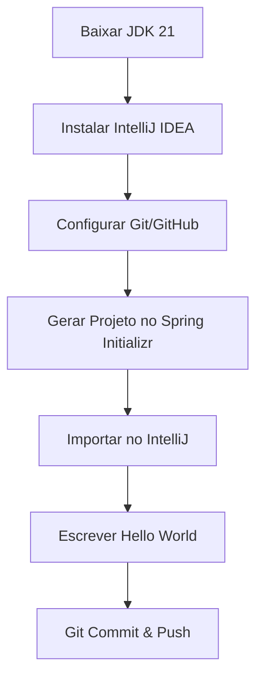

<Projeto 0: Preparação e Mentalidade>
> "Um bom marceneiro afia suas ferramentas antes de começar a trabalhar. O mesmo vale para nós, desenvolvedores!"

## O que você vai aprender neste módulo

- Configuração do ambiente de desenvolvimento Java
- Criação de um projeto base com Spring Initializr
- Versionamento básico com Git e GitHub
- Execução do primeiro código do nosso sistema

## Sumário

- [A História e Sua Missão](#a-história-e-sua-missão)
- [Requisitos Técnicos](#requisitos-técnicos)
- [Critérios de Aceite](#critérios-de-aceite)
- [O Processo (Diagrama)](#o-processo)
- [Dicas de Código](#dicas-de-código)

---

## A História e Sua Missão

Você acaba de ser contratado como Desenvolvedor(a) Backend pela Universidade Estadual (UE). O antigo sistema da biblioteca universitária era feito em planilhas de Excel e, francamente, está um caos! Livros somem, alunos não devolvem os empréstimos e a bibliotecária-chefe está à beira de um ataque de nervos.

**Sua missão:** Construir um **Sistema de Gestão de Biblioteca Universitária** moderno, escalável e confiável. Mas antes de escrever a primeira linha de código, você precisa preparar seu "cinto de utilidades".

---

## Requisitos Técnicos

Para este primeiro passo, você precisará:
1. Instalar o **JDK 21** (Java Development Kit) no seu sistema.
2. Instalar a IDE **IntelliJ IDEA** (a versão Community é suficiente).
3. Instalar o **Git** e criar uma conta no **GitHub**.
4. Criar um projeto via [Spring Initializr](https://start.spring.io/).
5. Fazer o primeiro commit com um "Hello World" da Biblioteca.

---

## Critérios de Aceite

O que precisa estar funcionando para você considerar esta etapa concluída?
- [ ] O comando `java -version` no terminal retorna a versão 21.
- [ ] O projeto abre no IntelliJ IDEA sem erros de compilação.
- [ ] Ao rodar o projeto, a mensagem "Sistema da Biblioteca Universitária iniciado!" aparece no console.
- [ ] O código está versionado e disponível em um repositório público ou privado no GitHub.

---

## O Processo

Aqui está o fluxo de trabalho que você vai seguir:



---

## Dicas de Código

Aqui vai um spoiler de como sua classe principal (a porta de entrada do sistema) deve ficar. Lembre-se, o código em Java sempre começa na função `main`!

```java
package br.com.universidade.biblioteca;

import org.springframework.boot.SpringApplication;
import org.springframework.boot.autoconfigure.SpringBootApplication;

// Dica: A anotação @SpringBootApplication transforma essa classe simples
// em um aplicativo Spring Boot completo!
@SpringBootApplication
public class BibliotecaApplication {

    public static void main(String[] args) {
        SpringApplication.run(BibliotecaApplication.class, args);
        
        // Nosso primeiro passo concreto!
        System.out.println("OK: Sistema da Biblioteca Universitária iniciado com sucesso!");
    }
}
```

Atencao: **Atenção:** Se o console fechar rápido demais ou você não vir a mensagem, certifique-se de que não há erros na aba "Run" ou "Build" da sua IDE.

---

## Exercícios de fixação do módulo

<details>
<summary>O que fazer se terminar cedo (Sugestões de Extensão)</summary>

1. **Entenda o `.gitignore`:** Abra o arquivo `.gitignore` gerado pelo Spring e adicione regras extras se estiver usando Windows (como `Thumbs.db`).
2. **Personalize o Banner:** O Spring Boot permite mudar o texto que aparece quando a aplicação sobe. Crie um arquivo `banner.txt` na pasta `src/main/resources` e coloque um texto ASCII legal lá dentro.
3. **Mude a porta:** Por padrão, aplicações web no Spring sobem na porta 8080. Você consegue descobrir como mudar isso para 8081 usando o arquivo `application.properties`?

</details>

## Referências

- [Download JDK 21 (Adoptium)](https://adoptium.net/)
- [Spring Initializr](https://start.spring.io/)
- [Download IntelliJ IDEA](https://www.jetbrains.com/idea/download/)

---
[Voltar aos Links Rápidos](../README.md#links-rapidos)
