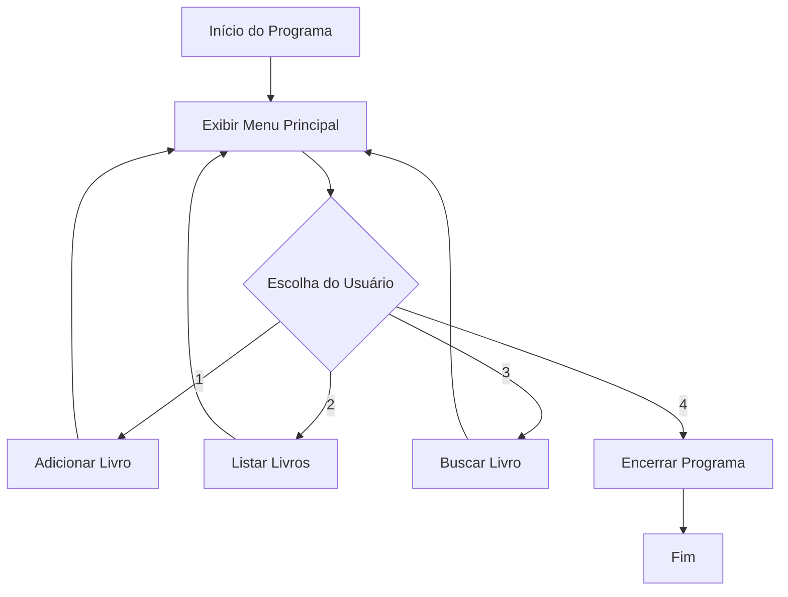

<Projeto 1: Fundamentos da Linguagem Java>
> "Grandes sistemas começam com um simples 'Hello World' que cresceu. Vamos dar vida à nossa biblioteca!"

## O que você vai aprender neste módulo

- Uso de tipos primitivos e manipulação de Strings
- Criação de arrays e ArrayLists
- Estruturas de repetição (loops) e decisão (if/switch)
- Entrada de dados pelo console com Scanner

## Sumário

- [A História e Sua Missão](#a-história-e-sua-missão)
- [Requisitos Funcionais](#requisitos-funcionais)
- [Requisitos Técnicos](#requisitos-técnicos)
- [Critérios de Aceite](#critérios-de-aceite)
- [Fluxo de Navegação](#fluxo-de-navegação)
- [Dicas e Exemplos](#dicas-e-exemplos)

---

## A História e Sua Missão

Você montou o ambiente com sucesso! A bibliotecária gostou da sua agilidade e pediu uma **Primeira Sprint**: ela quer um sistema provisório rodando diretamente no terminal. Esse protótipo vai ajudar a catalogar os livros físicos que estão empilhados na mesa dela, antes mesmo de termos um banco de dados de verdade.

**Sua missão:** Criar um menu interativo de linha de comando (CLI) que permita adicionar livros, listar o acervo atual e buscar um livro pelo título.

---

## Requisitos Funcionais

1. O sistema deve exibir um menu com opções: (1) Adicionar Livro, (2) Listar Livros, (3) Buscar por Título, (4) Sair.
2. Ao **adicionar**, o sistema deve pedir: título, autor e ano de publicação.
3. Ao **listar**, todos os livros salvos em memória devem ser exibidos.
4. Ao **buscar**, o sistema deve procurar por títulos que contenham a palavra digitada.

## Requisitos Técnicos

- Usar `Scanner` para capturar as entradas do usuário.
- Utilizar `String`, `int` (para ano) e tipos apropriados.
- Armazenar os livros (que por enquanto podem ser apenas strings formatadas ou arrays) usando `ArrayList<String>`.
- Controlar o menu usando uma estrutura `while` e `switch`.

---

## Critérios de Aceite

- [ ] O menu não fecha automaticamente após uma operação (só fecha ao escolher a opção Sair).
- [ ] O sistema não quebra (crash) se a busca não encontrar nada (apenas exibe "Livro não encontrado").
- [ ] Títulos salvos com letras maiúsculas ou minúsculas são encontrados na busca independente da capitalização (`toLowerCase()` é seu amigo!).

---

## Fluxo de Navegação



---

## Dicas e Exemplos

Veja como estruturar o esqueleto do seu menu usando um loop e o bom e velho `Scanner`:

```java
import java.util.ArrayList;
import java.util.List;
import java.util.Scanner;

public class ProtótipoBiblioteca {

    public static void main(String[] args) {
        // Dica: Scanner é a ponte entre o teclado do usuário e seu código
        Scanner scanner = new Scanner(System.in);
        List<String> acervo = new ArrayList<>();
        
        boolean executando = true;

        while (executando) {
            System.out.println("=== BIBLIOTECA UNIVERSITÁRIA ===");
            System.out.println("1. Adicionar Livro");
            System.out.println("2. Listar Livros");
            System.out.println("3. Buscar por Título");
            System.out.println("4. Sair");
            System.out.print("Escolha uma opção: ");
            
            int opcao = scanner.nextInt();
            scanner.nextLine(); // Atencao: Cuidado! Consome a quebra de linha que o nextInt deixa para trás

            switch (opcao) {
                case 1 -> {
                    System.out.print("Digite o título do livro: ");
                    String titulo = scanner.nextLine();
                    acervo.add(titulo);
                    System.out.println("OK: Livro adicionado!");
                }
                case 2 -> {
                    System.out.println(" Livros no acervo:");
                    // Loop for-each para percorrer a lista!
                    for (String livro : acervo) {
                        System.out.println("- " + livro);
                    }
                }
                case 3 -> System.out.println("Funcionalidade em construção...");
                case 4 -> executando = false;
                default -> System.out.println("Opção inválida, tente novamente.");
            }
        }
        
        System.out.println("Sistema encerrado.");
        scanner.close(); // OK: Boa prática: sempre feche o scanner ao final!
    }
}
```

---

## Exercícios de fixação do módulo

<details>
<summary>O que fazer se terminar cedo (Sugestões de Extensão)</summary>

1. **Evite duplicatas:** Antes de adicionar um livro, verifique se ele já não existe na lista.
2. **Remoção:** Adicione a opção "5. Remover Livro" no menu.
3. **Validação:** Não deixe o usuário adicionar um livro com o título vazio. Use um `if` para checar se a `String` não está em branco.

</details>

## Referências

- [Documentação Oficial do Scanner](https://docs.oracle.com/en/java/javase/21/docs/api/java.base/java/util/Scanner.html)
- [Guia sobre ArrayList no Java](https://docs.oracle.com/en/java/javase/21/docs/api/java.base/java/util/ArrayList.html)

---
[Voltar aos Links Rápidos](../README.md#links-rapidos)
