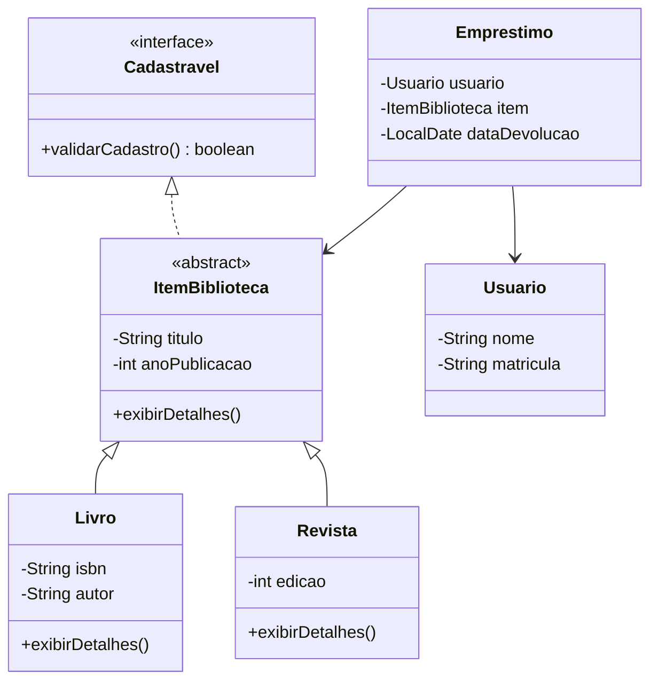

<Projeto 2: Orientação a Objetos>
> "O código reflete a vida real. Um livro não é só uma String, ele tem história, autor e um lugar na prateleira!"

## O que você vai aprender neste módulo

- Criação de Classes e Objetos
- Encapsulamento (Getters e Setters)
- Herança e Polimorfismo
- Interfaces no Java

## Sumário

- [A História e Sua Missão](#a-história-e-sua-missão)
- [Requisitos Funcionais](#requisitos-funcionais)
- [Requisitos Técnicos](#requisitos-técnicos)
- [Critérios de Aceite](#critérios-de-aceite)
- [Modelagem do Sistema](#modelagem-do-sistema)
- [Dicas de Implementação](#dicas-de-implementação)

---

## A História e Sua Missão

Seu protótipo fez sucesso, mas logo a realidade bateu na porta. O acervo não tem só "títulos", a biblioteca tem livros, revistas e artigos! Além disso, precisamos controlar quem pegou o quê (os usuários). Salvar tudo como `String` virou um pesadelo de manutenção. 

**Sua missão:** Refatorar o sistema CLI para o paradigma de Orientação a Objetos (OOP). Você criará entidades reais que se relacionam entre si, preparando o terreno para regras de negócio mais complexas.

---

## Requisitos Funcionais

1. O sistema deve permitir o cadastro de Livros e Revistas separadamente.
2. O sistema deve permitir cadastrar Usuários (Alunos e Professores).
3. Deve ser possível registrar um Empréstimo, vinculando um Item (Livro/Revista) a um Usuário.

## Requisitos Técnicos

- Criar uma **Interface** `Cadastravel`.
- Criar uma classe abstrata `ItemBiblioteca` (superclasse).
- Implementar **Herança** criando as classes `Livro` e `Revista` que herdam de `ItemBiblioteca`.
- Usar **Encapsulamento**: todos os atributos devem ser `private`, acessados via getters e setters.
- Aplicar **Polimorfismo**: criar um método que lista o acervo imprimindo os dados sem se preocupar se é Livro ou Revista.

---

## Critérios de Aceite

- [ ] A classe `Livro` tem atributos específicos (ex: ISBN), enquanto `Revista` tem outros (ex: edição/mês).
- [ ] Não é possível instanciar um `ItemBiblioteca` diretamente (deve ser abstrata).
- [ ] O método de exibir os detalhes do acervo invoca métodos sobrescritos (`@Override`) específicos de cada filho.

---

## Modelagem do Sistema

Veja como nossas classes vão se conectar nesta nova versão:



---

## Dicas de Implementação

Ao usar herança, aproveite o código da classe mãe com o comando `super`.

```java
public abstract class ItemBiblioteca {
    private String titulo;
    private int anoPublicacao;

    // Construtor, getters e setters omitidos para brevidade...

    public void exibirDetalhes() {
        System.out.println("Título: " + titulo + " | Ano: " + anoPublicacao);
    }
}

public class Livro extends ItemBiblioteca {
    private String autor;
    private String isbn;

    public Livro(String titulo, int anoPublicacao, String autor, String isbn) {
        // Dica: Chama o construtor da classe mãe!
        super(titulo, anoPublicacao); 
        this.autor = autor;
        this.isbn = isbn;
    }

    @Override
    public void exibirDetalhes() {
        // Aproveita o comportamento existente e adiciona novos detalhes!
        super.exibirDetalhes();
        System.out.println("Autor: " + autor + " | ISBN: " + isbn);
    }
}
```

OK: **Boa Prática:** Sempre que sobrescrever um método, use a anotação `@Override`. Isso faz o compilador validar se o método realmente existe na classe mãe, evitando bugs bobos de digitação!

---

## Exercícios de fixação do módulo

<details>
<summary>O que fazer se terminar cedo (Sugestões de Extensão)</summary>

1. **Regras de Negócio na OOP:** Crie um método `verificarDisponibilidade()` em `ItemBiblioteca`. Se um livro estiver emprestado, deve retornar falso.
2. **Nova Herança de Usuário:** Crie herdeiros para `Usuario` chamados `Aluno` e `Professor`. O professor pode ter um tempo de empréstimo maior!
3. **Limites:** Adicione uma regra onde um `Aluno` só pode pegar 3 livros no máximo simultaneamente.

</details>

## Referências

- [Tutorial da Oracle sobre Classes e Objetos](https://docs.oracle.com/javase/tutorial/java/javaOO/)
- [Entendendo Polimorfismo em Java](https://docs.oracle.com/javase/tutorial/java/IandI/polymorphism.html)

---
[Voltar aos Links Rápidos](../README.md#links-rapidos)
