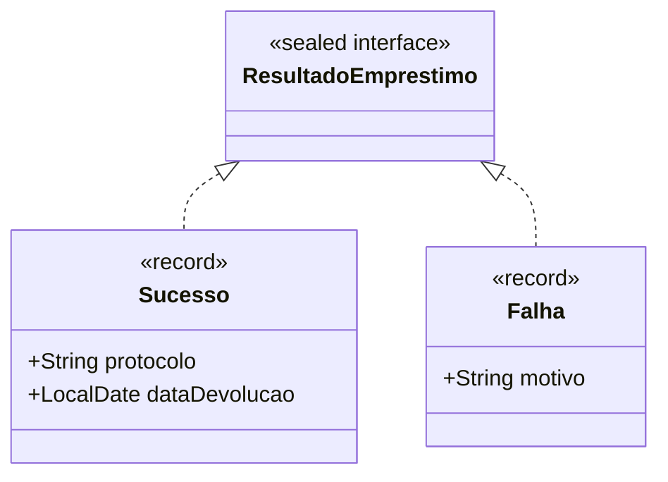

<Projeto 3: Recursos Modernos do Java>
> "Por que escrever 50 linhas de código se o Java moderno resolve o mesmo problema em 5 linhas mais seguras e elegantes?"

## O que você vai aprender neste módulo

- Records para criação rápida de DTOs
- Sealed Classes para hierarquias de domínio controladas
- Pattern Matching (Switch expressions)
- Text Blocks para manipulação de strings multilinhas

## Sumário

- [A História e Sua Missão](#a-história-e-sua-missão)
- [Requisitos Funcionais e Técnicos](#requisitos-funcionais-e-técnicos)
- [Critérios de Aceite](#critérios-de-aceite)
- [Hierarquia Segura (Diagrama)](#hierarquia-segura)
- [Trazendo o Sistema para o Século 21](#trazendo-o-sistema-para-o-século-21)

---

## A História e Sua Missão

Você montou uma estrutura orientada a objetos maravilhosa. Porém, ao apresentar o código, um desenvolvedor Sênior comentou: *"Isso está com cara de Java 8! Onde estão as novidades que o Java entregou nos últimos anos?"*. O sistema gera muitos arquivos de notificação para os alunos, e o código está cheio de concatenações confusas de Strings e estruturas Switch gigantescas e difíceis de ler.

**Sua missão:** Modernizar seu código utilizando as funcionalidades mais recentes da linguagem (Java 14 ao 21).

---

## Requisitos Funcionais e Técnicos

1. **Records:** Converta algumas das suas entidades que servem apenas para transportar dados (como um comprovante de empréstimo) para `record`.
2. **Sealed Classes:** O retorno de um empréstimo não pode ser qualquer coisa. Pode ser um Sucesso ou uma Falha. Use uma interface `sealed` chamada `ResultadoEmprestimo` que permite apenas implementações específicas.
3. **Pattern Matching:** No seu menu ou em uma função de processamento, substitua o fluxo de `if/else instanceof` por um moderno `switch` com Pattern Matching.
4. **Text Blocks:** O sistema agora deve gerar o corpo de um e-mail de notificação de devolução. Use `"""` (Text Blocks) para construir o texto mantendo a formatação HTML ou de espaçamento limpa.

---

## Critérios de Aceite

- [ ] Nenhum erro de compilação utilizando as features do Java 21.
- [ ] A classe de Resultado possui modificador `sealed` e as classes `Sucesso` e `Falha` são `final` ou `record`.
- [ ] O e-mail de cobrança é gerado com formatação de múltiplas linhas sem o uso massivo de `+ "\n" +`.

---

## Hierarquia Segura

Usando *Sealed Classes*, temos um controle restrito de quem pode implementar nossas regras:



---

## Trazendo o Sistema para o Século 21

Olha como o **Pattern Matching** combinado com **Records** e **Text Blocks** deixa nosso código absurdamente limpo:

```java
// Dica: Record gera construtor, getters, equals, hashCode e toString automaticamente!
public record Aluno(String nome, String matricula, String email) {}

// Processando resultados de forma elegante com Pattern Matching for switch (Java 21)
public void processarResultado(ResultadoEmprestimo resultado) {
    switch (resultado) {
        // Se for Sucesso, a variável 's' já é declarada e extraída no próprio case!
        case Sucesso s -> System.out.println("Tudo certo! Protocolo: " + s.protocolo());
        case Falha f -> System.out.println("Oops, não rolou: " + f.motivo());
    }
}

// Dica: Text blocks resolvem a dor de cabeça de montar e-mails!
public String gerarEmailCobranca(Aluno aluno, String tituloLivro) {
    return """
           Olá, %s!
           
           Notamos que o livro '%s' está com a devolução atrasada.
           Por favor, compareça à biblioteca para regularizar sua situação e 
           evitar multas no sistema.
           
           Atenciosamente,
           Biblioteca Universitária
           """.formatted(aluno.nome(), tituloLivro);
}
```

Atencao: **Atenção:** Nos Records, ao invés de `aluno.getNome()`, você acessa o dado usando o nome da variável diretamente: `aluno.nome()`.

---

## Exercícios de fixação do módulo

<details>
<summary>O que fazer se terminar cedo (Sugestões de Extensão)</summary>

1. **Guards no Switch:** O Pattern Matching no Java 21 permite colocar um `when` dentro do `case`. Tente adicionar um `case Sucesso s when s.diasDeEmprestimo() > 10` para dar um tratamento especial para empréstimos longos.
2. **Record Validation:** Você sabia que pode adicionar regras dentro de um `record`? Adicione uma validação no construtor compacto do `Aluno` para impedir a criação de um aluno com nome vazio.

</details>

## Referências

- [Java 14-21 Features Overview](https://dev.java/learn/modern-java/)
- [JEP 440: Record Patterns](https://openjdk.org/jeps/440)

---
[Voltar aos Links Rápidos](../README.md#links-rapidos)
