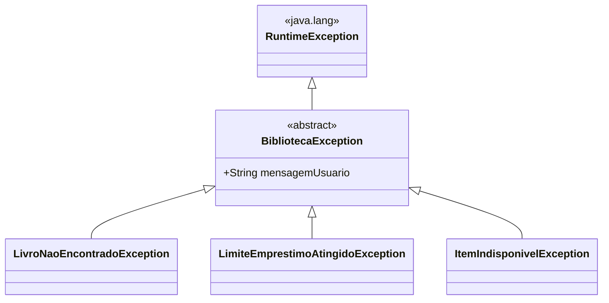

<Projeto 5: Tratamento de Erros e Tópicos Avançados>
> "Um software confiável não é aquele que nunca falha, mas sim o que sabe exatamente o que fazer quando as coisas dão errado."

## O que você vai aprender neste módulo

- Hierarquia de Exceções customizadas
- Criação e uso de classes Genéricas (Generics)
- Lambdas e Method References em cenários reais
- Introdução a concorrência moderna (Virtual Threads)

## Sumário

- [A História e Sua Missão](#a-história-e-sua-missão)
- [Requisitos Funcionais e Técnicos](#requisitos-funcionais-e-técnicos)
- [Critérios de Aceite](#critérios-de-aceite)
- [A Árvore de Problemas (Diagrama)](#a-árvore-de-problemas)
- [Código Resiliente e Rápido](#código-resiliente-e-rápido)

---

## A História e Sua Missão

Seu sistema está ótimo nas "situações de caminho feliz", mas e quando a internet cai? E quando o usuário digita texto no lugar de número? O pior aconteceu: o sistema tentou processar um empréstimo de um livro que não existia, a aplicação lançou um `NullPointerException` terrível e o sistema caiu para todo mundo. A reitoria também quer integrar as buscas com catálogos de outras bibliotecas do estado ao mesmo tempo.

**Sua missão:** Tornar a aplicação resiliente implementando exceções de negócio bem definidas e acelerar a busca externa adotando as revolucionárias *Virtual Threads* do Java 21.

---

## Requisitos Funcionais e Técnicos

1. **Exceções Customizadas:** Criar uma hierarquia de erros com `BibliotecaException` (mãe) e filhas como `LivroNaoEncontradoException` e `EmprestimoNaoPermitidoException`.
2. **Generics:** Criar um `RepositorioEmMemoria<T>` genérico para não precisar repetir código de "salvar/deletar/buscar" para Livros, Revistas e Usuários.
3. **Lambdas:** Passar comportamentos customizados (funções) como parâmetros (ex: filtrar o acervo baseado em uma condição dinâmica).
4. **Virtual Threads:** Criar um método que busca livros em 3 repositórios hipotéticos (tarefas demoradas usando `Thread.sleep`) simultaneamente usando o novo `Executors.newVirtualThreadPerTaskExecutor()`.

---

## Critérios de Aceite

- [ ] Tentativas de empréstimo inválidas não quebram o app, mas são capturadas (`try-catch`) e exibem uma mensagem amigável no console.
- [ ] A classe de repositório funciona perfeitamente para diferentes tipos (ex: `RepositorioEmMemoria<Livro>` e `RepositorioEmMemoria<Usuario>`).
- [ ] A busca paralela com Virtual Threads completa em tempo correspondente ao tempo da tarefa mais demorada (e não a soma de todas).

---

## A Árvore de Problemas

Ter uma exceção base do seu domínio facilita capturar qualquer erro de negócio de forma genérica se necessário:



---

## Código Resiliente e Rápido

Veja como as **Virtual Threads** (disponíveis desde o Java 21) permitem criar milhões de threads sem exaurir a memória do servidor:

```java
import java.util.concurrent.Executors;

public class ServicoBuscaExterna {

    public void buscarEmAcervosParceiros(String titulo) {
        // Dica: Antigamente isso travaria o servidor. 
        // Com Virtual Threads, o Java gerencia os recursos quase de graça!
        try (var executor = Executors.newVirtualThreadPerTaskExecutor()) {
            
            // Submete 3 buscas simultâneas
            executor.submit(() -> buscarNaUSP(titulo));
            executor.submit(() -> buscarNaUnicamp(titulo));
            executor.submit(() -> buscarNaUFRJ(titulo));
            
            // O bloco try-with-resources (try com parênteses) vai garantir que 
            // a execução só continua depois que todas as threads terminarem!
        }
        System.out.println("OK: Busca externa concluída em todos os parceiros!");
    }

    private void buscarNaUSP(String titulo) {
        try {
            Thread.sleep(2000); // Simulando rede lenta
            System.out.println("Resultado da USP processado para: " + titulo);
        } catch (InterruptedException e) {
            // Transformando erro técnico em erro de negócio
            throw new RuntimeException("Erro na busca remota", e);
        }
    }
    // (outros métodos omitidos...)
}
```

E no uso do repositório genérico:
```java
// OK: O <T> permite que essa classe seja reutilizada para qualquer entidade!
public class Repositorio<T> {
    private List<T> dados = new ArrayList<>();
    
    public void salvar(T item) {
        dados.add(item);
    }
}
```

---

## Exercícios de fixação do módulo

<details>
<summary>O que fazer se terminar cedo (Sugestões de Extensão)</summary>

1. **Predicate Lambda:** Crie um método no repositório `List<T> buscar(Predicate<T> filtro)`. Isso permitirá que quem chama faça buscas customizadas tipo: `repo.buscar(livro -> livro.ano() > 2020)`.
2. **Future:** Modifique a chamada das Virtual Threads para retornar os dados reais e agregar os resultados em uma lista. (Pesquise sobre `Future` e `Callable` no Java).

</details>

## Referências

- [JEP 444: Virtual Threads](https://openjdk.org/jeps/444)
- [Generics in Java (Oracle)](https://docs.oracle.com/javase/tutorial/java/generics/index.html)

---
[Voltar aos Links Rápidos](../README.md#links-rapidos)
