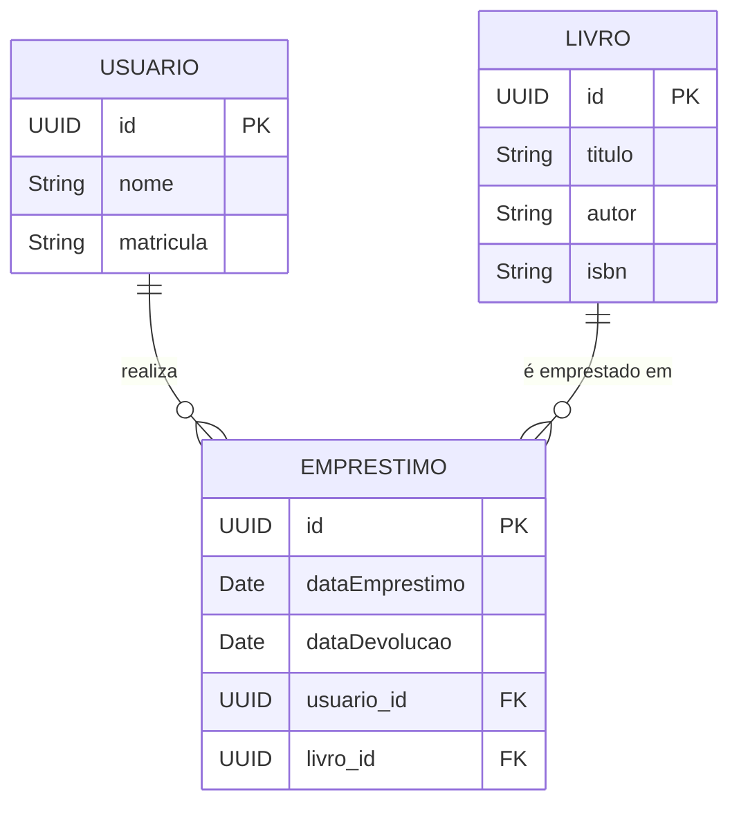

<Projeto 6: Persistência de Dados com JPA/Hibernate>
> "A memória RAM esquece. O Banco de Dados lembra. Chegou a hora de dar vida eterna aos nossos objetos."

## O que você vai aprender neste módulo

- Mapeamento Objeto-Relacional (ORM) com JPA e Hibernate
- Uso do Spring Data JPA
- Relacionamentos (OneToMany, ManyToOne, ManyToMany)
- Execução de Queries customizadas (JPQL)
- Configuração de banco de dados (PostgreSQL e H2)

## Sumário

- [A História e Sua Missão](#a-história-e-sua-missão)
- [Requisitos Funcionais e Técnicos](#requisitos-funcionais-e-técnicos)
- [Critérios de Aceite](#critérios-de-aceite)
- [O Mapa do Tesouro (Diagrama ER)](#o-mapa-do-tesouro)
- [Configurando o Spring Data JPA](#configurando-o-spring-data-jpa)

---

## A História e Sua Missão

Todas as noites o servidor reinicia e toda a biblioteca é... apagada. Seu gerente de TI parou na sua mesa com um olhar desaprovador e avisou que protótipos em memória já deram o que tinham que dar. O setor de infraestrutura preparou um banco de dados PostgreSQL para a aplicação.

**Sua missão:** Substituir as listas e HashMaps da sua aplicação por um banco de dados real. Você vai mapear as classes do Java diretamente para as tabelas do banco usando JPA, e vai gerenciar as consultas mágicas usando Spring Data JPA.

---

## Requisitos Funcionais e Técnicos

1. Mapear as classes `Livro`, `Usuario` e `Emprestimo` como entidades JPA (`@Entity`).
2. Configurar os identificadores únicos (`@Id` e `@GeneratedValue`).
3. Estabelecer relacionamentos corretos: 
   - Um usuário pode ter vários empréstimos (`@OneToMany`).
   - Um empréstimo pertence a um usuário e a um livro (`@ManyToOne`).
4. Criar as Interfaces estendendo `JpaRepository` (Spring Data).
5. Criar no repositório métodos de busca sem código, apenas pelo nome (ex: `findByTituloContainingIgnoreCase`).
6. Configurar o arquivo `application.properties` para rodar H2 em ambiente de teste e PostgreSQL no ambiente principal.

---

## Critérios de Aceite

- [ ] As tabelas são criadas automaticamente no banco de dados quando a aplicação inicia (`spring.jpa.hibernate.ddl-auto=update`).
- [ ] O banco armazena chaves estrangeiras (Foreign Keys) nos relacionamentos corretamente (verifique as tabelas criadas).
- [ ] A inserção de dados persiste mesmo após o encerramento da aplicação (no caso do PostgreSQL).

---

## O Mapa do Tesouro

Assim é como o JPA vai traduzir nossas classes Java para a linguagem dos bancos de dados relacionais:



---

## Configurando o Spring Data JPA

Mapear objetos em Java virou uma tarefa declarativa simples, e o Spring Data escreve o SQL por nós:

```java
import jakarta.persistence.*;
import java.time.LocalDate;
import java.util.UUID;

// Dica: @Entity avisa ao Hibernate que essa classe deve virar uma tabela no Banco
@Entity
@Table(name = "tb_livros")
public class Livro {

    @Id
    @GeneratedValue(strategy = GenerationType.UUID)
    private UUID id;

    @Column(nullable = false)
    private String titulo;

    @Column(unique = true)
    private String isbn;
    
    // Construtores, Getters e Setters...
}
```

A mágica real acontece no Repositório. Ao criar a interface abaixo, o Spring Boot injeta uma implementação funcional durante a execução:

```java
import org.springframework.data.jpa.repository.JpaRepository;
import java.util.List;
import java.util.UUID;

// O Spring Data faz toda a ponte. Recebe o tipo da entidade (Livro) e o tipo da Chave Primária (UUID)
public interface LivroRepository extends JpaRepository<Livro, UUID> {
    
    // OK: Spring cria a query SQL só lendo o nome do método!
    List<Livro> findByAutorAndDisponivelTrue(String autor);
    
    // Se o método for muito complexo, podemos usar JPQL:
    @Query("SELECT l FROM Livro l WHERE l.titulo LIKE %:termo%")
    List<Livro> pesquisarPorTermo(String termo);
}
```

---

## Exercícios de fixação do módulo

<details>
<summary>O que fazer se terminar cedo (Sugestões de Extensão)</summary>

1. **Auditoria:** Use anotações como `@CreationTimestamp` e `@UpdateTimestamp` (do Hibernate) em uma classe base (como `EntidadeBase`) para rastrear automaticamente quando registros foram criados ou editados no banco.
2. **Paginando resultados:** Mude seus repositórios para retornar uma `Page<T>` ao invés de `List<T>`. Pesquisar 100 mil livros de uma vez vai matar sua memória!
3. **Lazy Loading vs Eager Loading:** Entenda por que o comportamento padrão do `@OneToMany` é Lazy e experimente gerar o famoso erro "LazyInitializationException".

</details>

## Referências

- [Spring Data JPA Reference Documentation](https://docs.spring.io/spring-data/jpa/reference/index.html)
- [Baeldung - Hibernate One-To-Many Annotation Tutorial](https://www.baeldung.com/hibernate-one-to-many)

---
[Voltar aos Links Rápidos](../README.md#links-rapidos)
