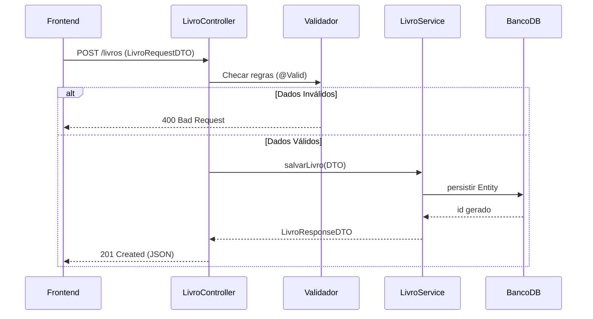

<Projeto 7: Ecossistema Spring Boot 3>
> "Seu código é incrível, mas se outras aplicações não puderem conversar com ele, ele é apenas uma ilha. Vamos abrir os portões via REST!"

## O que você vai aprender neste módulo

- Construção de APIs RESTful com Spring Web
- O Padrão DTO (Data Transfer Object)
- Validação de entrada de dados (Bean Validation)
- Padronização de erros HTTP usando RFC 9457 (ProblemDetail)
- Documentação automática de API com Swagger/OpenAPI

## Sumário

- [A História e Sua Missão](#a-história-e-sua-missão)
- [Requisitos Funcionais e Técnicos](#requisitos-funcionais-e-técnicos)
- [Critérios de Aceite](#critérios-de-aceite)
- [O Fluxo do Empréstimo na API (Diagrama)](#o-fluxo-do-empréstimo-na-api)
- [A Camada Web](#a-camada-web)

---

## A História e Sua Missão

A universidade contratou uma agência para fazer o aplicativo Mobile dos alunos em Flutter e um painel Web em React para a biblioteca. Ambos precisam consumir as funcionalidades do seu sistema. Chegou o momento em que a linha de comando não serve mais. 

**Sua missão:** Construir a camada de Controladores (Controllers) que expõe todas as suas regras de negócio e acesso a banco de dados por meio de Endpoints HTTP formatados em JSON. 

---

## Requisitos Funcionais e Técnicos

1. **REST Controllers:** Criar `LivroController` e `EmprestimoController` com os verbos HTTP corretos (GET para busca, POST para criação, PUT para atualização, DELETE para deleção).
2. **Isolamento de Entidades:** Não retornar as entidades do Banco de Dados direto para a web. Criar `LivroRequestDTO` e `LivroResponseDTO`.
3. **Bean Validation:** Garantir que ninguém crie um livro sem título usando anotações como `@NotBlank` e `@Size`.
4. **Tratamento Global de Erros:** Usar `@ControllerAdvice` e retornar o novo `ProblemDetail` do Spring 3 quando um Livro não for encontrado (Retornar HTTP 404).
5. **OpenAPI:** Integrar o `springdoc-openapi` para que os desenvolvedores frontend consigam visualizar os endpoints disponíveis via Swagger UI.

---

## Critérios de Aceite

- [ ] Chamadas POST sem os campos obrigatórios retornam HTTP 400 (Bad Request) detalhando quais campos estão inválidos.
- [ ] Empréstimos bem sucedidos retornam código HTTP 201 (Created) e o header `Location`.
- [ ] Acessar `/swagger-ui.html` no navegador exibe uma interface gráfica com todas as rotas documentadas.

---

## O Fluxo do Empréstimo na API

Em uma arquitetura moderna dividida em camadas, a requisição passa pelo Controller, valida dados, fala com o Service e então acessa o Repositório:



---

## A Camada Web

O Spring Web simplifica absurdamente o roteamento web. Veja como um endpoint robusto de criação se parece:

```java
import jakarta.validation.Valid;
import org.springframework.http.ResponseEntity;
import org.springframework.web.bind.annotation.*;
import org.springframework.web.servlet.support.ServletUriComponentsBuilder;

import java.net.URI;

@RestController
@RequestMapping("/api/v1/livros")
public class LivroController {

    private final LivroService livroService;

    // Dica: A injeção de dependência via construtor é a melhor prática no Spring
    public LivroController(LivroService livroService) {
        this.livroService = livroService;
    }

    @PostMapping
    public ResponseEntity<LivroResponseDTO> cadastrar(
            @RequestBody @Valid LivroRequestDTO request) {
        
        // Repassa para a regra de negócio
        LivroResponseDTO livroSalvo = livroService.cadastrar(request);

        // OK: Boa prática REST: Retornar 201 Created com a URI (link) do novo recurso
        URI location = ServletUriComponentsBuilder.fromCurrentRequest()
                .path("/{id}")
                .buildAndExpand(livroSalvo.id())
                .toUri();

        return ResponseEntity.created(location).body(livroSalvo);
    }
}
```

Usando Records, o seu DTO fica assim:

```java
import jakarta.validation.constraints.NotBlank;

public record LivroRequestDTO(
    @NotBlank(message = "O título é obrigatório!") String titulo,
    @NotBlank String autor,
    String isbn
) {}
```

---

## Exercícios de fixação do módulo

<details>
<summary>O que fazer se terminar cedo (Sugestões de Extensão)</summary>

1. **Filtros Dinâmicos:** Permita que o frontend faça requisições como `GET /livros?autor=Tolkien&ano=1954`. Capture esses parâmetros usando `@RequestParam`.
2. **Protegendo a API:** Como as bibliotecas não expõem suas APIs abertamente, pesquise sobre como adicionar `spring-boot-starter-security` para proteger as rotas de POST/PUT/DELETE, deixando o GET público.
3. **CORS:** O frontend Web muito provavelmente vai rodar em outra porta e vai ser bloqueado pelo navegador. Adicione a configuração de CORS (Cross-Origin Resource Sharing) nos seus controllers.

</details>

## Referências

- [Spring Boot Web Documentation](https://docs.spring.io/spring-boot/docs/current/reference/html/web.html)
- [SpringDoc OpenAPI - Setup Guide](https://springdoc.org/)

---
[Voltar aos Links Rápidos](../README.md#links-rapidos)
