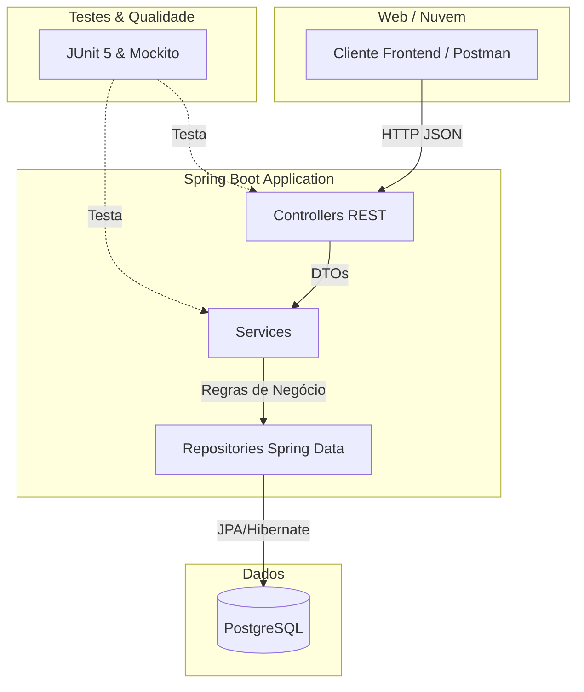

<Projeto 9: Projeto Final Capstone>
> "A jornada termina aqui, mas o código que você construiu fala por si. É hora de empacotar, testar e exibir sua obra-prima ao mundo."

## O que você vai aprender neste módulo

- Testes Unitários e de Integração com JUnit 5 e Mockito
- Cobertura de Código (Jacoco)
- Documentação profissional de repositórios (README.md)
- Deploy em nuvens de hospedagem (PaaS) modernas (Railway, Render ou Fly.io)
- Apresentação técnica do projeto

## Sumário

- [A História e Sua Missão](#a-história-e-sua-missão)
- [Requisitos Finais do Capstone](#requisitos-finais-do-capstone)
- [Critérios de Aceite](#critérios-de-aceite)
- [A Arquitetura Completa (Diagrama)](#a-arquitetura-completa)
- [O Valor dos Testes](#o-valor-dos-testes)

---

## A História e Sua Missão

Você percorreu um longo caminho! A biblioteca universitária saiu de papéis manchados de café para uma arquitetura em nuvem, conteinerizada e monitorada. A diretoria vai aprovar o lançamento em produção na próxima segunda-feira, mas com uma condição imposta pela auditoria técnica: o sistema precisa ser **altamente confiável e bem documentado**.

**Sua missão (Capstone):** Consolidar tudo. Você implementará testes que garantam que as regras de negócio cruciais nunca quebrem (Coverage de 70%), escreverá o documento de apresentação (README) digno de uma vitrine profissional e subirá a API na internet, fora do `localhost`.

---

## Requisitos Finais do Capstone

1. **Testes Unitários:** Usar Mockito para mockar o repositório e testar a lógica do seu Service (ex: garantir que a data de devolução seja exatamente daqui a 15 dias).
2. **Testes de Integração:** Usar `@SpringBootTest` e um banco H2 em memória para testar a gravação real de banco pelos Controllers (usando `MockMvc`).
3. **README:** O arquivo principal no GitHub deve ter a motivação, as tecnologias usadas, instruções de setup (Como rodar localmente com Docker) e os links úteis (Swagger).
4. **Deploy:** Sua aplicação deve estar viva na web utilizando um serviço gratuito focado no desenvolvedor (Sugestões: Railway, Render.com ou Fly.io).

---

## Critérios de Aceite

- [ ] Executar o comando `mvn test` no terminal aprova todos os testes.
- [ ] O repositório possui documentação técnica detalhada no README (se tiver um badge com o status da action do GitHub, ganha pontos extras!).
- [ ] Um recrutador consegue acessar o endereço público da sua API hospedada, abrir a tela do Swagger UI e testar as requisições no navegador dele.

---

## A Arquitetura Completa

Esta é a pintura de tudo o que você construiu, da ponta da API até a estrutura de dados e cloud:



---

## O Valor dos Testes

Testes de unidade não são burocracia, são redes de segurança. Com eles, você pode mexer no código sem medo de quebrar.

```java
import org.junit.jupiter.api.Test;
import org.junit.jupiter.api.extension.ExtendWith;
import org.mockito.InjectMocks;
import org.mockito.Mock;
import org.mockito.junit.jupiter.MockitoExtension;
import java.util.Optional;

import static org.junit.jupiter.api.Assertions.*;
import static org.mockito.Mockito.*;

// Dica: Prepara a classe para isolar o nosso objeto com "Mocks" (Dublês de teste)
@ExtendWith(MockitoExtension.class)
class LivroServiceTest {

    @Mock
    private LivroRepository repository;

    @InjectMocks
    private LivroService service;

    @Test
    void deveLancarExcecaoAoBuscarLivroInexistente() {
        // Cenário (Arrange)
        // O repositório finge que procurou e não achou
        when(repository.findById(any())).thenReturn(Optional.empty());

        // Ação (Act) e Validação (Assert) juntas no JUnit 5
        assertThrows(LivroNaoEncontradoException.class, () -> {
            service.buscarPorId(UUID.randomUUID());
        });
        
        // Garante que o repositório realmente foi consultado!
        verify(repository, times(1)).findById(any());
    }
}
```

---

## Exercícios de fixação do módulo

<details>
<summary>O que fazer se terminar cedo (Sugestões de Extensão)</summary>

1. **Teste Contêiners:** Substitua o H2 nos seus testes de integração pela biblioteca `Testcontainers`. Ela sobe um mini-banco de dados real no Docker durante o teste, deixando sua suíte muito mais fiel à produção.
2. **Métricas de Cobertura:** Adicione o plugin do `Jacoco` no seu `pom.xml`. Execute o build e veja o relatório HTML de quais linhas exatas os seus testes cobrem (ou deixaram de cobrir).
3. **Vídeo Pitch:** Grave a tela (Loom ou OBS) por 3 minutos mostrando a aplicação no ar, o CI rodando e como ficou o seu código. Coloque o link no README! O mercado ama desenvolvedores que sabem se comunicar.

</details>

## Referências

- [JUnit 5 User Guide](https://junit.org/junit5/docs/current/user-guide/)
- [Mockito Tutorial Baeldung](https://www.baeldung.com/mockito-series)
- [Railway App Platform](https://railway.app/)

---

[Voltar aos Links Rápidos](../README.md#links-rapidos)
