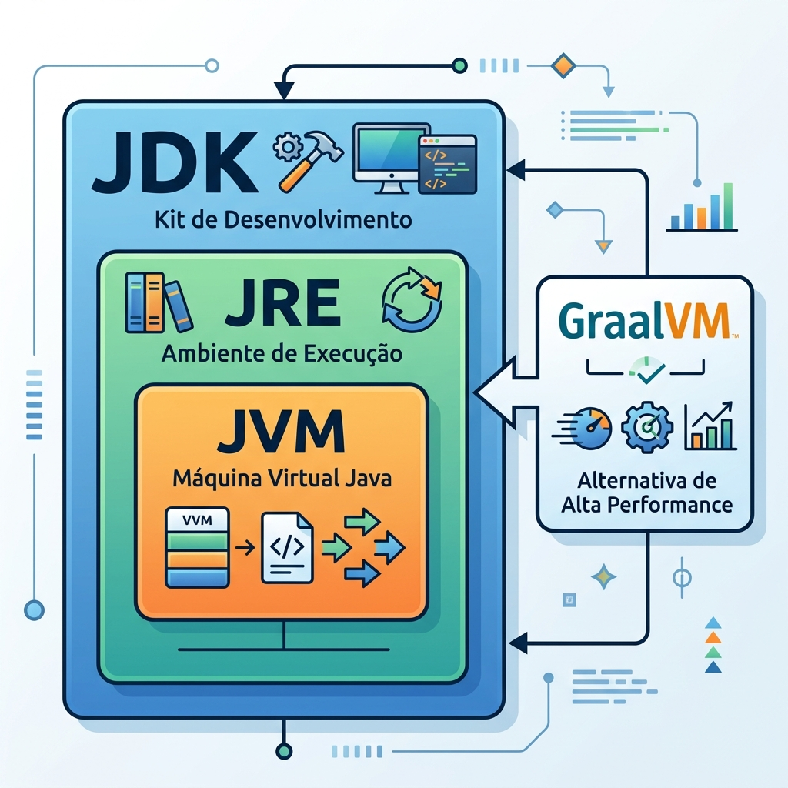

# Módulo 00: Preparação e Mentalidade
> Prepare o terreno antes de construir a casa: configure seu ambiente e ajuste sua mentalidade para dominar o Java moderno.


## O que você vai aprender neste módulo

- A evolução do ecossistema Java e por que ele continua relevante no mercado.
- A sopa de letrinhas desmistificada: entendendo JRE, JDK, JVM e GraalVM.
- Como instalar e configurar o JDK 21+ de forma profissional.
- Como criar e rodar seu primeiro programa "Hello World" manualmente.
- Como iniciar projetos pelo terminal usando o Maven.
- Técnicas de estudo modernas: Pomodoro e Active Recall.
- Como identificar e resolver erros lendo o Stacktrace.

## Sumário

- [Aula 0.1: O Ecossistema Java em 2025](#aula-01-o-ecossistema-java-em-2025)
- [Aula 0.2: Configurando o Ambiente de Desenvolvimento](#aula-02-configurando-o-ambiente-de-desenvolvimento)
- [Aula 0.3: Técnicas de Aprendizado Acelerado e Resolução de Erros](#aula-03-tecnicas-de-aprendizado-acelerado-e-resolucao-de-erros)
- [Exercícios de Fixação](#exercicios-de-fixacao)
- [Referências](#referencias)

---

## Aula 0.1: O Ecossistema Java em 2025

Você provavelmente já escutou que "o Java está morrendo" ou que é "lento demais". Mas a verdade no cenário corporativo é que o Java, lançado comercialmente em 1995, se reinventou drasticamente nas últimas duas décadas [1]. Hoje ele domina as infraestruturas mais críticas do planeta.

Muita gente parou no tempo com o Java 8 (de 2014). Hoje em dia, a Oracle lança novidades a cada 6 meses, mas o mercado foca nas versões chamadas de LTS (Long-Term Support), como o Java 11, 17 e o mais recente Java 21 [1].

Dica: O Java 21 trouxe as *Virtual Threads*, que permitem lidar com milhões de requisições simultâneas de forma leve, sem sobrecarregar a memória RAM.

### JRE, JDK e JVM



Para não se perder na sopa de letrinhas:
- **JVM (Java Virtual Machine):** É o cérebro que lê e executa o código compilado (o Bytecode), traduzindo-o para o seu sistema operacional. É o que garante a portabilidade do Java.
- **JRE (Java Runtime Environment):** É o ambiente de execução voltado para quem vai apenas rodar a aplicação. Contém a JVM e bibliotecas básicas.
- **JDK (Java Development Kit):** É a caixa de ferramentas do programador. Inclui o JRE, o compilador e tudo o que você precisa para criar software.

### E a GraalVM?

No mundo moderno de computação em nuvem (Cloud Native), iniciar rapidamente e consumir pouca memória é essencial. A GraalVM é uma inovação que permite compilar o código Java com antecedência (Ahead-of-Time). O resultado é um arquivo binário executável que inicia em milissegundos, superando a lentidão do modelo tradicional.

---

## Aula 0.2: Configurando o Ambiente de Desenvolvimento

Chegou a hora de preparar a sua máquina.

### Instalando o JDK 21

O mercado utiliza bastante a distribuição *Temurin 21* da Adoptium.

No Linux ou macOS, a forma mais elegante é usar o SDKMAN [2]:
```bash
# 1. Instale o SDKMAN
curl -s "https://get.sdkman.io" | bash

# 2. Instale o Java 21 Temurin
sdk install java 21.0.2-tem

# 3. Verifique a instalação
java -version
```

No Windows, acesse `adoptium.net`, baixe o instalador `.msi` e durante a instalação lembre-se de marcar a opção **Set JAVA_HOME variable**.

### Seu Primeiro "Hello World"

Crie um arquivo chamado `PrimeiroMundo.java`:
```java
public class PrimeiroMundo {
    public static void main(String[] args) {
        System.out.println("Olá, mundo Java 21!");
    }
}
```

Rode no terminal:
```bash
# Compila o código
javac PrimeiroMundo.java

# Executa
java PrimeiroMundo
```

### Maven: O Gerenciador de Projetos

Para projetos grandes, compilar na mão não funciona. O **Maven** [3] é a ferramenta padrão do mercado corporativo para criar projetos e gerenciar dependências. 

Para criar um projeto base pelo terminal, você pode usar:
```bash
mvn archetype:generate -DgroupId=com.meudominio -DartifactId=magia-projeto-raiz -DarchetypeArtifactId=maven-archetype-quickstart -DinteractiveMode=false
```
Isso criará a estrutura de pastas e o importante arquivo `pom.xml`, onde você listará todas as bibliotecas que seu projeto precisa.

---

## Aula 0.3: Técnicas de Aprendizado Acelerado e Resolução de Erros

Não tente decorar todo o Java. Ajuste a técnica Pomodoro: 50 minutos de foco intenso ininterrupto e 10 minutos de descanso.
Use a prática do *Active Recall* com flashcards no Anki para memorizar de forma ativa os conceitos importantes, ao invés de apenas reler textos.

### Como Ler um Stacktrace

Quando você errar o código, o terminal vai imprimir um texto longo em vermelho, chamado de **Stacktrace**. Não tenha medo, ele é apenas o mapa da solução:

1. **A primeira linha:** Ela diz o nome do erro (por exemplo, `java.lang.NullPointerException`) e explica a causa.
2. **Ignorando o ruído:** Pule as linhas que começam com pacotes internos (`java.`), e procure a linha que aponta para o pacote do seu código.
3. **A linha exata:** No final dessa linha do seu pacote, você verá algo como `(PrimeiroMundo.java:14)`. É exatamente ali que o erro ocorreu. Vá direto na linha 14 do seu arquivo e corrija a falha.

---

## Exercícios de Fixação

**Exercício 0:** Qual é a diferença entre a JVM e o JDK no ecossistema Java?
a) A JVM é o ambiente para rodar jogos antigos em Java, enquanto o JDK serve apenas para configurar o banco de dados.

b) O JDK é a máquina virtual que traduz o bytecode para a linguagem da máquina, enquanto a JVM é o kit de ferramentas do programador.

c) A JVM é o motor responsável por ler e executar o bytecode, garantindo a portabilidade, enquanto o JDK é a caixa de ferramentas que o desenvolvedor usa para criar e compilar o código (e inclui a JVM).

d) A JVM e o JDK são nomes diferentes para a mesma ferramenta lançada pela Oracle no Java 11.

<details>
<summary>Ver Resposta</summary>

**Resposta:** c) A JVM é o motor responsável por ler e executar o bytecode, garantindo a portabilidade, enquanto o JDK é a caixa de ferramentas que o desenvolvedor usa para criar e compilar o código (e inclui a JVM).

**Explicação:** A JVM foca na execução do Bytecode para o sistema operacional, já o JDK abrange o ambiente completo de desenvolvimento, contendo compilador (`javac`), ferramentas de documentação e a própria JVM embutida (através do JRE).
</details>

**Exercício 0.1:** Ao encontrar um erro no terminal (Stacktrace), qual o passo mais recomendado para identificar a causa rapidamente?
a) Olhar para a última linha do Stacktrace, onde sempre estará o erro, e copiar o texto para o Google sem ler as classes envolvidas.

b) Analisar a primeira linha para identificar o tipo de exceção, e depois procurar a primeira menção aos pacotes do seu próprio código para saber em qual linha o problema aconteceu.

c) Ignorar as linhas que mostram os arquivos Java e focar apenas nas mensagens que contêm a palavra `java.lang`.

d) Reinstalar o JDK imediatamente, pois os Stacktraces geralmente indicam que o ambiente de desenvolvimento foi corrompido.

<details>
<summary>Ver Resposta</summary>

**Resposta:** b) Analisar a primeira linha para identificar o tipo de exceção, e depois procurar a primeira menção aos pacotes do seu próprio código para saber em qual linha o problema aconteceu.

**Explicação:** A primeira linha define qual foi o problema técnico que impediu a execução. As menções a pacotes do próprio código indicam o exato arquivo e número da linha responsáveis por causar a exceção, facilitando a depuração.
</details>

## Referências

[1] dev.java. O Portal Oficial do Java. Disponível em: [https://dev.java/](https://dev.java/)
[2] SDKMAN. The Software Development Kit Manager. Disponível em: [https://sdkman.io/](https://sdkman.io/)
[3] Maven. Apache Maven Project. Disponível em: [https://maven.apache.org/](https://maven.apache.org/)

---

[Voltar aos Links Rápidos](../README.md#links-rapidos) | [Próximo módulo: Módulo 01 — Fundamentos da Linguagem Java](./modulo_01_fundamentos_da_linguagem_java.md)
