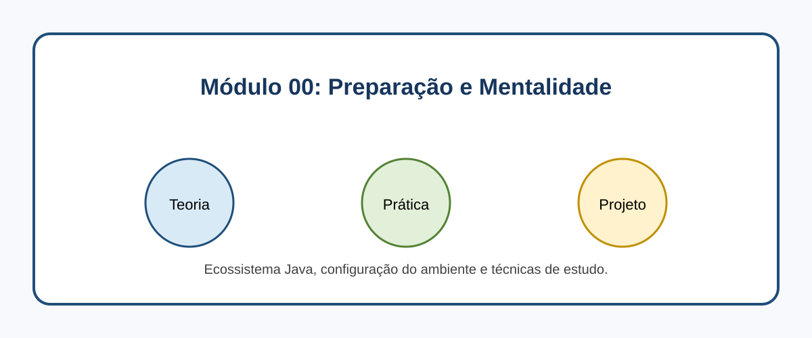

# Módulo 00: Preparação e Mentalidade

## Objetivos de Aprendizagem

Ao concluir este conteúdo, você deverá ser capaz de explicar os conceitos apresentados, executar os exemplos, reconhecer seus casos de uso e aplicar o conhecimento em uma solução pequena e verificável.

## Sumário

- [Introdução](#introducao)
- [Imagem conceitual](#imagem-conceitual)
- [Aulas](#aulas)
- [Referências](#referencias)

## Introdução

Ecossistema Java, configuração do ambiente e técnicas de estudo. Este módulo combina microlearning, prática deliberada e um projeto incremental.

## Imagem conceitual

## Aulas

- [Aula 0.1: O Ecossistema Java em 2025: Por que Java ainda domina? 🌍](modulo_00/aula_0_1_ecossistema_java.md)
- [Aula 0.2: Configurando o Ambiente de Desenvolvimento (JDK 21+, IDE) ](modulo_00/aula_0_2_configuracao_ambiente.md)
- [Aula 0.3: Como Estudar Programação: Técnicas de Aprendizado Acelerado 🧠](modulo_00/aula_0_3_tecnicas_estudo.md)

## Referências

[1] dev.java. Learn Java. Disponível em: [https://dev.java/learn/](https://dev.java/learn/)
[2] Oracle. Java Tutorials. Disponível em: [https://docs.oracle.com/javase/tutorial/](https://docs.oracle.com/javase/tutorial/)

---

[Voltar aos Links Rápidos](../README.md#links-rapidos)
