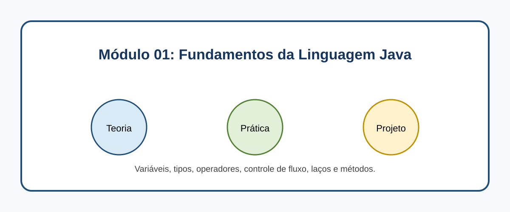

# Módulo 01: Fundamentos da Linguagem Java
> Os alicerces onde tudo começa: domine variáveis, operadores, controle de fluxo, laços e métodos no Java Moderno 21+.



## O que você vai aprender neste módulo

- A base estrutural do código moderno: Variáveis dinâmicas e Tipos de Dados Primitivos.
- O uso e a utilidade prática das poderosas Wrapper Classes.
- Como operar e extrair respostas usando a lógica e matemática (operadores unários e ternários).
- Tomada de decisões com estruturas de controle de fluxo (if, else e switch expressions).
- Como automatizar tarefas repetitivas usando laços (for, while, do-while).
- Como organizar blocos lógicos isolados usando métodos e parâmetros.

## Sumário

- [Aula 1.1: Variáveis e Tipos de Dados](#aula-11-variaveis-e-tipos-de-dados)
- [Aula 1.2: Operadores Matemáticos e Lógicos](#aula-12-operadores-matematicos-e-logicos)
- [Aula 1.3: Estruturas de Controle de Fluxo](#aula-13-estruturas-de-controle-de-fluxo)
- [Aula 1.4: Laços de Repetição](#aula-14-lacos-de-repeticao)
- [Aula 1.5: Métodos e Funções](#aula-15-metodos-e-funcoes)
- [Exercícios de Fixação](#exercicios-de-fixacao)
- [Referências](#referencias)

---

## Aula 1.1: Variáveis e Tipos de Dados

Para processar informações e salvar dados em memória, usamos variáveis. Como o Java possui tipagem estática forte [1], cada variável precisa ter um tipo explicitamente declarado no momento da sua criação.

### Tipos Primitivos

O Java possui 8 tipos primitivos que representam a base mais simples e veloz da linguagem:

```java
public class TiposPrimitivos {
    public static void main(String[] args) {
        // Numéricos inteiros
        int idade = 25;
        long populacao = 8000000000L; // Usamos o sufixo L para long
        
        // Numéricos decimais
        double saldo = 1500.50;
        
        // Valores lógicos
        boolean estaLogado = true;
        
        // Texto simples (apenas um caractere)
        char letra = 'A';
        
        System.out.println("Sua idade é: " + idade);
    }
}
```

### Wrapper Classes

Embora os tipos primitivos sejam rápidos, em Java muitas estruturas do dia a dia (como Listas Dinâmicas) exigem o uso de Objetos. Para contornar essa limitação, existem as **Wrapper Classes**, que encapsulam os tipos primitivos em objetos [1].

Normalmente basta usar o nome do primitivo com a primeira letra maiúscula (ex: `Integer`, `Double`, `Boolean`).

```java
import java.util.ArrayList;

public class UsoDeWrappers {
    public static void main(String[] args) {
        // Autoboxing: O Java converte primitivo em Wrapper de forma automática
        Integer idadeObjeto = 30;
        
        // A lista exige um objeto, portanto usamos a classe Wrapper Integer
        ArrayList<Integer> idades = new ArrayList<>();
        idades.add(idadeObjeto);
    }
}
```

### A Palavra-chave `final`

Se precisar criar valores que não devem ser alterados de jeito nenhum durante a execução do programa, como por exemplo uma constante física, utilize a palavra reservada `final`. O padrão recomendado é utilizar letras maiúsculas.

```java
public class TrabalhandoComConstantes {
    public static void main(String[] args) {
        final double GRAVIDADE = 9.81;
        // GRAVIDADE = 10.0; // Descomentar isso geraria erro de compilação
        System.out.println("A gravidade da Terra é " + GRAVIDADE);
    }
}
```

---

## Aula 1.2: Operadores Matemáticos e Lógicos

Precisamos de operadores para interagir com os dados armazenados e gerar novos resultados.

### Operadores Básicos

O Java suporta os operadores tradicionais: Adição (`+`), Subtração (`-`), Multiplicação (`*`) e Divisão (`/`). Um muito importante é o **módulo** (`%`), que calcula o resto de uma divisão exata.

```java
public class OperadoresMatematicos {
    public static void main(String[] args) {
        int flechas = 10;
        int alvos = 3;
        
        int sobras = flechas % alvos; // Resto da divisão de 10 por 3
        System.out.println("Restaram: " + sobras + " flechas.");
    }
}
```

### Operador Ternário

Para decisões de atribuição rápidas sem precisar escrever blocos extensos de if-else, o Java oferece o operador ternário, que funciona com o modelo `(condição) ? caso_verdadeiro : caso_falso`.

```java
public class AtalhoTernario {
    public static void main(String[] args) {
        int experiencia = 150;
        
        String nivel = (experiencia >= 100) ? "Mestre" : "Aprendiz";
        System.out.println("Nível alcançado: " + nivel);
    }
}
```

---

## Aula 1.3: Estruturas de Controle de Fluxo

Podemos controlar o que o código vai fazer usando expressões condicionais lógicas.

### O if-else Clássico

O modo mais direto de condicionar um caminho.

```java
public class EstruturaIfElse {
    public static void main(String[] args) {
        int moedas = 40;

        if (moedas > 50) {
            System.out.println("Você pode acessar a loja premium.");
        } else if (moedas > 20) {
            System.out.println("Você pode comprar itens básicos.");
        } else {
            System.out.println("Sem saldo, volte a explorar.");
        }
    }
}
```

### Switch Expressions (Java 14+)

Para substituir os antigos e muito extensos blocos de `switch` com vários `break`, o Java 14+ incluiu a sintaxe aprimorada de *Switch Expressions* [1]. Ela é muito mais limpa e pode retornar valores diretamente.

```java
public class UsoNovoSwitch {
    public static void main(String[] args) {
        String classePersonagem = "Guerreiro";

        String ataquePrincipal = switch (classePersonagem) {
            case "Mago" -> "Bola de Fogo";
            case "Arqueiro" -> "Tiro Certeiro";
            case "Guerreiro", "Paladino" -> "Ataque Pesado";
            default -> "Ataque Básico";
        };
        
        System.out.println("O ataque foi: " + ataquePrincipal);
    }
}
```

---

## Aula 1.4: Laços de Repetição

Não copie blocos de código se precisar repeti-los: use laços de repetição e deixe que a máquina automatize esse esforço para você.

### Laço for

Usado quando você sabe exatamente o número de vezes que a execução precisa acontecer.

```java
public class LacoFor {
    public static void main(String[] args) {
        for (int iteracao = 1; iteracao <= 3; iteracao++) {
            System.out.println("Iteração número " + iteracao);
        }
    }
}
```

### Laço while

Excelente para quando a execução depender de uma condição enquanto ela continuar sendo verdadeira.

```java
public class LacoWhile {
    public static void main(String[] args) {
        int vidaInimigo = 30;
        
        while (vidaInimigo > 0) {
            System.out.println("Atacando! Vida atual: " + vidaInimigo);
            vidaInimigo -= 10;
        }
    }
}
```

---

## Aula 1.5: Métodos e Funções

Em vez de jogar milhares de linhas soltas em um único local, organizamos lógicas com os métodos (também conhecidos como funções). Eles recebem parâmetros e, na maioria das vezes, retornam um resultado útil.

```java
public class MetodosUtilitarios {
    
    // Método simples de soma que retorna int
    public static int somarValores(int a, int b) {
        return a + b;
    }
    
    public static void main(String[] args) {
        int resultadoSoma = somarValores(10, 50);
        System.out.println("Resultado da soma calculada: " + resultadoSoma);
    }
}
```

---

## Exercícios de Fixação

**Exercício 1:** Ao precisar que uma variável contenha um valor numérico decimal em Java (ex: 9.99), qual tipo primitivo abaixo é o mais indicado?
a) int

b) boolean

c) double

d) String

<details>
<summary>Ver Resposta</summary>

**Resposta:** c) double

**Explicação:** O tipo primitivo `double` é o principal indicado no Java para guardar números de ponto flutuante (decimais). O tipo `int` apenas guarda inteiros, `boolean` guarda lógicos (true/false) e `String` não é um tipo primitivo, além de ser usado apenas para texto.
</details>

**Exercício 1.1:** O que o operador de módulo (`%`) calcula no Java?
a) O percentual que um número representa de outro.

b) O resto inteiro de uma divisão de dois números.

c) O resultado fracionário exato de uma divisão, evitando arredondamentos.

d) Ele é usado como um atalho do operador ternário lógico.

<details>
<summary>Ver Resposta</summary>

**Resposta:** b) O resto inteiro de uma divisão de dois números.

**Explicação:** Em Java, o operador `%` atua como a operação matemática de "resto da divisão" (módulo). Por exemplo, `10 % 3` resultará em 1, porque 10 dividido por 3 resulta em 3, com sobra de 1.
</details>

## Referências

[1] Oracle. Java Platform, Standard Edition & Java Development Kit Version 21 API Specification. Disponível em: [https://docs.oracle.com/en/java/javase/21/docs/api/](https://docs.oracle.com/en/java/javase/21/docs/api/)

---

[Voltar aos Links Rápidos](../README.md#links-rapidos) | [Próximo módulo: Módulo 02 — Introdução à Orientação a Objetos](./modulo_02_orientacao_a_objetos.md)
