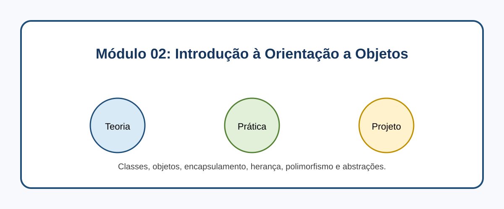

# Módulo 02: Introdução à Orientação a Objetos

## Objetivos de Aprendizagem

Ao concluir este conteúdo, você deverá ser capaz de explicar os conceitos apresentados, executar os exemplos, reconhecer seus casos de uso e aplicar o conhecimento em uma solução pequena e verificável.

## Sumário

- [Introdução](#introducao)
- [Imagem conceitual](#imagem-conceitual)
- [Aulas](#aulas)
- [Referências](#referencias)

## Introdução

Classes, objetos, encapsulamento, herança, polimorfismo e abstrações. Este módulo combina microlearning, prática deliberada e um projeto incremental.

## Imagem conceitual

## Aulas

- [Aula 2.1: Classes e Objetos: O DNA do seu Programa ](modulo_02/aula_2_1_classes_objetos.md)
- [Aula 2.2: Encapsulamento: Protegendo seus Dados 🔒](modulo_02/aula_2_2_encapsulamento.md)
- [Aula 2.3: Herança: Reutilizando Código com Inteligência 🌳](modulo_02/aula_2_3_heranca.md)
- [Aula 2.4: Polimorfismo: Múltiplas Formas, Uma Interface 🎭](modulo_02/aula_2_4_polimorfismo.md)
- [Aula 2.5: Interfaces e Classes Abstratas: Contratos e Modelos 🤝](modulo_02/aula_2_5_interfaces_abstratas.md)

## Referências

[1] Oracle. Object-Oriented Concepts. Disponível em: [https://docs.oracle.com/javase/tutorial/java/concepts/](https://docs.oracle.com/javase/tutorial/java/concepts/)
[2] Oracle. Inheritance. Disponível em: [https://docs.oracle.com/javase/tutorial/java/IandI/subclasses.html](https://docs.oracle.com/javase/tutorial/java/IandI/subclasses.html)

---

[Voltar aos Links Rápidos](../README.md#links-rapidos)
