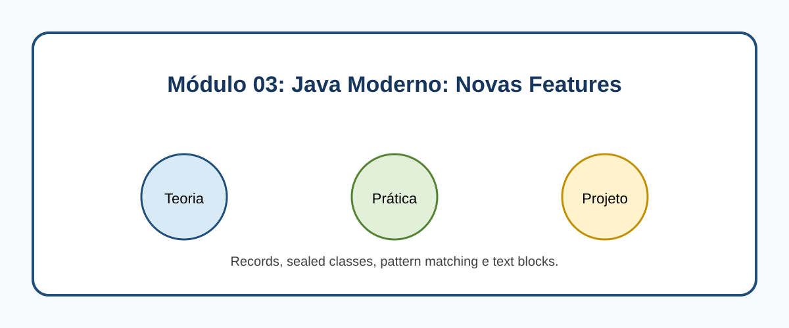

# Módulo 03: Java Moderno: Novas Features

## Objetivos de Aprendizagem

Ao concluir este conteúdo, você deverá ser capaz de explicar os conceitos apresentados, executar os exemplos, reconhecer seus casos de uso e aplicar o conhecimento em uma solução pequena e verificável.

## Sumário

- [Introdução](#introducao)
- [Imagem conceitual](#imagem-conceitual)
- [Aulas](#aulas)
- [Referências](#referencias)

## Introdução

Records, sealed classes, pattern matching e text blocks. Este módulo combina microlearning, prática deliberada e um projeto incremental.

## Imagem conceitual

## Aulas

- [Aula 3.1: Records: Classes de Dados Simples e Imutáveis 📦](modulo_03/aula_3_1_records.md)
- [Aula 3.2: Sealed Classes: Controlando a Herança ](modulo_03/aula_3_2_sealed_classes.md)
- [Aula 3.3: Pattern Matching para instanceof e switch: Simplificando Condicionais 🧩](modulo_03/aula_3_3_pattern_matching.md)
- [Aula 3.4: Text Blocks: Strings Multilinhas Mais Legíveis 📜](modulo_03/aula_3_4_text_blocks.md)

## Referências

[1] OpenJDK. Project Amber. Disponível em: [https://openjdk.org/projects/amber/](https://openjdk.org/projects/amber/)
[2] Oracle. Java Language Changes. Disponível em: [https://docs.oracle.com/en/java/javase/21/language/java-language-changes.html](https://docs.oracle.com/en/java/javase/21/language/java-language-changes.html)

---

[Voltar aos Links Rápidos](../README.md#links-rapidos)
