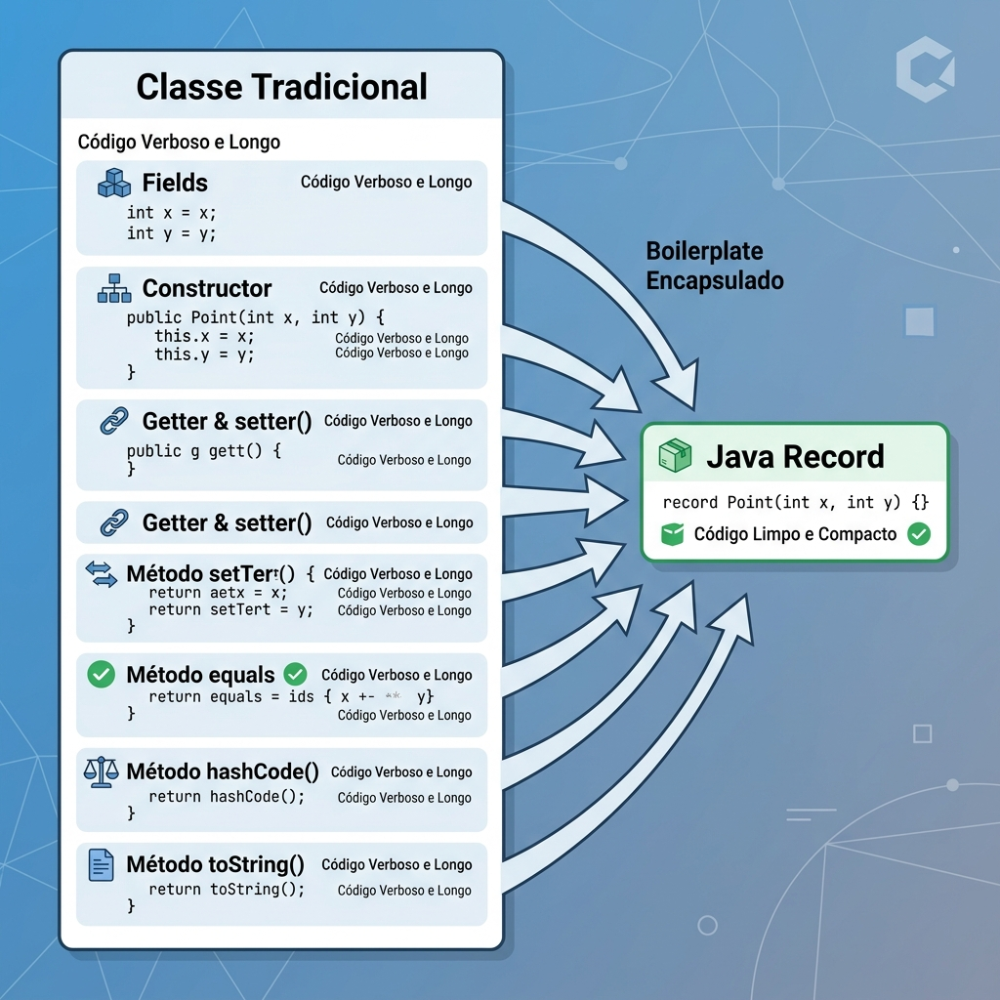

# Módulo 03: Recursos Modernos do Java
> O Java evoluiu muito! Escreva menos código, previna mais erros e expresse suas ideias com clareza usando as features modernas.

## O que você vai aprender neste módulo

O Java deixou de ser aquela linguagem excessivamente verbosa do passado. Neste módulo, você descobrirá como o "Java Moderno" (versões 14 a 21) trouxe ferramentas incríveis para tornar seu código mais limpo e seguro:
- Usar **Records** para criar classes de dados com apenas uma linha de código.
- Restringir a herança com **Sealed Classes** para modelagem de domínio mais segura.
- Escrever condicionais elegantes e seguras com **Pattern Matching** para `instanceof` e `switch`.
- Organizar strings longas (como JSON ou SQL) de forma legível usando **Text Blocks**.

E o mais legal: você verá como essas ferramentas trabalham juntas (Records + Sealed Classes + Pattern Matching) para criar o que chamamos de *Algebraic Data Types* (Tipos de Dados Algébricos).

## Sumário

- [Aula 3.1: Records](#aula-31-records-classes-de-dados-simples-e-imutaveis)
- [Aula 3.2: Sealed Classes](#aula-32-sealed-classes-controlando-a-heranca)
- [Aula 3.3: Pattern Matching](#aula-33-pattern-matching-para-instanceof-e-switch-simplificando-condicionais)
- [Aula 3.4: Text Blocks](#aula-34-text-blocks-strings-multilinhas-mais-legiveis)
- [Exercícios de Fixação](#exercicios-de-fixacao)

---

## Aula 3.1: Records: Classes de Dados Simples e Imutáveis 

Com a evolução do Java, a linguagem buscou oferecer [1] formas mais concisas de escrever código. Uma das adições mais significativas são os **Records** (Java 16+), classes especiais projetadas para serem portadores de dados imutáveis (DTOs).

### O Problema do Código Boilerplate

Tradicionalmente, para criar uma classe que apenas armazena dados, precisávamos de: atributos, construtor, getters, `equals()`, `hashCode()` e `toString()`. Tudo isso era muito código repetitivo (boilerplate).

```java
// O jeito antigo e verboso...
public class PontoTradicional {
    private final int x;
    private final int y;
    // ... construtor, getters, equals, hashCode, toString ...
}
```

### Introdução aos Records


*Figura 1: Comparativo entre uma Classe Tradicional e um Java Record.*


Os Records resolvem isso com uma única linha. O compilador gera automaticamente todo aquele código para você.

```java
// O jeito moderno!
public record Ponto(int x, int y) {
    // 1. Compact Constructor: Validação sem precisar repetir a atribuição (this.x = x)
    public Ponto {
        if (x < 0 || y < 0) {
            throw new IllegalArgumentException("Não aceitamos valores negativos");
        }
    }
    
    // 2. Você pode adicionar métodos customizados normais
    public double distanciaDaOrigem() {
        return Math.sqrt(x * x + y * y);
    }
}

// 3. Records podem implementar interfaces (mas não podem herdar de outras classes)
public interface Imprimivel {
    void imprimir();
}

public record Produto(String nome, double preco) implements Imprimivel {
    @Override
    public void imprimir() {
        System.out.println("Produto: " + nome + " | R$" + preco);
    }
}

public class TesteRecords {
    public static void main(String[] args) {
        Ponto p1 = new Ponto(10, 20);
        
        System.out.println(p1); // Já vem com toString! Saída: Ponto[x=10, y=20]
        System.out.println(p1.x()); // O "getter" tem o mesmo nome do atributo!
        System.out.println(p1.distanciaDaOrigem());
    }
}
```

### Classes vs Records

| Característica | Classe Normal | Record |
| --- | --- | --- |
| **Propósito** | Modelagem de comportamento e estado | Transporte de dados imutáveis (DTO) |
| **Imutabilidade** | Opcional (depende de você) | **Sempre** (atributos são `final`) |
| **Herança** | Pode usar `extends` | **Não pode** herdar (já estendem `java.lang.Record`) |
| **Interfaces** | Pode implementar | Pode implementar |
| **Boilerplate** | Alto (requer criar tudo na mão) | **Zero** (compilador faz tudo) |

Dica: **Quando usar?** Use para DTOs, Value Objects e quando um método precisar retornar múltiplos valores. Não use quando precisar de herança ou estado mutável.

E por falar em herança, se no passado a herança era "aberta para todos", agora podemos controlá-la.

---

## Aula 3.2: Sealed Classes: Controlando a Herança 

As **Sealed Classes** (Java 17+) permitem que você especifique explicitamente quais classes podem herdar de você.

### O Problema da Herança Aberta

Normalmente, qualquer classe pode dar um `extends` na sua classe, a menos que você a marque como `final` (que bloqueia *toda* a herança). Mas e se você quiser permitir que apenas *algumas* classes específicas herdem?

### Introdução às Sealed Classes

Usamos as palavras-chave `sealed` e `permits`. 

Vamos ver um exemplo extremamente útil e comum em arquiteturas modernas: modelar o resultado de uma operação (como uma chamada de API) que pode dar certo, falhar, ou vir vazio. Isso é um **Algebraic Data Type**!

```java
// Eu digo explicitamente quem tem permissão para implementar Result!
public sealed interface Result<T> permits Success, Failure, Empty {
}

// Subclasses de uma classe selada devem ser final, sealed ou non-sealed.
// Usar Records aqui é perfeito para Tipos Algébricos Seguros:
public record Success<T>(T data) implements Result<T> {}

public record Failure<T>(Exception exception) implements Result<T> {}

public record Empty<T>() implements Result<T> {}

// class Timeout<T> implements Result<T> {} // Atencao: ERRO! Timeout não está na lista permits!
```

Vantagem: A sua modelagem de domínio fica perfeitamente fechada e previsível. Você tem a segurança de que um `Result` só pode ser uma dessas três coisas, e ponto final.

Essa previsibilidade nos leva à próxima grande feature: se sabemos exatamente quem são as subclasses permitidas, fica fácil criar condicionais inteligentes.

---

## Aula 3.3: Pattern Matching para instanceof e switch: Simplificando Condicionais 

O **Pattern Matching** ajuda você [2] a extrair dados de objetos sem precisar ficar fazendo casts (conversões) manuais e perigosos.

### Pattern Matching para `instanceof` (Java 16+)

Antes, verificávamos o tipo e logo em seguida fazíamos o cast:

```java
if (obj instanceof String) {
    String s = (String) obj; // Repetitivo...
    if (s.length() > 5) {
        System.out.println(s.toUpperCase());
    }
}
```

Agora, o Java faz os dois passos de uma vez. O "Pattern Matching" verifica o tipo e, se for verdadeiro, já cria a variável no escopo correto. E você pode até encadear expressões na mesma linha usando o `&&`:

```java
// O "s" já é criado e convertido automaticamente!
// E o melhor: você pode usar a variável "s" na própria condição do if!
if (obj instanceof String s && s.length() > 5) { 
    System.out.println(s.toUpperCase());
}

// O escopo da variável 's' é inteligentemente gerido pelo compilador.
// Exemplo com "early return":
public void processar(Object obj) {
    if (!(obj instanceof String s)) {
        System.out.println("Não é String");
        return;
    }
    // A partir desta linha, o compilador sabe que a execução só chega aqui
    // se o objeto for String, logo a variável 's' CONTINUA existindo!
    System.out.println(s.toLowerCase());
}
```

### Pattern Matching para `switch` (Java 21+) e Record Patterns

O `switch` agora aceita objetos complexos, e não apenas números ou Strings. Além disso, podemos usar **Deconstruction Patterns** (desestruturar os records diretamente no switch) e **Guard Clauses** (`when` para adicionar uma condição extra).

Olha como fica incrível usar nosso `Result` (da seção anterior) com Pattern Matching:

```java
public void processarResultado(Result<String> resultado) {
    // Switch com Pattern Matching + Records/Sealed Classes = Perfeição!
    switch (resultado) {
        // Desestruturação: já pego o 'data' de dentro do Success
        case Success<String>(String data) -> 
            System.out.println("Deu certo! Dados: " + data);
            
        // Guard Clause (when): verifico a mensagem da exceção diretamente no case
        case Failure<String> f when f.exception() instanceof NullPointerException -> 
            System.out.println("Deu ruim por causa de um NullPointer!");
            
        case Failure<String>(Exception ex) -> 
            System.out.println("Outro erro: " + ex.getMessage());
            
        case Empty<String>() -> 
            System.out.println("Nenhum dado retornado.");
            
        // Não precisa de "default"! O compilador sabe que Result só tem esses 3 filhos.
    }
}
```

Essa combinação que acabamos de ver tem um nome na Ciência da Computação: **Data-Oriented Programming (DOP)** com **Algebraic Data Types (ADTs)**.

1. **Sealed Classes** atuam como o "OU" lógico (Soma Algébrica) - Um Result é Success *OU* Failure *OU* Empty. Ninguém além de você pode criar uma nova alternativa surpresa.
2. **Records** atuam como o "E" lógico (Produto Algébrico) - Um Produto é formado por Nome *E* Preço *E* Quantidade.
3. **Switch Pattern Matching** é a ferramenta inteligente que consome e destrincha essa estrutura.

Em vez de esconder os dados atrás de infinitas camadas de interfaces e polimorfismo clássico (como mandava a Orientação a Objetos dos anos 90), o Java Moderno encoraja você a deixar os dados expostos, imutáveis e bem tipados, tratando a lógica separadamente com switches exhaustivos. 

É um estilo muito inspirado em linguagens funcionais (como Haskell, Scala ou Rust), que reduz a quantidade de classes e abstrações desnecessárias. Agora, tudo isso está disponível nativamente, com a mesma segurança e performance de sempre, no Java!

---

## Aula 3.4: Text Blocks: Strings Multilinhas Mais Legíveis 

Por fim, o Java 15 trouxe os **Text Blocks** para salvar sua visão quando precisar lidar com Strings grandes, como Queries SQL ou JSON.

### O Problema e a Solução

Antes, escrever um JSON em Java era um pesadelo de aspas escapadas e concatenações:

```java
// O horror...
String jsonAntigo = "{\n" +
                    "  \"nome\": \"Alice\"\n" +
                    "}";
```

Com os Text Blocks (`"""`), você escreve a String exatamente como ela é. Você também tem novos escapes úteis como `\` (ignora a quebra de linha) e `\s` (força o Java a manter os espaços no final da linha).

```java
// 1. JSON
String jsonNovo = """
    {
      "nome": "Alice",
      "idade": 30
    }
    """;

// 2. SQL
String query = """
    SELECT id, nome \
    FROM usuarios \
    WHERE status = 'ATIVO'
    """; // O '\' no final da linha faz tudo ficar em UMA linha só no final!

// 3. HTML com formatação preservada (e espaços finais mantidos com \s)
String html = """
    <html>
        <body>
            <p>Texto indentado perfeitamente</p>   \s
        </body>
    </html>
    """;
```

Dica: **Dica sobre Indentação:** O Java inteligentemente calcula a "indentação base" olhando a linha mais à esquerda. Ele remove esses espaços iniciais de todas as linhas, para que você possa alinhar o Text Block bonitinho com o seu `String html = ...` sem encher a String real de espaços vazios indesejados.

### Interpolação de Variáveis em Text Blocks

Ao contrário de outras linguagens, o Java optou por não ter suporte direto a coisas como `${variavel}` dentro da String. Isso garante a segurança, especialmente para injeções SQL indesejadas, e mantém a compatibilidade do código antigo. 

Mas como colocar dados dinâmicos dentro deles? Use o novo método `.formatted()` ou (no futuro) *String Templates*:

```java
String nomeDoUsuario = "Matheus";
int idDaCompra = 998;

// Usando o método .formatted() introduzido no Java 15:
String queryDinamica = """
    SELECT * 
    FROM pedidos 
    WHERE nome_cliente = '%s' 
    AND id = %d;
    """.formatted(nomeDoUsuario, idDaCompra);

// NOTA: No Java 21 foi introduzido em PREVIEW o suporte nativo a 
// "String Templates" usando a classe STR. Fique de olho no futuro!
// String queryTemplate = STR."""SELECT * FROM pedidos WHERE nome_cliente = '\{nomeDoUsuario}'""";
```

---

## Exercícios de Fixação

**Exercício 3:** Qual é a principal característica dos Records no Java moderno?
a) Permitir herança múltipla de classes genéricas.

b) Atuar como portadores de dados simples e mutáveis.

c) Substituir automaticamente o uso de interfaces em projetos complexos.

d) Serem portadores de dados simples e imutáveis, com construtores e métodos básicos gerados pelo compilador.

<details>
<summary>Ver Resposta</summary>

**Resposta:** d) Serem portadores de dados simples e imutáveis, com construtores e métodos básicos gerados pelo compilador.

**Explicação:** Records (Java 16+) são ideais para DTOs (Data Transfer Objects), pois o compilador gera automaticamente construtores, getters, equals, hashCode e toString, focando na imutabilidade (atributos finais).
</details>

**Exercício 3.1:** Para que servem as Sealed Classes no Java?
a) Para aumentar a performance em tempo de execução bloqueando todos os polimorfismos.

b) Para criar classes que não podem ter seus dados lidos (encapsulamento estrito).

c) Para controlar e restringir explicitamente quais outras classes ou interfaces têm permissão para herdar ou implementá-la.

d) Para criar automaticamente blocos de texto (Text Blocks) seguros para SQL.

<details>
<summary>Ver Resposta</summary>

**Resposta:** c) Para controlar e restringir explicitamente quais outras classes ou interfaces têm permissão para herdar ou implementá-la.

**Explicação:** Com as palavras-chave `sealed` e `permits`, você define uma hierarquia de herança fechada e previsível, o que é fundamental para a criação de Algebraic Data Types em Java.
</details>

<details>
<summary><strong>Exercício Prático 1: Records e Pattern Matching</strong></summary>

Crie um `record` chamado `PedidoDTO` com `id` (int) e `valor` (double). Crie um método que receba um `Object`. Use o *Pattern Matching for instanceof* para verificar se o objeto é um `PedidoDTO` e, se for, imprima o valor dele.

**Gabarito:**
```java
public record PedidoDTO(int id, double valor) {}

public void analisarObjeto(Object obj) {
    if (obj instanceof PedidoDTO p) {
        System.out.println("O valor do pedido " + p.id() + " é: " + p.valor());
    } else {
        System.out.println("Não é um pedido.");
    }
}
```
</details>

<details>
<summary><strong>Exercício Prático 2: Sealed Classes com Switch Exhaustivo</strong></summary>

Crie uma interface selada `Pagamento` que permita `PagamentoPix` e `PagamentoBoleto` (faça ambos como records). Depois, faça um método que use o `switch` expression para retornar uma string indicando como foi pago.

**Gabarito:**
```java
public sealed interface Pagamento permits PagamentoPix, PagamentoBoleto {}

public record PagamentoPix(String chave) implements Pagamento {}
public record PagamentoBoleto(String codigoBarras) implements Pagamento {}

public String descreverPagamento(Pagamento p) {
    return switch (p) {
        case PagamentoPix pix -> "Pago com PIX: " + pix.chave();
        case PagamentoBoleto bol -> "Pago com Boleto: " + bol.codigoBarras();
        // Default omitido pois o Java sabe que não há outras opções
    };
}
```
</details>

<details>
<summary><strong>Exercício Prático 3: Text Blocks para SQL</strong></summary>

Crie uma string que guarde um `CREATE TABLE` para uma tabela de produtos, usando Text Blocks e indentando de forma legível.

**Gabarito:**
```java
String ddl = """
    CREATE TABLE produtos (
        id INT PRIMARY KEY,
        nome VARCHAR(100) NOT NULL,
        preco DECIMAL(10,2)
    );
    """;
```
</details>

## Referências

[1] Oracle. Java Language Changes (Java 21). Disponível em: [https://docs.oracle.com/en/java/javase/21/language/java-language-changes.html](https://docs.oracle.com/en/java/javase/21/language/java-language-changes.html)
[2] OpenJDK. Project Amber. Disponível em: [https://openjdk.org/projects/amber/](https://openjdk.org/projects/amber/)

---

[Voltar aos Links Rápidos](../README.md#links-rapidos) | [Próximo módulo: Módulo 04 — Collections e Stream API](./modulo_04_collections_e_stream_api.md)

