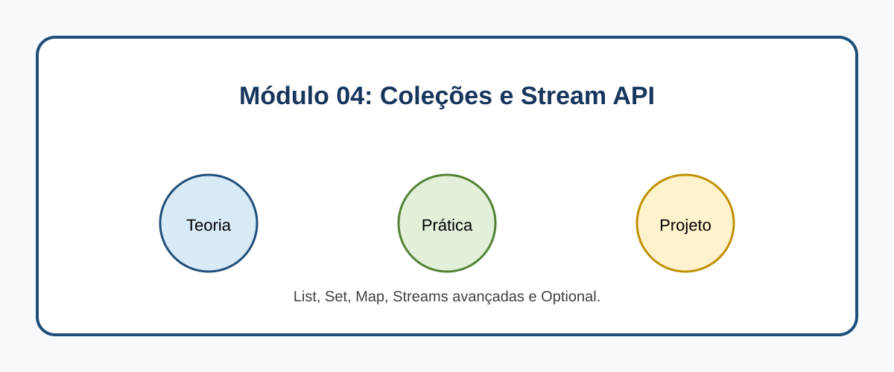

# Módulo 04: Coleções e Stream API

## Objetivos de Aprendizagem

Ao concluir este conteúdo, você deverá ser capaz de explicar os conceitos apresentados, executar os exemplos, reconhecer seus casos de uso e aplicar o conhecimento em uma solução pequena e verificável.

## Sumário

- [Introdução](#introducao)
- [Imagem conceitual](#imagem-conceitual)
- [Aulas](#aulas)
- [Referências](#referencias)

## Introdução

List, Set, Map, Streams avançadas e Optional. Este módulo combina microlearning, prática deliberada e um projeto incremental.

## Imagem conceitual

## Aulas

- [Aula 4.1: O Universo das Collections - Listas e Conjuntos ](modulo_04/aula_4_1_list_set.md)
- [Aula 4.2: Mapas e Dicionários - Chave e Valor 🔑](modulo_04/aula_4_2_maps.md)
- [Aula 4.3: Streams API - O Poder da Programação Funcional](modulo_04/aula_4_3_streams_api.md)
- [Aula 4.4: Operações Avançadas com Streams ](modulo_04/aula_4_4_streams_avancado.md)
- [Aula 4.5: Optional: Diga adeus ao NullPointerException ](modulo_04/aula_4_5_optional.md)

## Referências

[1] Oracle. Collections Framework. Disponível em: [https://docs.oracle.com/en/java/javase/21/docs/api/java.base/java/util/package-summary.html](https://docs.oracle.com/en/java/javase/21/docs/api/java.base/java/util/package-summary.html)
[2] Oracle. Stream Package. Disponível em: [https://docs.oracle.com/en/java/javase/21/docs/api/java.base/java/util/stream/package-summary.html](https://docs.oracle.com/en/java/javase/21/docs/api/java.base/java/util/stream/package-summary.html)

---

[Voltar aos Links Rápidos](../README.md#links-rapidos)
