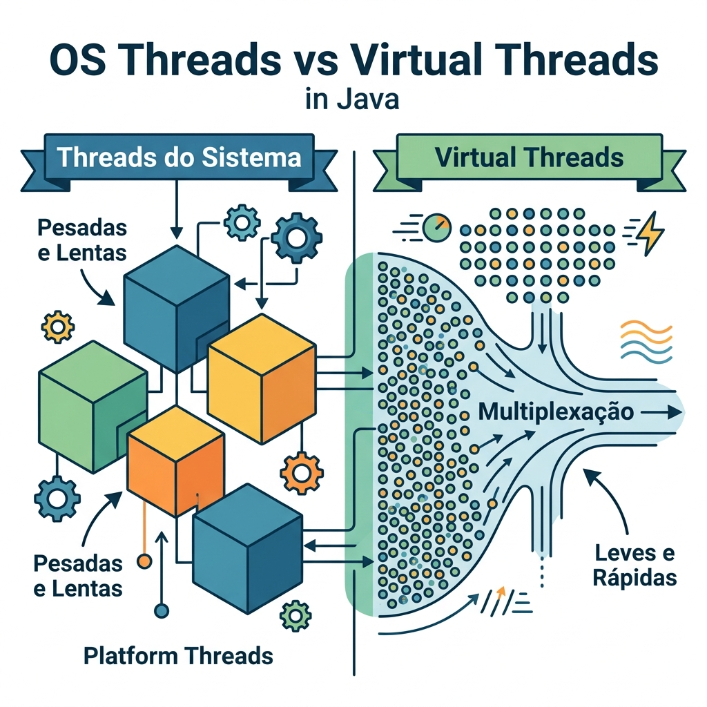

# Módulo 05: Tratamento de Erros e Tópicos Avançados
> Domine a base avançada do Java: como lidar com o inesperado e criar códigos genéricos, seguros e velozes.

## Sumário

- [Aula 5.1: Exceções: Lidando com o Inesperado](#aula-51-exceções-lidando-com-o-inesperado)
- [Aula 5.2: Generics: Código Flexível e Seguro em Tipos](#aula-52-generics-código-flexível-e-seguro-em-tipos)
- [Aula 5.3: Expressões Lambda: A Base do Código Funcional](#aula-53-expressões-lambda-a-base-do-código-funcional)
- [Aula 5.4: Concorrência e Virtual Threads: Desempenho no Java 21+](#aula-54-concorrência-e-virtual-threads-desempenho-no-java-21)
- [A Conexão: Lambdas + Generics + Exceções](#a-conexão-lambdas--generics--exceções)
- [Exercícios de fixação do módulo](#exercícios-de-fixação-do-módulo)

## O que você vai aprender neste módulo

- Como lidar com erros usando Exceções (`try-catch-finally`, Exceções Check e Unchecked, Exceções Customizadas)
- Escrever código flexível e seguro usando Generics e Wildcards (PECS)
- As raízes da programação funcional no Java: Expressões Lambda, Composição de Funções e Method References
- Como as Virtual Threads (Project Loom) estão mudando o desempenho e concorrência no Java
- Como Exceções, Generics e Lambdas se conectam para formar o Java moderno


---

## Aula 5.1: Exceções: Lidando com o Inesperado

Mesmo no melhor dos mundos, as coisas dão errado. A internet cai, o arquivo não está lá, alguém tenta dividir um número por zero. Em Java, tratamos esses eventos com as **Exceções** [1], criando aplicações resilientes.

### Hierarquia de Erros e Boas Práticas

O Java organiza os erros em uma hierarquia de classes. No topo, temos a classe `Throwable`. Dela derivam duas grandes famílias:

- **`Error`**: Problemas sérios da JVM (como falta de memória `OutOfMemoryError` ou estouro de pilha `StackOverflowError`). Não tente capturá-los! Se acontecerem, o programa deve morrer.
- **`Exception`**: Esses são os problemas do dia a dia. E eles se dividem em dois grupos fundamentais:
  - **`Checked Exceptions`**: O Java te *obriga* a tratá-los no momento da compilação. (Ex: `IOException`, `SQLException`). São coisas de fora do programa que dão erro e a gente deve estar preparado. Você é obrigado a usar um bloco `try-catch` ou declarar um `throws` na assinatura do método.
  - **`Unchecked Exceptions` (RuntimeException)**: O Java não te obriga a tratar. Geralmente são erros de lógica e descuido do programador (Ex: `NullPointerException`, `ArithmeticException`). O ideal é arrumar o bug, e não mascará-lo com `try-catch`.

| Tipo de Exceção | Quando usar | Como tratar | Exemplo clássico |
| :--- | :--- | :--- | :--- |
| **Checked** | Regras de negócio, erros externos recuperáveis (ex: falha de rede) | `try-catch` ou declarar com `throws` | `IOException`, `SQLException` |
| **Unchecked** | Erros de programação, bugs, estados inválidos e irrecuperáveis | Corrija o bug! (Não faça try-catch pra elas na maioria das vezes) | `NullPointerException`, `IllegalArgumentException` |

### Exceções Customizadas e Regras de Negócio

É muito comum criarmos nossas próprias exceções para representar regras de negócio. Fazer as exceções herdarem da sua própria classe base ajuda na hora de filtrar erros. Veja um exemplo com herança de exceções:

```java
// Exceção raiz da nossa biblioteca (Unchecked)
public class BibliotecaException extends RuntimeException {
    public BibliotecaException(String mensagem) { super(mensagem); }
}

// Erro específico 1
public class LivroNaoEncontradoException extends BibliotecaException {
    public LivroNaoEncontradoException(String titulo) {
        super("O livro '" + titulo + "' não foi encontrado no acervo.");
    }
}

// Erro específico 2
public class EmprestimoNaoPermitidoException extends BibliotecaException {
    public EmprestimoNaoPermitidoException(String motivo) {
        super("Empréstimo negado: " + motivo);
    }
}

// Usando as exceções:
public class SistemaBiblioteca {
    public void emprestarLivro(String titulo, boolean clienteComMulta) {
        if (clienteComMulta) {
            throw new EmprestimoNaoPermitidoException("Cliente possui multas pendentes.");
        }
        if (titulo == null || titulo.isBlank()) {
            throw new LivroNaoEncontradoException("Livro vazio");
        }
        System.out.println("Livro emprestado com sucesso!");
    }
}
```

### Try-Catch-Finally e Try-With-Resources

O `try-catch-finally` é o arroz com feijão:

```java
try {
    double resultado = 10 / 0; // Lança ArithmeticException
} catch (ArithmeticException e) {
    System.err.println("Erro matemático: " + e.getMessage());
} finally {
    System.out.println("Isso sempre roda, independente de erro.");
}
```

> Dica: **Dica Moderna (Java 7+)**: Com o **`try-with-resources`**, você pode abrir vários recursos que o Java fecha automaticamente para você. Muito útil para leitura e escrita de arquivos ou conexões de banco de dados.

```java
import java.io.FileReader;
import java.io.BufferedReader;
import java.io.IOException;

public class ArquivoExemplo {
    public static void main(String[] args) {
        // Os dois recursos serão fechados sozinhos na ordem inversa!
        // Primeiro o BufferedReader é fechado, depois o FileReader.
        try (
            FileReader fr = new FileReader("origem.txt");
            BufferedReader br = new BufferedReader(fr)
        ) {
            System.out.println("Primeira linha: " + br.readLine());
        } catch (IOException e) {
            System.err.println("Erro ao ler arquivo: " + e.getMessage());
        }
    }
}
```

---

## Aula 5.2: Generics: Código Flexível e Seguro em Tipos

Antes do Java 5, você podia enfiar um Inteiro, uma String e um Cachorro dentro da mesma lista de Objetos. Quando ia tirar de lá... *Boom!* Recebia um `ClassCastException` na cara. 

Os **Generics** introduziram a "Segurança de Tipos" no tempo de compilação.

### Exemplo Prático: Um Repositório Genérico

Vamos criar uma classe que serve para guardar qualquer tipo de Entidade (Cliente, Produto, etc), e que ainda retorna um `Optional` de forma segura.

```java
import java.util.HashMap;
import java.util.Map;
import java.util.Optional;

// O T representa qualquer tipo que quisermos passar. Ex: String, Cliente, Produto.
public class Repositorio<T> {
    private Map<Integer, T> bancoDeDados = new HashMap<>();

    public void salvar(Integer id, T entidade) {
        bancoDeDados.put(id, entidade);
    }

    public Optional<T> buscarPorId(Integer id) {
        return Optional.ofNullable(bancoDeDados.get(id));
    }

    public void imprimirTodos() {
        bancoDeDados.values().forEach(System.out::println);
    }

    public static void main(String[] args) {
        Repositorio<String> repoNomes = new Repositorio<>();
        repoNomes.salvar(1, "Alice");
        
        // Retorna Optional<String> de forma segura e sem Casts!
        String nome = repoNomes.buscarPorId(1).orElse("Desconhecido"); 
        System.out.println("Nome: " + nome);
        
        // repoNomes.salvar(2, 123); // Atencao: Erro de compilação! O repo é só de String.
    }
}
```

### O Curinga (Wildcard `?`) e a Regra PECS

Às vezes, um tipo `<T>` é muito rígido. Quando você quer escrever um método que aceite listas de vários tipos que façam sentido juntos, entram os *Wildcards*:

- `? extends T`: (Upper Bound). Aceita `T` ou *filhos* de `T`. 
- `? super T`: (Lower Bound). Aceita `T` ou *pais* de `T`.

A regra de ouro do Java se chama **PECS**: **P**roducer **E**xtends, **C**onsumer **S**uper.

- **Produtor (Producer)**: A coleção te "produz" dados (você só vai **ler** dela). Use `? extends T`.
- **Consumidor (Consumer)**: A coleção vai "consumir" seus dados (você vai **escrever** nela). Use `? super T`.

```java
import java.util.List;
import java.util.ArrayList;

public class PecsExemplo {
    // Só lê da lista (Produtor) -> Pode passar List<Integer>, List<Double>...
    // O compilador te impede de inserir novos elementos aqui, pois ele não sabe o tipo exato.
    public static void imprimir(List<? extends Number> numeros) {
        for (Number n : numeros) {
            System.out.println(n);
        }
    }

    // Só escreve na lista (Consumidor) -> Pode ser List<Integer>, List<Number>, List<Object>
    // O compilador garante que Integer pode ser colocado com segurança.
    public static void adicionarNumeros(List<? super Integer> lista) {
        lista.add(10);
        lista.add(20);
    }
    
    public static void main(String[] args) {
        List<Number> listaGenerica = new ArrayList<>();
        adicionarNumeros(listaGenerica); // É permitido pq Number é super de Integer!
        imprimir(listaGenerica); // É permitido pq Number é o tipo base.
    }
}
```

---

## Aula 5.3: Expressões Lambda: A Base do Código Funcional

O Java 8 mudou tudo com as Lambdas. Elas deixam você passar **comportamento** (código) como se fosse um dado. A sintaxe é incrivelmente enxuta: `(parâmetros) -> { corpo }`

### Interfaces Funcionais e a Biblioteca Padrão

O Java só aceita Lambdas onde existe uma **Interface Funcional** (uma interface com exatamente *um* método abstrato). O Java já tem várias no pacote `java.util.function`:

| Interface | O que ela faz | Assinatura (Mágica) | Exemplo Prático |
| :--- | :--- | :--- | :--- |
| `Predicate<T>` | Testa uma condição (Filtro) | `boolean test(T t)` | `x -> x > 10` |
| `Consumer<T>` | Recebe e não devolve nada | `void accept(T t)` | `nome -> System.out.println(nome)` |
| `Supplier<T>` | Não recebe nada, só fornece | `T get()` | `() -> new Cliente()` |
| `Function<T, R>`| Transforma um `T` num `R` | `R apply(T t)` | `str -> Integer.parseInt(str)` |
| `BiFunction<T, U, R>`| Recebe 2, devolve 1 | `R apply(T t, U u)` | `(a, b) -> a + b` |

### Composição de Funções

Você pode juntar várias Lambdas para criar operações complexas de forma declarativa! Isso traz um poder de abstração gigantesco.

```java
import java.util.function.Function;
import java.util.function.Predicate;

public class ComposicaoExemplo {
    public static void main(String[] args) {
        // Composição de Predicates (AND / OR)
        Predicate<String> comecaComA = s -> s.startsWith("A");
        Predicate<String> temMaisQue3 = s -> s.length() > 3;
        Predicate<String> filtroValido = comecaComA.and(temMaisQue3);
        
        System.out.println("Alice é válido? " + filtroValido.test("Alice")); // true
        System.out.println("Ana é válido? " + filtroValido.test("Ana"));     // false
        
        // Composição de Functions (andThen / compose)
        Function<Integer, Integer> multiplicaPorDois = x -> x * 2;
        Function<Integer, Integer> somaDez = x -> x + 10;
        
        // andThen: Executa a primeira e DEPOIS a segunda. x -> (x * 2) + 10
        Function<Integer, Integer> pipeline = multiplicaPorDois.andThen(somaDez);
        System.out.println("Pipeline (5 * 2) + 10 = " + pipeline.apply(5)); // Saída: 20
        
        // compose: Executa a segunda e DEPOIS a primeira. x -> (x + 10) * 2
        Function<Integer, Integer> pipelineInverso = multiplicaPorDois.compose(somaDez);
        System.out.println("Pipeline Inverso (5 + 10) * 2 = " + pipelineInverso.apply(5)); // Saída: 30
    }
}
```

### Method References (Referências de Método)

Ainda achou a Lambda feia? Dá pra encurtar mais! Se a sua Lambda apenas chama um método existente, use a **Referência de Método** (`::`). 

Existem 4 tipos principais:

1. **Método Estático**:
   - Lambda: `x -> String.valueOf(x)`
   - Method Ref: `String::valueOf`
2. **Método de Instância de um Objeto Particular**:
   - Lambda: `x -> System.out.println(x)`
   - Method Ref: `System.out::println`
3. **Método de Instância de um Objeto Arbitrário (da classe)**:
   - Lambda: `s -> s.toLowerCase()`
   - Method Ref: `String::toLowerCase`
4. **Construtor**:
   - Lambda: `() -> new ArrayList<>()`
   - Method Ref: `ArrayList::new`

---

## Aula 5.4: Concorrência e Virtual Threads: Desempenho no Java 21+

Programação concorrente é fazer muitas coisas "ao mesmo tempo" (como um servidor web respondendo a milhares de usuários). 

Historicamente, as Threads Java gastavam muita memória porque cada uma mapeava para uma Thread real do Sistema Operacional. Isso impedia os sistemas de escalarem.

### O pulo do gato: Virtual Threads (Project Loom) e o "Garçom"


*Figura 1: Diferença arquitetural entre OS Threads e Virtual Threads no Java.*


Pense num restaurante. 
- **Threads tradicionais** são como garçons que pegam o pedido de um cliente e ficam esperando de pé ao lado da mesa até a comida ficar pronta. Se o restaurante lotar, você precisaria contratar milhares de garçons (caro e pesado!).
- **Virtual Threads** são garçons modernos. Eles pegam o pedido, mandam pra cozinha e vão atender outra mesa. Quando a comida da primeira mesa fica pronta, o garçom (ou qualquer outro garçom livre) volta pra entregar e finalizar o atendimento.

Isso é o **Project Loom** [2]: as Virtual Threads se "desmontam" da Thread real do SO quando há bloqueio (I/O, banco de dados, rede, requisição HTTP demorada) e cedem o espaço físico do processador para outra tarefa útil. O resultado? Você pode criar **milhões** delas simultaneamente!

### Comparativo Prático de Desempenho

Veja a diferença gritante entre submeter 10.000 tarefas concorrentes com threads normais x virtuais.

```java
import java.util.concurrent.ExecutorService;
import java.util.concurrent.Executors;
import java.time.Duration;
import java.time.Instant;

public class VirtualThreadExemplo {
    public static void main(String[] args) {
        // Tarefa que simula uma lentidão (como chamada à API ou Banco de Dados)
        Runnable tarefaLenta = () -> {
            try { Thread.sleep(1000); } catch (InterruptedException e) {}
        };

        System.out.println("Iniciando o teste de estresse...");

        // 1. O JEITO ANTIGO (Usando um pool pequeno pq Threads de SO são caras)
        Instant inicio = Instant.now();
        
        // Um pool com 100 threads normais.
        // Se temos 10.000 tarefas de 1 segundo cada, com 100 threads só podemos processar 100 por vez.
        // Logo, levaria ~100 segundos no total!
        try (ExecutorService execAntigo = Executors.newFixedThreadPool(100)) {
            for (int i = 0; i < 10000; i++) {
                execAntigo.submit(tarefaLenta);
            }
        } // try-with-resources aguarda o fim de todas as tarefas para seguir a execução
        System.out.println("Tempo Threads Antigas (Pool 100): " + Duration.between(inicio, Instant.now()).toSeconds() + "s");

        // 2. O JEITO NOVO JAVA 21 (Virtual Threads)
        inicio = Instant.now();
        
        // Não criamos pool fixo! O Java sobe quantas virtuais quiser dinamicamente.
        // As 10.000 tarefas são engolidas quase instantaneamente!
        try (ExecutorService execNovo = Executors.newVirtualThreadPerTaskExecutor()) {
            for (int i = 0; i < 10000; i++) {
                execNovo.submit(tarefaLenta);
            }
        }
        System.out.println("Tempo Virtual Threads: " + Duration.between(inicio, Instant.now()).toSeconds() + "s");
        
        // Conclusão: a primeira execução demora ~100s, a segunda demora apenas ~1s !
    }
}
```

---

## A Conexão: Lambdas + Generics + Exceções

Se você reparar bem, esses três conceitos andam de mãos dadas formando a programação moderna no Java:

Quando você usa a `Stream API` (que é cheia de **Generics** sob o capô, ex: `Stream<T>`), você injeta comportamentos usando **Lambdas**. E quando coisas dão errado nas suas lógicas funcionais (ou quando lida com as Virtual Threads novas do Java), os erros explodem como **Exceções**.

Você passa `Function<T, R>` (Generics) via Lambda `(x -> x * 2)`, o compilador valida todas as checagens com a ajuda da inferência de tipos. Todo esse poder e segurança são viabilizados pelas raízes que exploramos em detalhes neste módulo!

---

## Exercícios de fixação do módulo

1. **Exceção Segura**: Escreva um método `double dividir(double a, double b)` que lance uma Exceção customizada `DivisaoPorZeroException` se `b == 0`. Chame o método de um `main` dentro de um `try-catch` capturando e imprimindo a mensagem.
2. **Caixa Genérica e PECS**: Crie uma classe genérica chamada `Cofre<T>` que recebe um valor privado. Crie métodos para `guardar(T item)` e `pegar()`. Depois, faça um método estático que receba `List<? super String>` e adicione duas Strings diferentes nela (Testando seu Consumer).
3. **Composição de Predicates**: Crie dois Predicates para Integer: um verifica se é par, o outro se é maior que 50. Use o encadeamento `and` para filtrar uma Stream de números e imprimir apenas os resultados válidos utilizando Method Reference (`System.out::println`).
4. **Virtual Threads na veia**: Usando o novo executor `Executors.newVirtualThreadPerTaskExecutor()`, crie um loop simples que submeta 50 tarefas chamando `Thread.sleep(500)`. Ao cronometrar o código, perceba que a execução total será finalizada em aproximadamente 500ms, e não em 25 segundos se fosse algo síncrono.

<details>
<summary>Gabarito</summary>

```java
// Resposta 1
class DivisaoPorZeroException extends RuntimeException {
    public DivisaoPorZeroException() { super("Não pode dividir por zero!"); }
}
public static double dividir(double a, double b) {
    if (b == 0) throw new DivisaoPorZeroException();
    return a / b;
}

// Resposta 2
class Cofre<T> {
    private T item;
    public void guardar(T item) { this.item = item; }
    public T pegar() { return item; }
}
public static void addStrings(List<? super String> lista) {
    lista.add("Java"); 
    lista.add("Loom");
}

// Resposta 3
Predicate<Integer> isPar = n -> n % 2 == 0;
Predicate<Integer> maiorQue50 = n -> n > 50;
List.of(10, 40, 60, 77, 100).stream()
    .filter(isPar.and(maiorQue50))
    .forEach(System.out::println); // Saída: 60, 100

// Resposta 4
try (ExecutorService exec = Executors.newVirtualThreadPerTaskExecutor()) {
    for (int i = 0; i < 50; i++) {
        exec.submit(() -> {
            try { 
                Thread.sleep(500); 
            } catch(Exception e) {
                // handle
            }
            System.out.println("Terminou rápido!");
        });
    }
}
```
</details>

## Exercícios de Fixação

**Exercício 5:** Qual a principal diferença entre Checked Exceptions e Unchecked Exceptions em Java?
a) Checked Exceptions não precisam de try-catch, enquanto Unchecked Exceptions exigem.
b) Checked Exceptions são verificadas em tempo de compilação, forçando tratamento, enquanto Unchecked (RuntimeException) não são.
c) Ambas são iguais, mudando apenas a sintaxe.
d) Checked Exceptions são erros do sistema operacional e Unchecked do Java.

<details>
<summary>Ver Resposta</summary>

**Resposta:** b) Checked Exceptions são verificadas em tempo de compilação, forçando tratamento, enquanto Unchecked (RuntimeException) não são.

**Explicação:** O compilador obriga que Checked Exceptions sejam tratadas (try-catch ou throws).
</details>

**Exercício 5.1:** O que o Project Loom traz de principal benefício com as Virtual Threads no Java 21+?
a) Melhora a interface gráfica de aplicações desktop.
b) Reduz o uso de memória por thread, permitindo instanciar milhões de threads com baixo custo.
c) Otimiza automaticamente códigos em C++ nativo usando JNI.
d) Transforma código síncrono em callbacks invisíveis.

<details>
<summary>Ver Resposta</summary>

**Resposta:** b) Reduz o uso de memória por thread, permitindo instanciar milhões de threads com baixo custo.

**Explicação:** Virtual Threads desvinculam do SO as threads reais em momentos de bloqueio (I/O), tornando muito mais leve escalonar centenas de milhares de tarefas em paralelo.
</details>

## Referências

[1] Oracle Docs. Exceptions. Disponível em: [URL](https://docs.oracle.com/javase/tutorial/essential/exceptions/)
[2] Oracle Docs. Virtual Threads. Disponível em: [URL](https://docs.oracle.com/en/java/javase/21/core/virtual-threads.html)

---

[Voltar aos Links Rápidos](../README.md#links-rapidos) | [Próximo módulo: Módulo 06 — Persistência de Dados com JPA/Hibernate](./modulo_06_persistencia_de_dados_com_jpa_hibernate.md)


