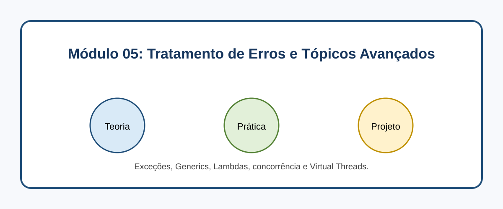

# Módulo 05: Tratamento de Erros e Tópicos Avançados

## Objetivos de Aprendizagem

Ao concluir este conteúdo, você deverá ser capaz de explicar os conceitos apresentados, executar os exemplos, reconhecer seus casos de uso e aplicar o conhecimento em uma solução pequena e verificável.

## Sumário

- [Introdução](#introducao)
- [Imagem conceitual](#imagem-conceitual)
- [Aulas](#aulas)
- [Referências](#referencias)

## Introdução

Exceções, Generics, Lambdas, concorrência e Virtual Threads. Este módulo combina microlearning, prática deliberada e um projeto incremental.

## Imagem conceitual

## Aulas

- [Aula 5.1: Exceções: Lidando com o Inesperado](modulo_05/aula_5_1_excecoes.md)
- [Aula 5.2: Generics: Código Flexível e Seguro em Tipos ](modulo_05/aula_5_2_generics.md)
- [Aula 5.3: Expressões Lambda: Programação Funcional no Java](modulo_05/aula_5_3_lambdas.md)
- [Aula 5.4: Concorrência e Virtual Threads: Desempenho e Escalabilidade](modulo_05/aula_5_4_concorrencia_virtual_threads.md)

## Referências

[1] Oracle. Virtual Threads. Disponível em: [https://docs.oracle.com/en/java/javase/21/core/virtual-threads.html](https://docs.oracle.com/en/java/javase/21/core/virtual-threads.html)
[2] Oracle. Exceptions Tutorial. Disponível em: [https://docs.oracle.com/javase/tutorial/essential/exceptions/](https://docs.oracle.com/javase/tutorial/essential/exceptions/)

---

[Voltar aos Links Rápidos](../README.md#links-rapidos)
