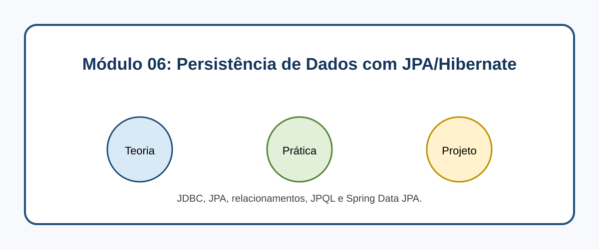

# Módulo 06: Persistência de Dados com JPA/Hibernate

## Objetivos de Aprendizagem

Ao concluir este conteúdo, você deverá ser capaz de explicar os conceitos apresentados, executar os exemplos, reconhecer seus casos de uso e aplicar o conhecimento em uma solução pequena e verificável.

## Sumário

- [Introdução](#introducao)
- [Imagem conceitual](#imagem-conceitual)
- [Aulas](#aulas)
- [Referências](#referencias)

## Introdução

JDBC, JPA, relacionamentos, JPQL e Spring Data JPA. Este módulo combina microlearning, prática deliberada e um projeto incremental.

## Imagem conceitual

## Aulas

- [Aula 6.1: Introdução à Persistência de Dados e JDBC](modulo_06/aula_6_1_introducao_persistencia.md)
- [Aula 6.2: JPA Fundamentals: Entidades, EntityManager e Ciclo de Vida](modulo_06/aula_6_2_jpa_fundamentals.md)
- [Aula 6.3: Relacionamentos entre Entidades (OneToOne, OneToMany, ManyToOne, ManyToMany)](modulo_06/aula_6_3_relacionamentos_entidades.md)
- [Aula 6.4: JPQL (Java Persistence Query Language) e Consultas Nativas](modulo_06/aula_6_4_jpql_consultas.md)
- [Aula 6.5: Spring Data JPA - A Ponte para o Spring Boot](modulo_06/aula_6_5_spring_data_jpa.md)

## Referências

[1] Jakarta EE. Persistence 3.1. Disponível em: [https://jakarta.ee/specifications/persistence/3.1/](https://jakarta.ee/specifications/persistence/3.1/)
[2] Spring. Spring Data JPA Reference. Disponível em: [https://docs.spring.io/spring-data/jpa/reference/](https://docs.spring.io/spring-data/jpa/reference/)

---

[Voltar aos Links Rápidos](../README.md#links-rapidos)
