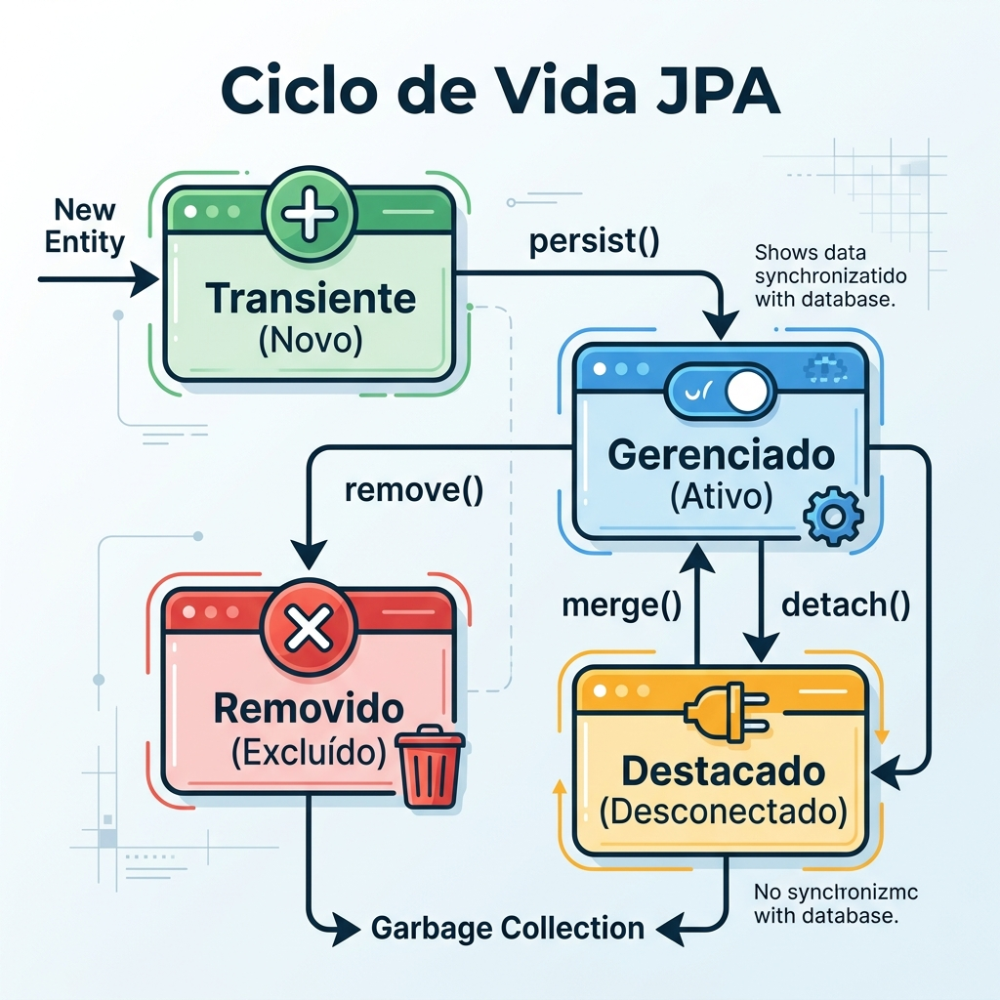

# Módulo 06: Persistência de Dados com JPA e Hibernate
> Desvende os segredos de salvar e recuperar dados em Java: do "baixo nível" do JDBC ao poder e simplicidade do Spring Data JPA.

## Sumário

- [Aula 6.1: Introdução à Persistência e JDBC](#aula-61-introdução-à-persistência-e-jdbc)
- [Aula 6.2: Fundamentos JPA e Hibernate](#aula-62-fundamentos-jpa-e-hibernate)
- [Aula 6.3: Relacionamentos entre Entidades](#aula-63-relacionamentos-entre-entidades)
- [Aula 6.4: JPQL, Criteria API e Consultas Complexas](#aula-64-jpql-criteria-api-e-consultas-complexas)
- [Aula 6.5: A Mágica do Spring Data JPA](#aula-65-a-mágica-do-spring-data-jpa)
- [Exercícios de fixação do módulo](#exercícios-de-fixação-do-módulo)
- [Referências](#referências)

## O que você vai aprender neste módulo

Neste módulo mergulharemos no ecossistema de persistência do Java. Você vai aprender:
- A base de como o Java conversa com bancos de dados usando o **JDBC**.
- O que é o **JPA (Java Persistence API)** e como o **Hibernate** implementa essa especificação.
- Mapeamento objeto-relacional: de classes Java simples para tabelas complexas no banco de dados.
- Relacionamentos (1:1, 1:N, N:N), controle transacional e ciclo de vida de entidades.
- Como realizar buscas flexíveis e poderosas usando **JPQL** e a **Criteria API**.
- E, finalmente, o estado da arte com **Spring Data JPA**, reduzindo o boilerplate a quase zero.


---

## Aula 6.1: Introdução à Persistência e JDBC

Imagine que você criou um sistema incrível de gerenciamento de tarefas. Você passa horas cadastrando tarefas, mas quando a energia cai (ou você reinicia a aplicação), puf! Tudo desaparece. O problema de manter os dados na memória (usando `List`, `Map` ou variáveis) é que a memória RAM é **volátil**. Para que nossos dados sobrevivam ao fim do processo, precisamos **persisti-los** em algum lugar durável — como um banco de dados relacional (MySQL, PostgreSQL, Oracle, etc.).

### O JDBC: A camada mais baixa

No mundo Java, a forma padrão de se comunicar com bancos de dados relacionais é o **JDBC (Java Database Connectivity)**. Ele é uma API de baixo nível que envia comandos SQL diretamente para o banco e recebe os resultados de volta. 

Os protagonistas do JDBC são:
- **`DriverManager`**: A fábrica que sabe como encontrar o driver do banco e criar uma conexão.
- **`Connection`**: Representa a sessão ativa com o banco.
- **`PreparedStatement`**: Onde você escreve a instrução SQL parametrizada de forma segura.
- **`ResultSet`**: A tabela de resultados devolvida após uma consulta (`SELECT`).

### Exemplo Completo: CRUD básico com JDBC e H2

Vamos ver como funciona o "feijão com arroz" do JDBC. Para este exemplo, usaremos o banco em memória **H2** para facilitar (não precisa instalar nada).

```java
import java.sql.Connection;
import java.sql.DriverManager;
import java.sql.PreparedStatement;
import java.sql.ResultSet;
import java.sql.SQLException;
import java.sql.Statement;

public class JdbcExemplo {
    
    // URL de conexão para o banco H2 em memória
    private static final String DB_URL = "jdbc:h2:mem:testdb;DB_CLOSE_DELAY=-1";
    private static final String USER = "sa";
    private static final String PASS = "";

    public static void main(String[] args) {
        
        // Dica: Usamos o try-with-resources do Java para garantir 
        // que a Connection seja fechada no final, evitando vazamento de recursos!
        try (Connection conn = DriverManager.getConnection(DB_URL, USER, PASS)) {
            System.out.println("Conectado ao banco de dados com sucesso!");

            // 1. Criar a tabela
            String createTableSql = "CREATE TABLE IF NOT EXISTS usuarios (" +
                                    "id INT AUTO_INCREMENT PRIMARY KEY, " +
                                    "nome VARCHAR(100), " +
                                    "email VARCHAR(100))";
            try (Statement stmt = conn.createStatement()) {
                stmt.execute(createTableSql);
            }

            // 2. Inserir dados (Create)
            String insertSql = "INSERT INTO usuarios (nome, email) VALUES (?, ?)";
            try (PreparedStatement pstmt = conn.prepareStatement(insertSql)) {
                pstmt.setString(1, "Maria Silva"); // Substitui o primeiro '?'
                pstmt.setString(2, "maria@email.com"); // Substitui o segundo '?'
                int rowsAffected = pstmt.executeUpdate();
                System.out.println("Inseridos " + rowsAffected + " registros.");
            }

            // 3. Buscar dados (Read)
            String selectSql = "SELECT id, nome, email FROM usuarios";
            try (Statement stmt = conn.createStatement();
                 ResultSet rs = stmt.executeQuery(selectSql)) {
                
                System.out.println("--- Lista de Usuários ---");
                while (rs.next()) { // Move o cursor para a próxima linha
                    int id = rs.getInt("id");
                    String nome = rs.getString("nome");
                    String email = rs.getString("email");
                    System.out.printf("ID: %d | Nome: %s | Email: %s%n", id, nome, email);
                }
            }

        } catch (SQLException e) {
            System.err.println("Erro ao conectar ou executar no banco de dados.");
            e.printStackTrace();
        }
    }
}
// Saída esperada:
// Conectado ao banco de dados com sucesso!
// Inseridos 1 registros.
// --- Lista de Usuários ---
// ID: 1 | Nome: Maria Silva | Email: maria@email.com
```

### Os problemas do JDBC Puro

Se o JDBC funciona, por que não o usamos em todos os lugares?
1. **Verbosidade**: Observe a quantidade de código (abrir conexão, preparar SQL, lidar com ResultSet, tratar `SQLException`) apenas para salvar e ler um dado simples.
2. **Mapeamento manual**: Você recebe dados do banco como colunas e precisa convertê-los "na unha" para objetos Java (o famoso "Result Set mapping").
3. **Falta de portabilidade**: Se você usar funções específicas de um banco (como a formatação de data do Oracle) e precisar migrar para o PostgreSQL, terá que reescrever suas queries.

**Atencao (SQL Injection):** Nunca concatene strings para formar instruções SQL! Use sempre o `PreparedStatement`. Se você concatenar `SELECT * FROM usuarios WHERE nome = '` + nome + `'`, alguém pode passar `' OR 1=1 --` e acessar dados que não deveria.

### O Surgimento dos ORMs (Object-Relational Mapping)

Para resolver o incômodo de converter manualmente registros de banco de dados em Objetos Java (e vice-versa), nasceram os **ORMs**. A ideia é fantástica: você trabalha com classes e objetos normais em Java, e a ferramenta (o ORM) se encarrega de gerar o SQL, enviar para o banco e transformar os resultados de volta em objetos. 

O ORM mais famoso do mundo Java é o **Hibernate** [1]. E para padronizar como os ORMs devem funcionar no Java, a especificação **JPA** foi criada [3].

---

## Aula 6.2: Fundamentos JPA e Hibernate

Você já sabe que **JPA (Jakarta Persistence API, antigamente Java Persistence API)** é apenas uma **especificação** — um conjunto de regras e interfaces. O JPA por si só não faz nada. O **Hibernate** é a implementação "mão na massa" que obedece a essas regras. É como se a JPA fosse a planta de uma casa, e o Hibernate fossem os pedreiros que a constroem.

### Mapeando sua primeira Entidade

O conceito central da JPA é a **Entidade** (`Entity`). Uma entidade é uma classe Java simples (POJO) que representa uma tabela no banco de dados.

Vamos mapear a nossa classe de usuário:

```java
import jakarta.persistence.Entity;
import jakarta.persistence.Table;
import jakarta.persistence.Id;
import jakarta.persistence.GeneratedValue;
import jakarta.persistence.GenerationType;
import jakarta.persistence.Column;

@Entity // Marca a classe como uma entidade gerenciada pela JPA
@Table(name = "tb_usuarios") // (Opcional) Especifica o nome da tabela no banco
public class Usuario {

    @Id // Define qual campo será a chave primária (Primary Key)
    @GeneratedValue(strategy = GenerationType.IDENTITY) // O banco de dados vai gerar o ID automaticamente (auto-incremento)
    private Long id;

    @Column(nullable = false, length = 150) // Define que a coluna não pode ser nula e tem tamanho máx 150
    private String nome;

    @Column(unique = true) // Garante que o email será único na tabela
    private String email;

    // A JPA EXIGE um construtor vazio (padrão)
    public Usuario() {}

    public Usuario(String nome, String email) {
        this.nome = nome;
        this.email = email;
    }

    // Getters e Setters ocultos por brevidade...
}
```

### O Gerente de Tudo: `EntityManager`


*Figura 1: Diagrama de transição de estados no ciclo de vida de uma entidade JPA.*


O `EntityManager` é o "mordomo" da JPA. Ele é responsável por gerenciar o **Contexto de Persistência** — uma espécie de cache em memória onde ficam guardadas as entidades.

O Ciclo de vida de uma entidade tem 4 estados importantes:
1. **TRANSIENT (Transitória)**: Você acabou de instanciar (`new Usuario()`). A JPA não a conhece e não tem associação com o banco.
2. **MANAGED (Gerenciada)**: Você mandou persistir ou carregou do banco. O `EntityManager` está de olho nela. Qualquer mudança nos atributos (setters) será salva no banco quando houver o `commit` da transação.
3. **DETACHED (Desanexada)**: A entidade tem um ID, já esteve no banco, mas o `EntityManager` foi fechado ou limpo. Alterações nela não afetam mais o banco imediatamente.
4. **REMOVED (Removida)**: A entidade foi marcada para ser deletada no banco.

### CRUD com EntityManager (Sem Spring)

Se estivermos em um projeto Java puro (sem Spring), precisamos configurar um arquivo `META-INF/persistence.xml` para dizer qual banco usar. Com isso configurado, criaríamos o `EntityManager` assim:

```java
import jakarta.persistence.EntityManager;
import jakarta.persistence.EntityManagerFactory;
import jakarta.persistence.Persistence;

public class JpaExemplo {
    public static void main(String[] args) {
        
        // Inicializa a fábrica a partir do persistence.xml
        EntityManagerFactory emf = Persistence.createEntityManagerFactory("meu-persistence-unit");
        EntityManager em = emf.createEntityManager();

        try {
            em.getTransaction().begin(); // Inicia a transação

            // 1. CREATE (Persistir)
            Usuario novoUser = new Usuario("João Silva", "joao@email.com");
            em.persist(novoUser); // Entidade passa de Transient para Managed

            // 2. READ (Buscar)
            Usuario userEncontrado = em.find(Usuario.class, 1L);
            System.out.println("Usuário encontrado: " + userEncontrado.getNome());

            // 3. UPDATE (Atualizar)
            // Como userEncontrado está 'Managed', basta usar o setter. 
            // O Hibernate fará o UPDATE automático no commit! (Magia)
            userEncontrado.setNome("João da Silva Atualizado");

            // 4. DELETE (Remover)
            // em.remove(userEncontrado);

            em.getTransaction().commit(); // Confirma e envia as SQLs (INSERT, UPDATE, etc) pro banco
            System.out.println("Transação salva no banco!");

        } catch (Exception e) {
            em.getTransaction().rollback(); // Em caso de erro, desfaz tudo
            e.printStackTrace();
        } finally {
            em.close();
            emf.close();
        }
    }
}
```

**Boa Prática:** Em aplicações Spring Boot, você quase **nunca** precisará abrir e fechar o `EntityManager` ou `Transactions` manualmente. O Spring cuida dessa complexidade para você.

---

## Aula 6.3: Relacionamentos entre Entidades

Sistemas reais não são feitos de tabelas isoladas. Usuários têm Perfis, Autores escrevem Posts, Posts recebem Comentários. A JPA permite mapear esses relacionamentos perfeitamente.

### 1. Um-para-Um (`@OneToOne`)

Um usuário possui um perfil detalhado.
```java
@Entity
public class User {
    @Id @GeneratedValue(strategy = GenerationType.IDENTITY)
    private Long id;
    
    // O CascadeType.ALL significa: se eu salvar o User, salve o Profile junto. 
    // Se deletar o User, delete o Profile.
    @OneToOne(cascade = CascadeType.ALL, fetch = FetchType.LAZY)
    private UserProfile profile;
}
```

**Dica: EAGER vs LAZY**: 
- `FetchType.EAGER` (Ansioso): Quando a JPA buscar o `User`, ela imediatamente fará um JOIN para buscar o `UserProfile`.
- `FetchType.LAZY` (Preguiçoso): A JPA só fará o SELECT no `UserProfile` se (e somente se) você chamar `user.getProfile()`. **Sempre prefira LAZY** para economizar memória e tráfego com o banco de dados. (Em `@OneToOne` e `@ManyToOne`, o padrão da JPA é EAGER. Mude manualmente para LAZY!).

### 2. Um-para-Muitos e Muitos-para-Um (`@OneToMany` / `@ManyToOne`)

Um Post (Artigo) tem vários Comentários (Comments).

```java
@Entity
public class Comment {
    @Id @GeneratedValue(strategy = GenerationType.IDENTITY)
    private Long id;
    private String texto;

    @ManyToOne(fetch = FetchType.LAZY) // MUITOS comentários para UM post
    @JoinColumn(name = "post_id") // A coluna de chave estrangeira que ficará na tabela de comments
    private Post post;
}

@Entity
public class Post {
    @Id @GeneratedValue(strategy = GenerationType.IDENTITY)
    private Long id;
    private String titulo;

    // mappedBy indica que a relação já foi mapeada do outro lado, na propriedade "post" de Comment.
    // Isso diz à JPA: "O dono do relacionamento é o Comment".
    @OneToMany(mappedBy = "post", cascade = CascadeType.ALL)
    private List<Comment> comments = new ArrayList<>();
}
```

### 3. Muitos-para-Muitos (`@ManyToMany`)

Um Aluno (`Student`) cursa vários Cursos (`Course`), e um Curso tem vários Alunos.

```java
@Entity
public class Student {
    @Id @GeneratedValue(strategy = GenerationType.IDENTITY)
    private Long id;
    private String name;

    @ManyToMany
    @JoinTable(
        name = "student_course_enrollment", // Nome da tabela de junção N:N
        joinColumns = @JoinColumn(name = "student_id"),
        inverseJoinColumns = @JoinColumn(name = "course_id")
    )
    private Set<Course> courses = new HashSet<>();
}
```

### O Terrível Problema do N+1

Imagine que você quer listar todos os 100 Posts e seus respectivos Comentários.
O que o Hibernate faz, por padrão, se a relação for LAZY?
1. Ele faz **1** select para buscar os 100 posts: `SELECT * FROM Post`
2. Quando você itera nos posts para mostrar os comentários (`post.getComments()`), ele faz **100** selects extras, um para cada post: `SELECT * FROM Comment WHERE post_id = ?`.

Total: **101 selects**! Isso mata a performance da aplicação (Problema N+1).

**Como resolver?** Usando **JOIN FETCH** na consulta. Isso força a JPA a trazer os posts e os comentários no mesmo SQL (em um grande JOIN):
`SELECT p FROM Post p JOIN FETCH p.comments`

---

## Aula 6.4: JPQL, Criteria API e Consultas Complexas

Com JPA, nós não fazemos consultas nas **tabelas** do banco, fazemos consultas nas **Entidades (classes) Java**. Essa linguagem de consulta se chama **JPQL (Java Persistence Query Language)**.

### JPQL: Consultando Objetos

```java
// Repare que "Usuario" é o nome da CLASSE, não da tabela!
// "u" é o alias.
String jpql = "SELECT u FROM Usuario u WHERE u.nome LIKE :nomeBusca";

// Criando uma Query Tipada (TypedQuery)
TypedQuery<Usuario> query = em.createQuery(jpql, Usuario.class);
query.setParameter("nomeBusca", "%Silva%"); // Proteção contra SQL injection!

List<Usuario> usuariosSilvas = query.getResultList();
```

Você também pode definir **NamedQueries** no topo da classe entidade, para consultas reutilizáveis:
```java
@Entity
@NamedQuery(name = "Usuario.findByEmail", query = "SELECT u FROM Usuario u WHERE u.email = :email")
public class Usuario { ... }
```

### Criteria API: Consultas Dinâmicas (e Type-Safe)

A JPQL é uma string. Se você digitar uma coluna errada, o erro só estoura no momento da execução (Runtime). A **Criteria API** permite construir consultas usando métodos e objetos, evitando erros de digitação e facilitando construções complexas.

```java
import jakarta.persistence.criteria.*;

CriteriaBuilder cb = em.getCriteriaBuilder();
CriteriaQuery<Usuario> cq = cb.createQuery(Usuario.class);

// "FROM Usuario u"
Root<Usuario> root = cq.from(Usuario.class); 

// "WHERE u.idade > 18"
Predicate maiorDeIdade = cb.greaterThan(root.get("idade"), 18);
cq.select(root).where(maiorDeIdade);

List<Usuario> resultados = em.createQuery(cq).getResultList();
```
É mais verboso, mas extremamente seguro, ótimo para criar telas de filtros dinâmicos na sua aplicação.

### Paginação com JPA

O banco tem 1 milhão de registros. Você não vai trazer todos de uma vez.
```java
TypedQuery<Usuario> query = em.createQuery("SELECT u FROM Usuario u", Usuario.class);
query.setFirstResult(0);   // OFFSET: Pula os 0 primeiros (Começa do começo)
query.setMaxResults(10);   // LIMIT: Traz no máximo 10
List<Usuario> pagina1 = query.getResultList();
```

---

## Aula 6.5: A Mágica do Spring Data JPA

Tudo o que vimos até aqui foi usando as especificações da JPA pura. O **Spring Data JPA** [2] é uma camada criada pelo Spring para simplificar brutalmente o uso da JPA. Com ele, você literalmente **não precisa escrever implementações de DAO/Repositories**.

### `JpaRepository<T, ID>`: O que vem de graça

Basta criar uma interface, e o Spring fornece o CRUD completo em tempo de execução!

```java
import org.springframework.data.jpa.repository.JpaRepository;

// A interface recebe o tipo da Entidade (Usuario) e o tipo da Chave Primária (Long)
public interface UsuarioRepository extends JpaRepository<Usuario, Long> {
}
```
Com apenas isso, em um Service injetando o `UsuarioRepository`, você já tem:
- `repository.save(usuario)`
- `repository.findById(1L)`
- `repository.findAll()`
- `repository.deleteById(1L)`

### A Mágica dos Query Methods

O Spring Data é tão inteligente que ele deduz o que você quer apenas lendo o **nome do método** que você cria na interface!

```java
public interface UsuarioRepository extends JpaRepository<Usuario, Long> {
    
    // O Spring gera: SELECT u FROM Usuario u WHERE u.nome = ?
    List<Usuario> findByNome(String nome);
    
    // SELECT u FROM Usuario u WHERE u.idade > ?
    List<Usuario> findByIdadeGreaterThan(Integer idade);

    // SELECT u FROM Usuario u WHERE LOWER(u.nome) LIKE %?% AND u.ativo = true
    List<Usuario> findByNomeContainingIgnoreCaseAndAtivoTrue(String trechoNome);
}
```

### Anotação `@Query` para Controle Total

Quando o nome do método for ficar enorme e ilegível, ou você precisar de JOIN FETCH para resolver o N+1, você escreve sua própria JPQL com `@Query`:

```java
public interface PostRepository extends JpaRepository<Post, Long> {

    @Query("SELECT p FROM Post p JOIN FETCH p.comments WHERE p.autor.id = :autorId")
    List<Post> buscarPostsComComentarios(Long autorId);
    
    // Quer usar SQL nativo de verdade? Tudo bem:
    @Query(value = "SELECT * FROM tb_posts WHERE data_criacao > NOW()", nativeQuery = true)
    List<Post> buscarPostsRecentes();
}
```

### `@Transactional`

Lembra que antes tínhamos que abrir `em.getTransaction().begin()` e no final dar `.commit()`? O Spring cuida disso com uma única anotação:

```java
import org.springframework.stereotype.Service;
import org.springframework.transaction.annotation.Transactional;

@Service
public class TransferenciaService {

    @Transactional // Inicia transação. Se algo falhar (Exception), faz Rollback automático!
    public void transferirDinheiro(Conta origem, Conta destino, BigDecimal valor) {
        origem.sacar(valor);
        contaRepository.save(origem);
        
        // Se a aplicação estourar um erro aqui, o saque feito acima será revertido (rollback)!
        
        destino.depositar(valor);
        contaRepository.save(destino);
    }
}
```

---

## Exercícios de Fixação

**Exercício 6:** Quando você carrega um registro usando `em.find(Usuario.class, 1L)`, qual é o estado dessa entidade dentro do `EntityManager` e o que acontece se você alterar os dados dela na mesma transação?
a) TRANSIENT - A entidade não é conhecida, mudanças não são salvas.

b) DETACHED - A entidade é conhecida, mas precisa de `merge()` para salvar mudanças.

c) MANAGED - A entidade é gerenciada, e qualquer alteração (setter) fará um `UPDATE` automático no `commit`.

d) REMOVED - A entidade será apagada no próximo `commit`.

<details>
<summary>Ver Resposta</summary>

**Resposta:** c) MANAGED - A entidade é gerenciada, e qualquer alteração (setter) fará um `UPDATE` automático no `commit`.

**Explicação:** A entidade lida no banco de dados com `find` está no estado **MANAGED**. O `EntityManager` rastreia qualquer mudança. No momento do `commit` da transação, o Hibernate notará que a entidade está "suja" (dirty checking) e fará um `UPDATE` automaticamente.
</details>

**Exercício 6.1:** Qual o nome correto do método Spring Data JPA (query method) para buscar uma lista de `Livro` cujo `autor` seja igual ao passado por parâmetro e ordenado pelo campo `anoPublicacao` decrescente?
a) `getLivroByAutorOrderByAnoPublicacao()`

b) `findByAutorOrderByAnoPublicacaoDesc(String autor)`

c) `findLivroWhereAutorAndOrderByAnoPublicacaoDesc()`

d) `searchByAutorSortAnoPublicacaoDesc()`

<details>
<summary>Ver Resposta</summary>

**Resposta:** b) `findByAutorOrderByAnoPublicacaoDesc(String autor)`

**Explicação:** O prefixo `findBy` indica uma busca. `Autor` é o atributo filtrado. `OrderByAnoPublicacaoDesc` ordena pelo campo `anoPublicacao` de forma decrescente.
</details>

## Referências

[1] Red Hat. Hibernate ORM Documentation. Disponível em: [https://hibernate.org/orm/documentation/](https://hibernate.org/orm/documentation/)
[2] VMware. Spring Data JPA Reference. Disponível em: [https://docs.spring.io/spring-data/jpa/reference/](https://docs.spring.io/spring-data/jpa/reference/)
[3] Baeldung. JPA vs Hibernate. Disponível em: [https://www.baeldung.com/hibernate-vs-jpa](https://www.baeldung.com/hibernate-vs-jpa)
[4] Baeldung. O Problema N+1 na JPA. Disponível em: [https://www.baeldung.com/hibernate-n-plus-1-problem-solution](https://www.baeldung.com/hibernate-n-plus-1-problem-solution)
[5] Manning Publications. Java Persistence with Hibernate. Disponível em: [https://www.manning.com/books/java-persistence-with-hibernate-second-edition](https://www.manning.com/books/java-persistence-with-hibernate-second-edition)
[6] Baeldung. Anotações Core da JPA Explicadas. Disponível em: [https://www.baeldung.com/jpa-core-annotations](https://www.baeldung.com/jpa-core-annotations)

---

[Voltar aos Links Rápidos](../README.md#links-rapidos) | [Próximo módulo: Módulo 07 — Ecossistema Spring Boot 3](./modulo_07_ecossistema_spring_boot_3.md)


