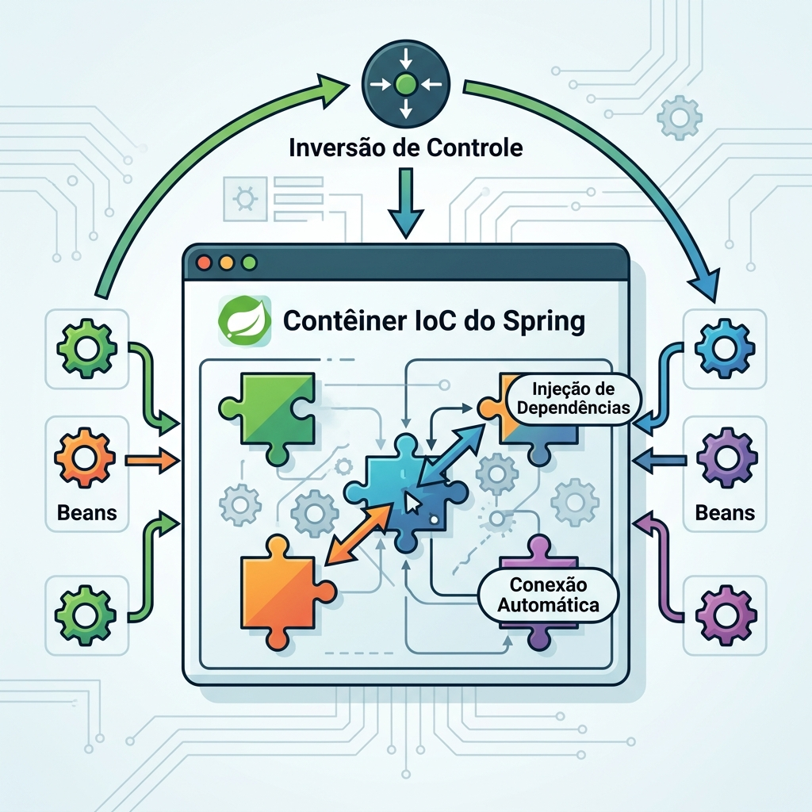

# Módulo 07: Ecossistema Spring Boot 3
> O Spring Boot revolucionou a forma como criamos aplicações Java. Aprenda a sair do zero absoluto até uma API RESTful robusta, com injeção de dependências e tratamento global de erros em minutos!

## Sumário

- [Aula 7.1: A Revolução do Spring Boot](#aula-71-a-revolução-do-spring-boot)
- [Aula 7.2: Injeção de Dependência e IoC](#aula-72-injeção-de-dependência-e-ioc)
- [Aula 7.3: Construindo APIs RESTful com Spring MVC](#aula-73-construindo-apis-restful-com-spring-mvc)
- [Aula 7.4: Validação de Dados e Tratamento de Erros](#aula-74-validação-de-dados-e-tratamento-de-erros)
- [Exercícios de fixação do módulo](#exercícios-de-fixação-do-módulo)
- [Referências](#referências)

## O que você vai aprender neste módulo

Neste módulo, uniremos os blocos fundamentais do back-end moderno. Você aprenderá a:
- Como o **Spring Boot** facilita a configuração de projetos com `autoconfiguração` e `starters`.
- Dominar o conceito de **Inversão de Controle (IoC)** e **Injeção de Dependência (DI)**.
- Criar **APIs RESTful** padronizadas e profissionais utilizando o ecossistema Spring MVC.
- Blindar suas APIs através de **Validação de Dados** com Jakarta Validation.
- Capturar e padronizar falhas usando um **Tratamento Global de Erros** (`@ControllerAdvice`).

Ao final do módulo, você entenderá como conectar Controladores, Serviços, injeções e validações em um fluxo limpo e coeso.


---

## Aula 7.1: A Revolução do Spring Boot

Antes do Spring Boot, configurar um projeto Spring era uma verdadeira "dor de cabeça". Eram necessários extensos arquivos XML, configurações complexas de bibliotecas e servidores de aplicação externos (como Tomcat) configurados à mão.

O **Spring Boot** [1] é um framework (construído sobre o Spring "puro") que adota a filosofia de "Convenção sobre Configuração". 

Seus 3 pilares principais são:
1. **Autoconfiguração**: O Spring Boot examina as bibliotecas do seu projeto e "adivinha" e configura automaticamente o que você precisa. Se você adiciona o JPA, ele tenta criar as transações e o EntityManager sozinho!
2. **Starter Dependencies**: Grupos prontos de dependências. Em vez de adicionar dezenas de JARs soltos, você inclui apenas `spring-boot-starter-web` e ele puxa Spring MVC, JSON Mapping, Tomcat embutido e tudo o que precisa.
3. **Fat JARs**: A sua aplicação toda (junto com o servidor Web embutido) é empacotada em um único arquivo `.jar` executável. `java -jar meu-app.jar` e a API está rodando.

### A Estrutura de um projeto e a Classe Principal

Criando o projeto via Spring Initializr [2], baixamos um esqueleto. A classe principal se parece com isto:

```java
package com.meuprojeto;

import org.springframework.boot.SpringApplication;
import org.springframework.boot.autoconfigure.SpringBootApplication;

// Esta pequena anotação faz TODA a mágica:
// 1. Marca como classe de configuração.
// 2. Habilita a Autoconfiguração do Boot.
// 3. Pede para escanear componentes (Classes com @Service, @RestController, etc) deste pacote pra baixo.
@SpringBootApplication
public class MinhaApiApplication {

    public static void main(String[] args) {
        // Inicializa o container e o servidor embarcado
        SpringApplication.run(MinhaApiApplication.class, args);
    }
}
```

### Configurações com `application.yml` e Perfis (Profiles)

O Spring Boot permite externalizar as configurações para que você possa usar o mesmo código em diferentes ambientes (Desenvolvimento, Teste, Produção). O formato mais popular e legível hoje é o **YAML (`application.yml`)**.

Veja um exemplo de como configurar o banco de dados (Datasource) e o pool de conexões HikariCP, dividindo as configurações por perfis de execução:

```yaml
# application.yml
spring:
  application:
    name: minha-api
  profiles:
    active: dev # Define qual perfil está ativo por padrão

# Configurações globais (valem para todos os perfis, a menos que sejam sobrescritas)
server:
  port: 8080

---
# Perfil de Desenvolvimento (Ativado quando spring.profiles.active=dev)
spring:
  config:
    activate:
      on-profile: dev
  datasource:
    url: jdbc:h2:mem:meubancodev
    username: sa
    password: 
    driver-class-name: org.h2.Driver
  jpa:
    hibernate:
      ddl-auto: update # Atualiza o esquema do banco automaticamente
    show-sql: true # Mostra as queries no console

---
# Perfil de Produção (Ativado quando spring.profiles.active=prod)
spring:
  config:
    activate:
      on-profile: prod
  datasource:
    url: jdbc:postgresql://db-producao:5432/meubancoprod
    username: myuser
    password: mypassword
    driver-class-name: org.postgresql.Driver
    hikari: # Configuração do Pool de Conexões Hikari (padrão do Spring Boot)
      maximum-pool-size: 20
      minimum-idle: 5
      idle-timeout: 30000
      pool-name: MeuHikariPool
  jpa:
    hibernate:
      ddl-auto: validate # Em produção, nunca deixamos o Hibernate alterar tabelas!
    show-sql: false
```

### `@ConfigurationProperties`: Configurações Type-Safe

Em vez de injetar valores de configuração soltos usando `@Value("${minha.config}")`, o Spring Boot permite mapear blocos do YAML diretamente para classes Java (Records ou POJOs). Isso traz segurança de tipos (Type-safety) e autocompletar na sua IDE!

```yaml
# No application.yml:
app:
  integracoes:
    api-pagamento-url: "https://api.pagamentos.com/v1"
    timeout-segundos: 30
```

```java
import org.springframework.boot.context.properties.ConfigurationProperties;

// O Spring lê os valores prefixados com "app.integracoes" e preenche os campos do record!
@ConfigurationProperties(prefix = "app.integracoes")
public record IntegracoesProperties(String apiPagamentoUrl, int timeoutSegundos) {
}

// Para habilitar isso, na classe principal coloque:
// @EnableConfigurationProperties(IntegracoesProperties.class)
```

---

## Aula 7.2: Injeção de Dependência e IoC


*Figura 1: Representação visual do Contêiner IoC do Spring gerenciando Beans.*


O framework Spring tem em seu coração um **Container IoC (Inversion of Control)**. 
Em código Java puro antigo, nós mesmos éramos responsáveis por instanciar classes usando o temido `new` e gerenciar quem usava quem. 
```java
// O JEITO ANTIGO (E ACOPLADO)
public class PedidoService {
    private EmailService emailService;
    
    public PedidoService() {
        // Forte acoplamento! A classe Pedido cria a própria dependência.
        this.emailService = new EmailService(); 
    }
}
```

O **IoC (Inversão de Controle)** dita que nós entregamos esse trabalho para o framework. O Spring criará os objetos (chamados de **Beans** dentro do ecossistema) e os entregará prontos para quem precisa deles. Isso é a **Injeção de Dependência (DI)**.

### Como funciona no Spring?

Para transformar uma classe em um Bean gerenciado, usamos anotações (Estereótipos):
- `@Component`: Genérica.
- `@Service`: Para regras de negócio.
- `@Repository`: Para camadas de acesso ao banco (DAO/JPA).
- `@Controller` / `@RestController`: Para expor URLs da API.

```java
import org.springframework.stereotype.Service;

@Service // Agora o Spring sabe que gerencia esta classe
public class EmailService {
    public void enviar(String mensagem) {
        System.out.println("Enviando... " + mensagem);
    }
}
```

### Injetando Dependências: Constructor vs Field Injection

A injeção pode ocorrer de algumas maneiras, mas uma delas deve ser evitada a todo custo!

**O Jeito Ruim (Field Injection):**
Usar a anotação `@Autowired` diretamente no campo é a forma mais fácil de escrever, mas esconde problemas graves.
```java
@Service
public class PedidoService {
    
    @Autowired // RUIM: Injeção direta no atributo (Field Injection)
    private EmailService emailService;
    
    // ...
}
```
Por que é ruim? 
1. **Quebra a Testabilidade:** Você não consegue criar uma instância de `PedidoService` em um teste de unidade usando um simples `new PedidoService()` passando um "falso" EmailService (Mock), pois o campo é privado e o Spring não estará rodando no teste de unidade simples para injetar por reflexão.
2. **Mutabilidade:** O campo não pode ser marcado como `final`.
3. **Esconde complexidade:** Fica muito fácil adicionar 15 campos `@Autowired` na classe sem perceber que ela violou o Princípio da Responsabilidade Única.

**O Jeito Certo (Constructor Injection):**
A forma recomendada é solicitar a dependência via construtor. A partir de versões recentes, se a classe tiver apenas um construtor, o `@Autowired` fica implícito (você nem precisa escrevê-lo).

```java
@Service
public class PedidoService {
    
    // BOM: O campo pode ser 'final' garantindo imutabilidade
    private final EmailService emailService;

    // O Spring automaticamente entende que precisa passar o EmailService aqui!
    public PedidoService(EmailService emailService) {
        this.emailService = emailService;
    }

    public void confirmarPedido(String id) {
        System.out.println("Processando...");
        emailService.enviar("Seu pedido " + id + " foi aprovado!");
    }
}
```

**Dica: Vantagem de Testabilidade:** Agora, no seu teste de unidade, você simplesmente faz: `PedidoService service = new PedidoService(meuMockEmailService);`!

### Lógica de Desempate: `@Primary` e `@Qualifier`

E se tivermos duas classes implementando a mesma interface? Qual delas o Spring injetará?

```java
public interface PagamentoService { void pagar(); }

@Service
public class PagamentoCartao implements PagamentoService { ... }

@Service
public class PagamentoPix implements PagamentoService { ... }
```

Se o `PedidoService` pedir um `PagamentoService`, o Spring vai dar um erro: *NoUniqueBeanDefinitionException*, pois ele não sabe qual escolher.

**Solução 1: `@Primary`**
Colocamos `@Primary` na implementação padrão. O Spring a escolherá em caso de empate.
```java
@Service
@Primary
public class PagamentoPix implements PagamentoService { ... }
```

**Solução 2: `@Qualifier`**
Se precisamos de uma específica para um caso, indicamos explicitamente pelo nome da classe (com a primeira letra minúscula).
```java
@Service
public class PedidoInternacionalService {
    private final PagamentoService pagamento;

    // Forçamos a injeção do PagamentoCartao especificamente aqui
    public PedidoInternacionalService(@Qualifier("pagamentoCartao") PagamentoService pagamento) {
        this.pagamento = pagamento;
    }
}
```

---

## Aula 7.3: Construindo APIs RESTful com Spring MVC

O pacote Web do Spring permite criar rotas para que aplicativos e navegadores conversem com nossa aplicação. Usamos o princípio **REST (Representational State Transfer)**, casando verbos do HTTP com ações:

- `GET` (Consultar)
- `POST` (Criar)
- `PUT` (Atualizar Tudo)
- `PATCH` (Atualizar Parcial)
- `DELETE` (Remover)

```java
import org.springframework.http.HttpStatus;
import org.springframework.http.ResponseEntity;
import org.springframework.data.domain.Page;
import org.springframework.data.domain.Pageable;
import org.springframework.web.bind.annotation.*;

@RestController // Indica que é uma API (as respostas serão enviadas direto para o corpo no formato JSON)
@RequestMapping("/api/produtos") // Prefixo de rotas
public class ProdutoController {

    private final ProdutoService service;

    public ProdutoController(ProdutoService service) {
        this.service = service; // Injeção de dependência!
    }

    // GET /api/produtos/123
    @GetMapping("/{id}")
    public ResponseEntity<ProdutoDto> buscar(@PathVariable Long id) {
        ProdutoDto produto = service.buscarPorId(id);
        
        if (produto == null) {
            // Retorna 404 Not Found se o recurso não existir
            return ResponseEntity.notFound().build(); 
        }
        // Retorna status 200 OK + O JSON do produto
        return ResponseEntity.ok(produto);
    }

    // GET /api/produtos?nome=Notebook&page=0&size=10
    // Usamos @RequestParam para filtros e Pageable para paginação automática!
    @GetMapping
    public ResponseEntity<Page<ProdutoDto>> listar(
            @RequestParam(required = false) String nome,
            Pageable pageable) {
        
        Page<ProdutoDto> pagina = service.buscarTodos(nome, pageable);
        return ResponseEntity.ok(pagina);
    }

    // POST /api/produtos
    @PostMapping
    public ResponseEntity<ProdutoDto> criar(@RequestBody ProdutoDto novo) {
        ProdutoDto salvo = service.salvar(novo);
        
        // Retorna 201 Created (quando recém-criamos um recurso na base)
        return ResponseEntity.status(HttpStatus.CREATED).body(salvo);
    }

    // PATCH /api/produtos/123/preco
    // Usado para atualizar PARCIALMENTE um recurso
    @PatchMapping("/{id}/preco")
    public ResponseEntity<Void> atualizarPreco(@PathVariable Long id, @RequestBody PrecoUpdateDto precoDto) {
        service.atualizarPreco(id, precoDto.novoPreco());
        
        // Retorna 204 No Content (sucesso, mas sem corpo de resposta)
        return ResponseEntity.noContent().build();
    }
}

// Exemplo completo de DTO usando Record (Java 14+)
public record ProdutoDto(
    Long id,
    String nome,
    String descricao,
    java.math.BigDecimal preco,
    boolean ativo
) {}

public record PrecoUpdateDto(java.math.BigDecimal novoPreco) {}
```

Veja como é claro: conectamos a anotação da rota, recebemos dados com o `@RequestBody` (onde o JSON de entrada é convertido para objeto) e usamos o `ResponseEntity` para formatar a saída com o Status Code HTTP adequado.

---

## Aula 7.4: Validação de Dados e Tratamento de Erros

Em uma API, nunca confie no usuário! Um nome vazio, um email inválido ou um preço negativo não podem chegar até o seu banco de dados.

### 1. Validando DTOs

O Spring Boot se integra com o Jakarta Bean Validation. Podemos decorar nossos DTOs (`Data Transfer Objects`) com anotações de validações.

**Tabela com as principais Anotações de Validação:**

| Anotação | Para que serve? | Exemplo de uso |
| :--- | :--- | :--- |
| `@NotNull` | O campo não pode ser null (mas pode ser vazio). | `Integer idade` |
| `@NotBlank` | O campo (String) não pode ser nulo, vazio, nem conter só espaços. | `String nome` |
| `@Size(min, max)` | O tamanho/comprimento deve estar no intervalo. | `String senha` |
| `@Email` | Deve seguir o padrão de um endereço de email válido. | `String email` |
| `@Pattern(regexp)` | Deve bater com a Expressão Regular informada. | `String cpf` |
| `@Positive` / `@PositiveOrZero` | O número deve ser maior (ou maior/igual) a zero. | `BigDecimal preco` |
| `@Future` / `@Past` | A data deve estar no futuro ou no passado. | `LocalDate validade` |

Exemplo de uso:

```java
import jakarta.validation.constraints.NotBlank;
import jakarta.validation.constraints.Positive;
import jakarta.validation.constraints.Email;

// Record: Estrutura imutável em Java, excelente para DTOs
public record UsuarioCadastroDto(
    
    @NotBlank(message = "O nome não pode ser vazio")
    String nome,

    @NotBlank(message = "O email é obrigatório")
    @Email(message = "Formato de email inválido")
    String email,

    @Positive(message = "Idade deve ser maior que zero")
    Integer idade
) {}
```

Para avisar ao Controller que queremos barrar dados inválidos, adicionamos o `@Valid` junto do `@RequestBody`:

```java
@PostMapping
public ResponseEntity<UsuarioCadastroDto> cadastrar(@Valid @RequestBody UsuarioCadastroDto dto) {
    // Se dto for inválido, o fluxo NUNCA CHEGA AQUI. 
    // O Spring arremessa uma Exception!
    return ResponseEntity.status(201).body(service.salvar(dto));
}
```

### 2. O Tratamento Global (`@ControllerAdvice` e `ProblemDetail`)

Se a validação falhar, o Spring, por padrão, exibe erros com muitos detalhes internos que não queremos expor para clientes finais da nossa API.
Para formatar nossos próprios JSON de erros e capturá-los para toda a aplicação de uma só vez, usamos um componente chamado `@RestControllerAdvice` [3]. 

O Spring Boot 3 introduziu suporte nativo à **RFC 9457**, que padroniza o formato de resposta de erros HTTP em APIs usando a classe `ProblemDetail`.

```java
import org.springframework.http.HttpStatus;
import org.springframework.http.ProblemDetail;
import org.springframework.web.bind.MethodArgumentNotValidException;
import org.springframework.web.bind.annotation.ExceptionHandler;
import org.springframework.web.bind.annotation.RestControllerAdvice;
import java.net.URI;
import java.util.stream.Collectors;

// Um "Escudo" que intercepta exceções nos controllers
@RestControllerAdvice 
public class TratadorErrosGlobal {

    // Avisa que este método trata as exceções geradas pelo @Valid
    @ExceptionHandler(MethodArgumentNotValidException.class)
    public ProblemDetail lidarComValidacao(MethodArgumentNotValidException ex) {
        
        // Formata os erros em uma string descritiva
        String errosFormatados = ex.getBindingResult().getFieldErrors().stream()
            .map(erro -> erro.getField() + ": " + erro.getDefaultMessage())
            .collect(Collectors.joining(", "));

        // Cria o retorno padronizado RFC 9457
        ProblemDetail problem = ProblemDetail.forStatusAndDetail(HttpStatus.BAD_REQUEST, "A requisição possui campos inválidos.");
        problem.setTitle("Erro de Validação");
        problem.setType(URI.create("https://minhaapi.com/erros/validacao"));
        problem.setProperty("campos_invalidos", errosFormatados);

        return problem;
    }
}
```

O legal dessa abordagem (onde Injeção de Dependências + Controllers Rest + Validations se unem) é que o código da sua regra de negócios (o seu Service) fica **totalmente puro**, livre de ifs de validação básicos e livre de lida com conversão de HTTP!

---

## Exercícios de Fixação

**Exercício 7:** Sobre a injeção de dependências no Spring, por que o Field Injection (`@Autowired` em atributos privados) não é recomendado?
a) Porque diminui a segurança, expondo variáveis.

b) Porque os objetos são instanciados muitas vezes.

c) Porque quebra a testabilidade unitária e esconde a complexidade da classe.

d) Porque exige mais memória do container.

<details>
<summary>Ver Resposta</summary>

**Resposta:** c) Porque quebra a testabilidade unitária e esconde a complexidade da classe.

**Explicação:** O Field Injection dificulta os testes de unidade, pois não há um método ou construtor exposto para passar a dependência manualmente. Além disso, oculta quando uma classe recebe dependências demais.
</details>

**Exercício 7.1:** Qual anotação usamos em uma classe para capturar e tratar exceções de forma global para todos os controllers da API?
a) `@ExceptionHandler`

b) `@RestControllerAdvice`

c) `@ControllerAdviceGlobal`

d) `@GlobalError`

<details>
<summary>Ver Resposta</summary>

**Resposta:** b) `@RestControllerAdvice`

**Explicação:** `@RestControllerAdvice` (ou `@ControllerAdvice`) age como um interceptador global de exceções na camada web.
</details>

## Referências

[1] VMware. Spring Boot Documentation. Disponível em: [https://docs.spring.io/spring-boot/docs/current/reference/htmlsingle/](https://docs.spring.io/spring-boot/docs/current/reference/htmlsingle/)
[2] VMware. Spring Initializr. Disponível em: [https://start.spring.io](https://start.spring.io)
[3] Baeldung. Spring @ControllerAdvice. Disponível em: [https://www.baeldung.com/exception-handling-for-rest-with-spring](https://www.baeldung.com/exception-handling-for-rest-with-spring)

---

[Voltar aos Links Rápidos](../README.md#links-rapidos) | [Próximo módulo: Módulo 08 — Arquitetura Moderna e Cloud Native](./modulo_08_arquitetura_moderna_e_cloud_native.md)


