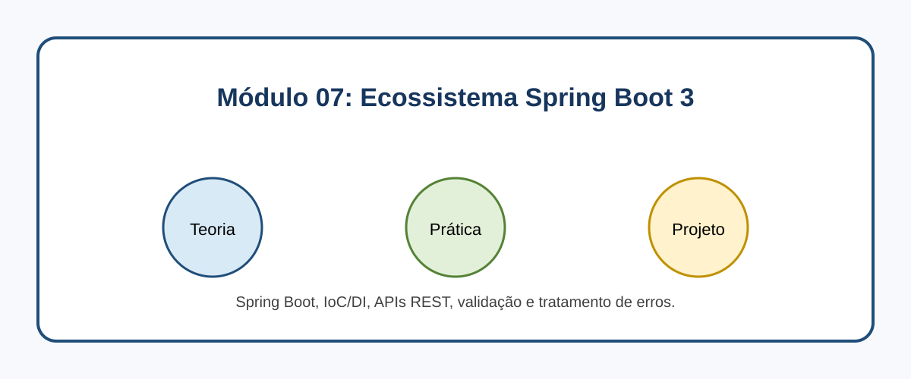

# Módulo 07: Ecossistema Spring Boot 3

## Objetivos de Aprendizagem

Ao concluir este conteúdo, você deverá ser capaz de explicar os conceitos apresentados, executar os exemplos, reconhecer seus casos de uso e aplicar o conhecimento em uma solução pequena e verificável.

## Sumário

- [Introdução](#introducao)
- [Imagem conceitual](#imagem-conceitual)
- [Aulas](#aulas)
- [Referências](#referencias)

## Introdução

Spring Boot, IoC/DI, APIs REST, validação e tratamento de erros. Este módulo combina microlearning, prática deliberada e um projeto incremental.

## Imagem conceitual

## Aulas

- [Aula 7.1: Introdução ao Spring Boot](modulo_07/aula_7_1_introducao_spring_boot.md)
- [Aula 7.2: Injeção de Dependência e Inversão de Controle (IoC) ](modulo_07/aula_7_2_injecao_dependencia.md)
- [Aula 7.3: Construindo APIs RESTful com Spring MVC ](modulo_07/aula_7_3_api_rest.md)
- [Aula 7.4: Validação de Dados e Tratamento de Erros no Spring Boot ](modulo_07/aula_7_4_validacao_erros.md)

## Referências

[1] Spring. Spring Boot Reference. Disponível em: [https://docs.spring.io/spring-boot/docs/3.3.x/reference/html/](https://docs.spring.io/spring-boot/docs/3.3.x/reference/html/)
[2] Spring. Spring Framework Reference. Disponível em: [https://docs.spring.io/spring-framework/reference/](https://docs.spring.io/spring-framework/reference/)

---

[Voltar aos Links Rápidos](../README.md#links-rapidos)
