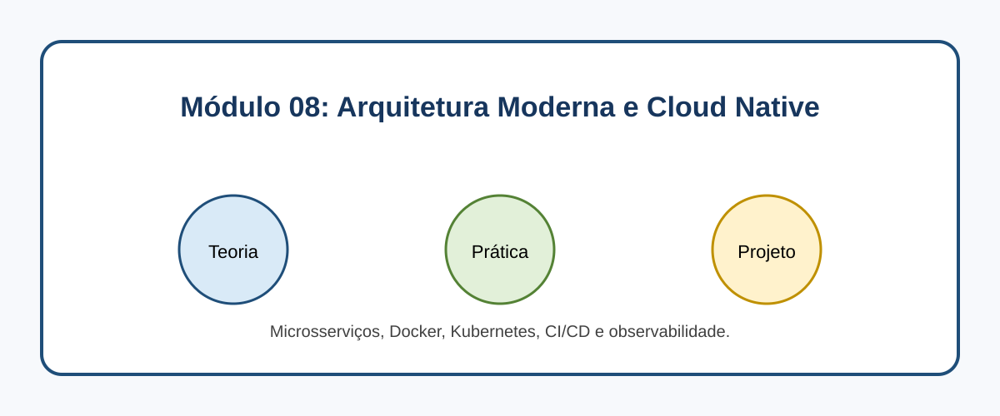

# Módulo 08: Arquitetura Moderna e Cloud Native

## Objetivos de Aprendizagem

Ao concluir este conteúdo, você deverá ser capaz de explicar os conceitos apresentados, executar os exemplos, reconhecer seus casos de uso e aplicar o conhecimento em uma solução pequena e verificável.

## Sumário

- [Introdução](#introducao)
- [Imagem conceitual](#imagem-conceitual)
- [Aulas](#aulas)
- [Referências](#referencias)

## Introdução

Microsserviços, Docker, Kubernetes, CI/CD e observabilidade. Este módulo combina microlearning, prática deliberada e um projeto incremental.

## Imagem conceitual

## Aulas

- [Aula 8.1: Introdução a Microsserviços: Quebrando Monólitos](modulo_08/introducao_a_microsservicos.md)
- [Aula 8.2: Docker: Conteinerizando Aplicações Java](modulo_08/docker_conteinerizando_aplicacoes_java.md)
- [Aula 8.3: Kubernetes Essencial: Orquestração de Contêineres](modulo_08/kubernetes_essencial.md)
- [Aula 8.4: CI/CD com GitHub Actions: Automatizando o Deploy](modulo_08/ci_cd_com_github_actions.md)
- [Aula 8.5: Monitoramento e Observabilidade em Microsserviços](modulo_08/monitoramento_e_observabilidade.md)

## Referências

[1] Kubernetes. Kubernetes Documentation. Disponível em: [https://kubernetes.io/docs/home/](https://kubernetes.io/docs/home/)
[2] Docker. Docker Documentation. Disponível em: [https://docs.docker.com/](https://docs.docker.com/)
[3] CNCF. Cloud Native Definition. Disponível em: [https://github.com/cncf/toc/blob/main/DEFINITION.md](https://github.com/cncf/toc/blob/main/DEFINITION.md)

---

[Voltar aos Links Rápidos](../README.md#links-rapidos)
