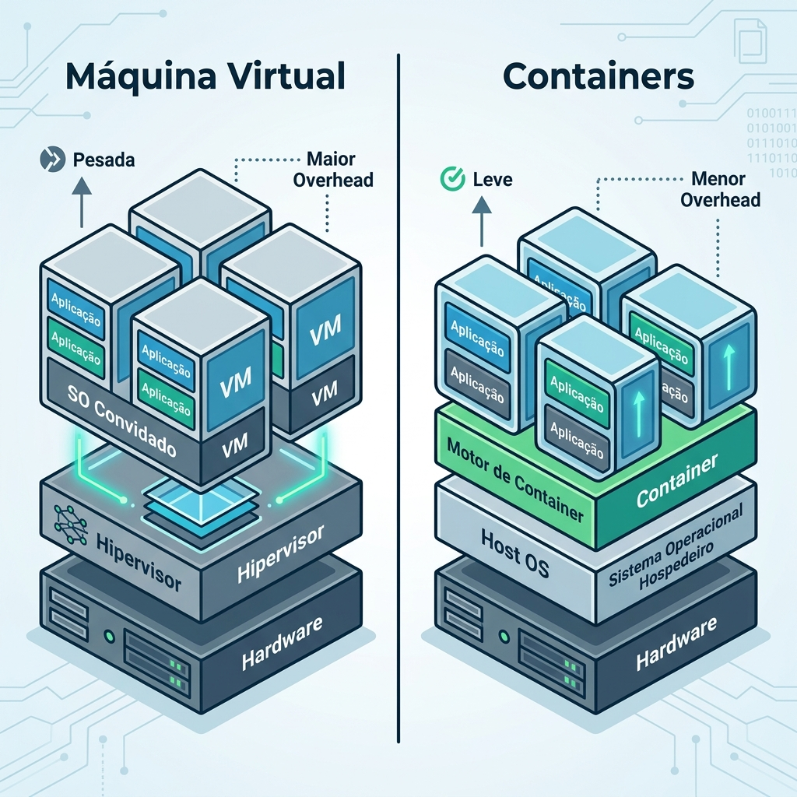

</Agent System Instructions>
# Módulo 08: Arquitetura Moderna e Cloud Native
> Bem-vindo à nuvem! Onde suas aplicações escalam, se recuperam sozinhas e voam alto.

## O que você vai aprender neste módulo

- Microsserviços e Monólitos: quando usar cada um
- Docker: conteinerizando sua aplicação Java
- Kubernetes Essencial: orquestração para o mundo real
- CI/CD com GitHub Actions: automação de deploy
- Monitoramento e Observabilidade: não voe às cegas

## Sumário

- [Aula 8.1: Microsserviços](#aula-81-microsserviços)
- [Aula 8.2: Docker e Conteinerização](#aula-82-docker)
- [Aula 8.3: Kubernetes Essencial](#aula-83-kubernetes-essencial)
- [Aula 8.4: CI/CD com GitHub Actions](#aula-84-cicd-com-github-actions)
- [Aula 8.5: Monitoramento e Observabilidade](#aula-85-monitoramento-e-observabilidade)
- [Exercícios de fixação do módulo](#exercícios-de-fixação-do-módulo)
- [Referências](#referências)

---

## Aula 8.1: Microsserviços

Ah, os microsserviços... a palavra mágica que todo recrutador adora! Mas será que eles são a bala de prata para todos os problemas de software? Spoiler: **Não!**

Nesta aula, vamos entender os trade-offs honestos entre monólitos e microsserviços, quando usar cada um e os padrões arquiteturais que vêm junto com aplicações distribuídas.

### Monólito vs Microsserviços: Trade-offs Honestos

O **Monólito** é uma aplicação onde todo o código, lógica de negócio, interfaces e acessos a banco de dados estão em um único projeto (um único `.jar` ou `.war`).
Os **Microsserviços** quebram essa aplicação em pequenos pedaços independentes que se comunicam através da rede.

**Vantagens do Monólito:**
- Simples de desenvolver, debugar e testar.
- Deploy é apenas um arquivo.
- A comunicação entre módulos é apenas uma chamada de método em memória (rápido!).
- Transações ACID no banco de dados são simples.

**Desvantagens do Monólito:**
- Quando cresce muito, o código fica um espaguete (se não houver disciplina).
- Subir a aplicação demora muito.
- Se uma parte quebra (ex: estouro de memória), a aplicação toda cai.
- Escalar significa duplicar tudo, mesmo se apenas uma funcionalidade estiver sob carga.

**Vantagens dos Microsserviços:**
- Cada serviço pode ser escalado independentemente.
- Times podem trabalhar e fazer deploy sem depender dos outros (autonomia).
- Isolamento de falhas: se o serviço de envio de email cair, a loja continua vendendo.
- Você pode usar tecnologias diferentes para serviços diferentes.

**Desvantagens dos Microsserviços:**
- Complexidade insana de infraestrutura e deployment.
- A comunicação pela rede é lenta e falha (latência e timeouts).
- Transações distribuídas são um pesadelo.
- "Seu monólito não virou microsserviços, virou um monólito distribuído".

Atencao: **Quando NÃO usar microsserviços?**
Se você tem uma equipe pequena, um domínio de negócio que ainda está sendo descoberto, ou poucos usuários, comece com um **Monólito Modularizado**. Só migre para microsserviços quando a dor do monólito for maior que a dor de gerenciar sistemas distribuídos.

### Bounded Context (DDD Básico)

Como dividir meu monólito? A melhor abordagem vem do Domain-Driven Design (DDD). O **Bounded Context** (Contexto Delimitado) define os limites de um modelo. 

Por exemplo, em um e-commerce, o conceito de "Produto" é visto de forma diferente:
- No Catálogo: Produto tem nome, descrição, imagens.
- No Estoque: Produto é só um ID, quantidade e localização no armazém.
- No Transporte: Produto é peso, dimensões e fragilidade.

Cada um desses contextos pode ser um microsserviço independente!

### Comunicação Síncrona vs Assíncrona

Quando separamos os serviços, eles precisam conversar. 

**Comunicação Síncrona:** O serviço A liga para o serviço B e espera na linha até ele responder.
- **REST (HTTP):** O padrão. Usando JSON. Simples e universal, mas lento.
- **gRPC:** Usa HTTP/2 e Protocol Buffers (binário). Muito mais rápido e eficiente, ótimo para comunicação interna entre microsserviços.

```java
// Exemplo de chamada REST síncrona usando RestClient no Spring Boot 3
@Service
public class CatalogoService {
    
    private final RestClient restClient;
    
    public CatalogoService(RestClient.Builder builder) {
        this.restClient = builder.baseUrl("http://estoque-service").build();
    }
    
    public EstoqueResponse verificarEstoque(Long produtoId) {
        // Chamada síncrona: se o estoque estiver fora do ar, isso falha!
        return restClient.get()
                .uri("/api/estoque/{id}", produtoId)
                .retrieve()
                .body(EstoqueResponse.class);
    }
}
```

**Comunicação Assíncrona:** O serviço A manda uma mensagem ("aconteceu isso") e vai fazer outra coisa. O serviço B recebe a mensagem quando puder.
- **Mensageria (RabbitMQ, Kafka, AWS SQS):** Serviço A publica um evento. Serviço B (e C, D...) escutam e reagem.

Dica: Prefira comunicação assíncrona sempre que possível para não criar um forte acoplamento entre os serviços.

### Padrões: API Gateway, Circuit Breaker e Service Discovery

- **API Gateway:** É o recepcionista do seu sistema. O cliente (Front-end, Mobile) não fala direto com os 50 microsserviços. Ele fala com o Gateway, e o Gateway roteia o pedido.
- **Service Discovery:** Como o serviço A sabe o IP do serviço B se os IPs mudam toda hora na nuvem? O Service Discovery (ex: Eureka, Consul, ou o do próprio Kubernetes) é a "lista telefônica" dinâmica da rede.
- **Circuit Breaker:** Se o serviço B cai, o serviço A que depende dele pode travar esperando resposta. O Circuit Breaker percebe a falha e "abre o circuito", falhando rapidamente as próximas requisições e dando tempo pro serviço B se recuperar. (Ferramenta comum: Resilience4j).

---

## Aula 8.2: Docker e Conteinerização

Bem-vindo ao mundo dos containers! Chega daquela famosa frase: *"Mas na minha máquina funciona!"*

### Containers vs VMs: A analogia dos navios


*Figura 1: Comparativo estrutural entre Máquinas Virtuais e Containers Docker.*


Imagine que você quer transportar mercadorias em um navio. 
**Máquina Virtual (VM):** É como se você construísse um navio inteiro para cada tipo de mercadoria. Um navio só de sapatos, outro só de camisas. Cada navio tem seu próprio motor, comandante, etc. (Sistema Operacional próprio). Muito pesado e gasta muitos recursos.

**Container (Docker):** É colocar as mercadorias em caixas de aço padronizadas (containers). O navio (servidor) é um só. O motor e o comandante (Sistema Operacional base) são compartilhados. Você empilha os containers, e eles ficam isolados uns dos outros. Leve, rápido de subir e padronizado!

### Dockerfile para app Spring Boot (Multi-stage build)

Vamos criar um `Dockerfile` profissional. O Multi-stage build significa que usamos uma imagem pesada (com JDK e Maven) para construir (build) o projeto, mas empacotamos o `.jar` final em uma imagem bem levinha (apenas JRE) para rodar em produção.

```dockerfile
# Estágio 1: Builder
# Imagem base do Maven com Java 21 para compilar o código
FROM maven:3.9.6-eclipse-temurin-21 AS builder
WORKDIR /app
# Copia o pom.xml e baixa as dependências (faz cache)
COPY pom.xml .
RUN mvn dependency:go-offline
# Copia o código fonte e faz o build
COPY src ./src
RUN mvn clean package -DskipTests

# Estágio 2: Runtime
# Imagem super leve só com o JRE 21 para rodar o app
FROM eclipse-temurin:21-jre-alpine
WORKDIR /app
# Copia APENAS o .jar gerado no estágio anterior
COPY --from=builder /app/target/*.jar app.jar
# Expõe a porta 8080
EXPOSE 8080
# Comando para rodar a aplicação
ENTRYPOINT ["java", "-jar", "app.jar"]
```

**Boa prática:** Usar imagens `-alpine` no runtime reduz o tamanho final da sua imagem de 500MB para menos de 150MB, melhorando a segurança e o tempo de deploy [1].

### Docker Compose: Aplicação Completa

Abaixo um exemplo de `docker-compose.yml` completo rodando a Aplicação Spring Boot, o Banco de Dados PostgreSQL e o cliente web pgAdmin. Ele inclui volumes persistentes, health checks rigorosos e networks fechadas.

```yaml
version: '3.8'

services:
  meu-app:
    build: .
    container_name: app_spring
    ports:
      - "8080:8080"
    environment:
      - SPRING_PROFILES_ACTIVE=prod
      - SPRING_DATASOURCE_URL=jdbc:postgresql://postgres-db:5432/meubanco
      - SPRING_DATASOURCE_USERNAME=postgres
      - SPRING_DATASOURCE_PASSWORD=senha_secreta
    depends_on:
      postgres-db:
        condition: service_healthy # Só sobe o app se o BD estiver 100% pronto
    networks:
      - app_network

  postgres-db:
    image: postgres:16-alpine
    container_name: app_postgres
    environment:
      - POSTGRES_DB=meubanco
      - POSTGRES_USER=postgres
      - POSTGRES_PASSWORD=senha_secreta
    ports:
      - "5432:5432"
    volumes:
      - pg_data:/var/lib/postgresql/data
    healthcheck:
      test: ["CMD-SHELL", "pg_isready -U postgres"]
      interval: 5s
      timeout: 5s
      retries: 5
    networks:
      - app_network

  pgadmin:
    image: dpage/pgadmin4
    container_name: app_pgadmin
    environment:
      - PGADMIN_DEFAULT_EMAIL=admin@admin.com
      - PGADMIN_DEFAULT_PASSWORD=admin
    ports:
      - "5050:80"
    depends_on:
      - postgres-db
    networks:
      - app_network

volumes:
  pg_data:

networks:
  app_network:
    driver: bridge
```

### Comandos essenciais do Docker

- `docker build -t meu-app:1.0 .` → Constrói a imagem.
- `docker run -d -p 8080:8080 meu-app:1.0` → Roda o container em background.
- `docker ps` → Lista os containers rodando.
- `docker compose up -d` → Sobe todos os serviços do docker-compose.
- `docker compose down` → Derruba e limpa tudo.

---

## Aula 8.3: Kubernetes Essencial

### Por que Kubernetes (k8s)? [2]

Kubernetes é o "maestro" da orquestração de containers. Ele gerencia o ciclo de vida, escala automaticamente, faz load balance, auto-healing (se cair, ele reinicia), e injeta configurações.

### Conceitos Chave

- **Pod:** Menor unidade (ex: 1 container do Spring Boot).
- **Deployment:** "Receita" de como rodar seu app (ex: 3 réplicas).
- **Service:** IP fixo e balanceador de carga.
- **ConfigMap / Secret:** Injeção de variáveis de ambiente e senhas de forma segura.

### Manifestos YAML Completos

Vamos criar um ConfigMap, um Deployment e um Service para a nossa aplicação.

```yaml
# 1. ConfigMap para Variáveis de Ambiente não secretas
apiVersion: v1
kind: ConfigMap
metadata:
  name: spring-app-config
data:
  SPRING_PROFILES_ACTIVE: "prod"
  DB_URL: "jdbc:postgresql://meu-postgres-cluster:5432/meubanco"

---
# 2. Deployment
apiVersion: apps/v1
kind: Deployment
metadata:
  name: spring-boot-app
spec:
  replicas: 3
  selector:
    matchLabels:
      app: spring-boot
  template:
    metadata:
      labels:
        app: spring-boot
    spec:
      containers:
        - name: app
          image: meu-app:1.0
          ports:
            - containerPort: 8080
          envFrom:
            - configMapRef:
                name: spring-app-config
          env:
            - name: DB_PASSWORD
              valueFrom:
                secretKeyRef:
                  name: db-credentials
                  key: password
          # Liveness e Readiness Probes
          livenessProbe:
            httpGet:
              path: /actuator/health/liveness
              port: 8080
            initialDelaySeconds: 20
            periodSeconds: 10
            failureThreshold: 3
          readinessProbe:
            httpGet:
              path: /actuator/health/readiness
              port: 8080
            initialDelaySeconds: 20
            periodSeconds: 5
            failureThreshold: 3

---
# 3. Service (Load Balancer)
apiVersion: v1
kind: Service
metadata:
  name: spring-boot-service
spec:
  type: LoadBalancer
  selector:
    app: spring-boot
  ports:
    - port: 80
      targetPort: 8080
```

### Explicando Liveness e Readiness Probes

A integração com o **Spring Boot Actuator** fornece os endpoints nativos `/actuator/health/liveness` e `readiness`.

- **Readiness Probe:** Diz ao K8s: *"Estou pronto para receber requisições?"*. Se o app estiver pesado inicializando caches ou o banco estiver temporariamente lento, a probe falha. O K8s tira o Pod do balanceador de carga (ninguém vai acessar esse Pod), mas ele não é reiniciado.
- **Liveness Probe:** Diz ao K8s: *"Estou vivo?"*. Se o app entrar em deadlock ou estourar a memória (OutOfMemory), a probe falha várias vezes (`failureThreshold: 3`). O K8s **mata e destrói** o Pod defeituoso e cria um novo em folha!

---

## Aula 8.4: CI/CD com GitHub Actions

O processo moderno de deploy passa obrigatoriamente por Integração Contínua (CI) e Deploy Contínuo (CD).

### Workflow completo de CI/CD (Build, Test, Docker Push e Deploy) [3]

Abaixo está o YAML completo `.github/workflows/ci-cd.yml`:

```yaml
name: Java CI/CD Pipeline

on:
  push:
    branches: [ "main" ]

jobs:
  build-and-test:
    name: Build & Test
    runs-on: ubuntu-latest
    steps:
      - name: Checkout repository
        uses: actions/checkout@v4

      - name: Set up JDK 21
        uses: actions/setup-java@v4
        with:
          java-version: '21'
          distribution: 'temurin'
          cache: maven # Faz cache das dependências do Maven

      - name: Build and Test
        run: mvn clean verify

  docker-and-deploy:
    name: Docker Push & Deploy
    needs: build-and-test # Só avança se o build passar
    runs-on: ubuntu-latest
    steps:
      - name: Checkout repository
        uses: actions/checkout@v4

      - name: Log in to Docker Hub
        uses: docker/login-action@v3
        with:
          username: ${{ secrets.DOCKER_USERNAME }}
          password: ${{ secrets.DOCKER_TOKEN }}

      - name: Build and push Docker image
        uses: docker/build-push-action@v5
        with:
          context: .
          push: true
          tags: meunome/meu-app:latest, meunome/meu-app:${{ github.sha }}

      - name: Deploy via SSH to Server
        uses: appleboy/ssh-action@v1.0.3
        with:
          host: ${{ secrets.SERVER_HOST }}
          username: ${{ secrets.SERVER_USER }}
          key: ${{ secrets.SERVER_SSH_KEY }}
          script: |
            docker pull meunome/meu-app:latest
            docker stop meu-app || true
            docker rm meu-app || true
            docker run -d -p 80:8080 --name meu-app meunome/meu-app:latest
```

---

## Aula 8.5: Monitoramento e Observabilidade

Seus 3 pilares são:
1. **Métricas:** Os sinais vitais (Uso de CPU, qtd de erros HTTP 500).
2. **Logs:** O diário da aplicação (Stacktraces, mensagens de erro).
3. **Traces:** O GPS da requisição (por quais microsserviços e bancos a request de id `123` passou).

### Spring Boot Actuator e Micrometer

O Actuator expõe endpoints de saúde. Adicione no pom.xml:
```xml
<dependency>
    <groupId>org.springframework.boot</groupId>
    <artifactId>spring-boot-starter-actuator</artifactId>
</dependency>
<dependency>
    <groupId>io.micrometer</groupId>
    <artifactId>micrometer-registry-prometheus</artifactId>
</dependency>
```

Ative no `application.yml`:
```yaml
management:
  endpoints:
    web:
      exposure:
        include: health, info, metrics, prometheus
```
Pronto! Em `/actuator/prometheus` seu app agora vomita métricas no formato que o Prometheus entende.

**Instrumentando código customizado:**
Quer contar quantos usuários se registraram?
```java
@Service
public class UserService {
    private final Counter userRegistrationCounter;

    public UserService(MeterRegistry registry) {
        this.userRegistrationCounter = registry.counter("usuarios.registrados.total");
    }

    public void registrarUsuario(Usuario usuario) {
        // ... logica de salvar
        userRegistrationCounter.increment(); // Aumenta no Prometheus!
    }
}
```

### Prometheus e Grafana

- **Prometheus [4]:** Um banco de dados especializado em séries temporais. Ele faz *pull* (visita sua aplicação a cada 10 segundos) e guarda os dados de `/actuator/prometheus`.
- **Grafana:** O painel bonitão. Conecta no Prometheus e desenha os gráficos (pizza, linha do tempo, etc). 

### Logs Estruturados e Traces

Para Traces Distribuídos, usamos o **OpenTelemetry** [5]. Ele adiciona um `traceId` no header HTTP. Se sua requisição passa pelo Gateway, Serviço A, Serviço B e Banco, esse mesmo ID é passado adiante.

---

## Exercícios de Fixação

**Exercício 8:** Qual a principal diferença entre containers e máquinas virtuais (VMs)?
a) VMs compartilham o SO host, enquanto containers têm seu próprio SO.

b) Containers empacotam a aplicação com um SO convidado completo, tornando-os mais pesados.

c) Containers compartilham o kernel do SO do host, sendo mais leves e rápidos de iniciar do que VMs.

d) Não há diferença prática, ambos usam a mesma quantidade de recursos.

<details>
<summary>Ver Resposta</summary>

**Resposta:** c) Containers compartilham o kernel do SO do host, sendo mais leves e rápidos de iniciar do que VMs.

**Explicação:** Como vimos na analogia dos navios, containers aproveitam o sistema operacional base do host, dispensando a necessidade de virtualizar todo o hardware e rodar um SO completo para cada aplicação.
</details>

**Exercício 8.1:** Em Kubernetes, qual é a diferença entre um Pod e um Deployment?
a) Um Pod é a menor unidade implantável, enquanto o Deployment gerencia a criação e escala dos Pods.

b) Um Deployment executa a aplicação, e o Pod expõe o serviço na rede.

c) Pods são usados apenas para banco de dados, Deployments para backend.

d) Não há diferença, são sinônimos.

<details>
<summary>Ver Resposta</summary>

**Resposta:** a) Um Pod é a menor unidade implantável, enquanto o Deployment gerencia a criação e escala dos Pods.

**Explicação:** O Pod é onde o container realmente roda. O Deployment é um controlador que garante que um número especificado de réplicas de um Pod esteja sempre em execução.
</details>

## Referências

[1] Docker. Docker Documentation. Disponível em: https://docs.docker.com/
[2] Kubernetes. Kubernetes Basics. Disponível em: https://kubernetes.io/docs/tutorials/kubernetes-basics/
[3] GitHub. GitHub Actions Setup Java. Disponível em: https://github.com/actions/setup-java
[4] Prometheus. Prometheus Documentation. Disponível em: https://prometheus.io/docs/introduction/overview/
[5] OpenTelemetry. OpenTelemetry Documentation. Disponível em: https://opentelemetry.io/docs/

---

[Voltar aos Links Rápidos](../README.md#links-rapidos) | [Próximo módulo: Módulo 09 — Projeto Final Capstone](./modulo_09_projeto_final_capstone.md)

