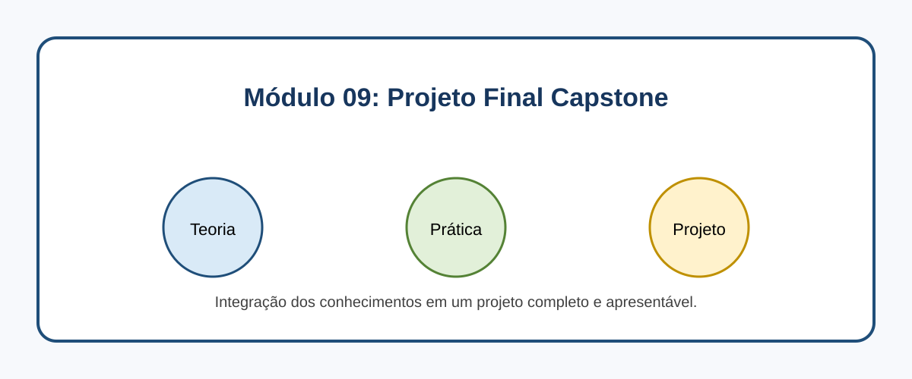

# Módulo 09: Projeto Final Capstone

## Objetivos de Aprendizagem

Ao concluir este conteúdo, você deverá ser capaz de explicar os conceitos apresentados, executar os exemplos, reconhecer seus casos de uso e aplicar o conhecimento em uma solução pequena e verificável.

## Sumário

- [Introdução](#introducao)
- [Imagem conceitual](#imagem-conceitual)
- [Aulas](#aulas)
- [Referências](#referencias)

## Introdução

Integração dos conhecimentos em um projeto completo e apresentável. Este módulo combina microlearning, prática deliberada e um projeto incremental.

## Imagem conceitual

## Aulas

- [Aula 9.1: Revisão e Integração de Conceitos](modulo_09/revisao_e_integracao.md)
- [Aula 9.2: Design do Projeto Final: Planejamento e Arquitetura](modulo_09/design_do_projeto_final.md)
- [Aula 9.3: Implementação do Backend: Spring Boot e Microsserviços](modulo_09/implementacao_do_backend.md)
- [Aula 9.4: Implementação do Frontend: Consumindo APIs](modulo_09/implementacao_do_frontend.md)
- [Aula 9.5: Deploy, Testes e Apresentação do Projeto](modulo_09/deploy_testes_e_apresentacao.md)

## Referências

[1] Spring. Spring Guides. Disponível em: [https://spring.io/guides](https://spring.io/guides)
[2] GitHub. About README files. Disponível em: [https://docs.github.com/en/repositories/managing-your-repositorys-settings-and-features/customizing-your-repository/about-readmes](https://docs.github.com/en/repositories/managing-your-repositorys-settings-and-features/customizing-your-repository/about-readmes)

---

[Voltar aos Links Rápidos](../README.md#links-rapidos)
