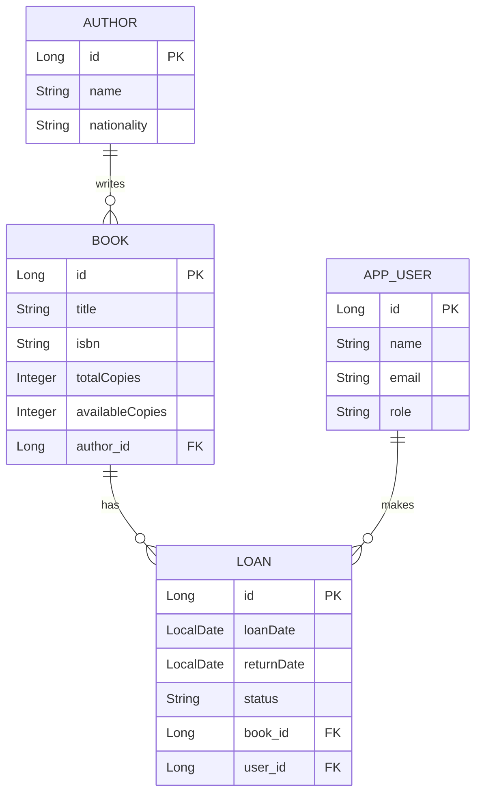
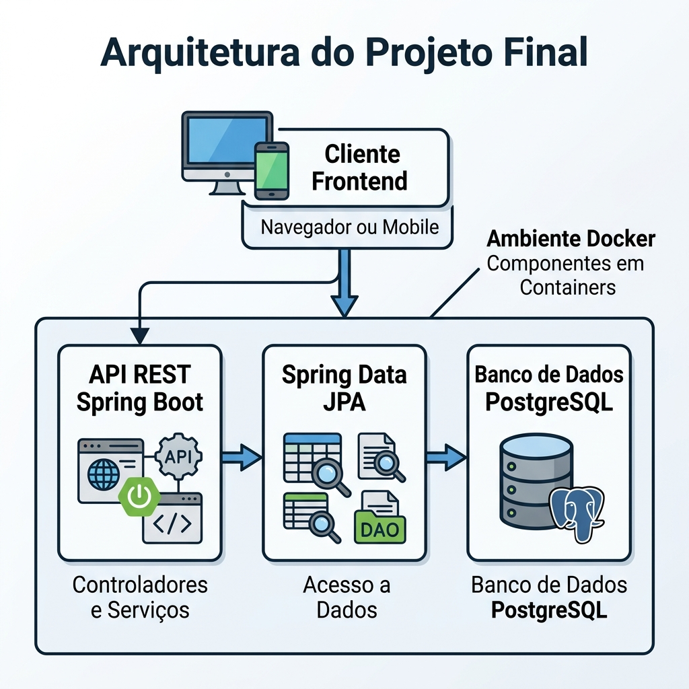

</Agent System Instructions>
# Módulo 09: Projeto Final Capstone
> A hora da verdade: onde todo o conhecimento se une para criar um sistema real do zero ao deploy.

## Sumário

- [Aula 9.1: Revisão e Integração](#aula-91-revisão-e-integração)
- [Aula 9.2: Design do Projeto Final](#aula-92-design-do-projeto-final)
- [Aula 9.3: Implementação do Backend](#aula-93-implementação-do-backend)
- [Aula 9.4: Testes](#aula-94-testes)
- [Aula 9.5: Deploy e Apresentação](#aula-95-deploy-e-apresentação)
- [Exercícios de fixação do módulo](#exercícios-de-fixação-do-módulo)
- [Referências](#referências)

## O que você vai aprender neste módulo

- Consolidar todos os conceitos de Java 21, Spring Boot 3 e JPA
- Desenhar a arquitetura de um Sistema de Gestão de Biblioteca
- Implementar as regras de negócio de ponta a ponta
- Escrever testes automatizados que garantem a qualidade
- Fazer o deploy do projeto e construir um portfólio de respeito


---

## Aula 9.1: Revisão e Integração

Chegamos ao ápice da nossa jornada! Ao longo deste curso, você aprendeu muitas peças de um quebra-cabeça imenso. Agora, chegou a hora de montá-lo.

### Checklist do que dominamos até aqui:

**Java 21 Moderno:** Records, Pattern Matching, Switch Expressions, Virtual Threads.
**Spring Boot 3:** Injeção de dependências, configuração automática, ecossistema.
**APIs RESTful:** Controllers, métodos HTTP, códigos de status, DTOs, validação.
**Persistência com JPA/Hibernate:** Mapeamento de entidades, relacionamentos (1:N, N:M), queries.
**Segurança:** Spring Security, JWT, autenticação e autorização.
**Infraestrutura Cloud:** Docker, pipelines de CI/CD.

### Como os conceitos se conectam?

Imagine uma requisição real de um usuário:
1. O usuário bate no **Controller** (API REST).
2. O **Spring Security** intercepta, valida o token JWT e verifica se ele tem permissão.
3. Os dados entram via **DTO** e são validados (ex: `@NotNull`).
4. O Controller repassa para a camada de **Service**.
5. O Service aplica as **regras de negócio** (usando as novidades do Java).
6. O Service chama o **Repository**.
7. O Repository traduz tudo para SQL e fala com o Banco de Dados via **JPA**.
8. A resposta volta até o Controller, que devolve um HTTP 200 (OK) para o cliente.

Tudo isso, empacotado em um container **Docker** e rodando em um servidor!

---

## Aula 9.2: Design do Projeto Final

Vamos construir o **BiblioTech**, um Sistema de Gestão de Biblioteca.

### Definição de Requisitos

- **Usuários:** Podem ser Leitores ou Bibliotecários.
- **Livros e Autores:** Um livro pertence a um autor. Um livro tem uma quantidade total e quantidade disponível.
- **Empréstimos:** Um leitor pode emprestar um livro. O empréstimo tem data de retirada e devolução.
- **Regras:**
  - Não é possível emprestar um livro que não tem unidades disponíveis.
  - O leitor não pode ter mais de 3 livros emprestados simultaneamente.
  - Apenas bibliotecários podem cadastrar livros.

### Diagrama de Entidades (MER)

A modelagem de dados é o coração do projeto. 



### Arquitetura e Decisões (ADR)


*Figura 1: Desenho da arquitetura de software do Projeto Final.*


Para mantermos o registro de nossas escolhas, fazemos um mini *Architecture Decision Record (ADR)*:
- **Linguagem:** Java 21 (Aproveitar Records para DTOs).
- **Framework:** Spring Boot 3 com Spring Web e Spring Data JPA.
- **Banco de Dados:** PostgreSQL (robusto, relacional).
- **Migrações:** Flyway (para controle de versão do banco, garantindo previsibilidade).

---

## Aula 9.3: Implementação do Backend

Vamos estruturar nosso código em pacotes claros, usando o padrão *Layered Architecture*.

Estrutura de pastas:
```text
com.bibliotech
 ├── controller   (Endpoints REST)
 ├── service      (Lógica de Negócio)
 ├── repository   (Acesso a Dados - Interfaces)
 ├── model        (Entidades JPA)
 ├── dto          (Records de Entrada e Saída)
 ├── config       (Configurações de Seguranca, Swagger)
 └── exception    (Tratamento global de erros)
```

### Entidades e Records (DTO)

Usamos JPA para a Entidade e Java Records para os DTOs. Isso separa perfeitamente "o que vai para o banco" do "o que vai para o cliente".

```java
// Entidade JPA
@Entity
@Table(name = "books")
public class Book {
    @Id @GeneratedValue(strategy = GenerationType.IDENTITY)
    private Long id;
    
    private String title;
    
    private Integer availableCopies;

    @ManyToOne(fetch = FetchType.LAZY)
    @JoinColumn(name = "author_id")
    private Author author;

    // Construtores, Getters e Setters (ou Lombok) omitted
    public void decreaseCopies() {
        this.availableCopies--;
    }
}

// DTO usando Java 21 Record
public record BookRequestDTO(
    @NotBlank(message = "Título é obrigatório") String title,
    @NotNull(message = "ID do autor não pode ser nulo") Long authorId,
    @Min(1) Integer totalCopies
) {}
```

### A Camada de Service e Regras de Negócio

Aqui mora o coração da aplicação. Não coloque regras de negócio no Controller!

```java
@Service
public class LoanService {

    private final LoanRepository loanRepository;
    private final BookRepository bookRepository;
    private final UserRepository userRepository;

    public LoanService(LoanRepository loanRepository, BookRepository bookRepository, UserRepository userRepository) {
        this.loanRepository = loanRepository;
        this.bookRepository = bookRepository;
        this.userRepository = userRepository;
    }

    @Transactional // Garante que tudo salva junto ou faz rollback de tudo
    public LoanResponseDTO createLoan(Long userId, Long bookId) {
        // 1. Busca usuário e livro (tratando erros)
        var user = userRepository.findById(userId)
                .orElseThrow(() -> new ResourceNotFoundException("Usuário não encontrado"));
        var book = bookRepository.findById(bookId)
                .orElseThrow(() -> new ResourceNotFoundException("Livro não encontrado"));

        // 2. Regra de negócio: Tem cópia?
        if (book.getAvailableCopies() <= 0) {
            throw new BusinessRuleException("Livro não possui cópias disponíveis no momento.");
        }

        // 3. Regra de negócio: Limite de empréstimos?
        long activeLoans = loanRepository.countByUserIdAndStatus(userId, LoanStatus.ACTIVE);
        if (activeLoans >= 3) {
            throw new BusinessRuleException("Usuário já possui o limite máximo de 3 empréstimos.");
        }

        // 4. Executa a ação
        book.decreaseCopies(); // atualiza o livro
        
        var loan = new Loan();
        loan.setUser(user);
        loan.setBook(book);
        loan.setLoanDate(LocalDate.now());
        loan.setStatus(LoanStatus.ACTIVE);

        loanRepository.save(loan); // Salva o empréstimo

        // O Hibernate atualiza o Book automaticamente por causa do @Transactional e estado gerenciado!

        return new LoanResponseDTO(loan.getId(), book.getTitle(), loan.getLoanDate());
    }
}
```

### Tratamento Global de Exceções

Ao invés de encher seus controllers com `try-catch`, use `@ControllerAdvice`.

```java
@RestControllerAdvice
public class GlobalExceptionHandler {

    @ExceptionHandler(BusinessRuleException.class)
    public ResponseEntity<ErrorResponse> handleBusinessRule(BusinessRuleException ex) {
        var error = new ErrorResponse("REGRA_NEGOCIO", ex.getMessage());
        // Devolve 422 Unprocessable Entity
        return ResponseEntity.status(HttpStatus.UNPROCESSABLE_ENTITY).body(error); 
    }
    
    @ExceptionHandler(ResourceNotFoundException.class)
    public ResponseEntity<ErrorResponse> handleNotFound(ResourceNotFoundException ex) {
        var error = new ErrorResponse("NAO_ENCONTRADO", ex.getMessage());
        return ResponseEntity.status(HttpStatus.NOT_FOUND).body(error); 
    }
}
```

---

## Aula 9.4: Testes

Testar não é frescura, é a única garantia de que você pode mudar o código sexta-feira às 17h e ir pra casa tranquilo.

### Pirâmide de Testes
1. **Unitários:** Rápidos, isolados. Testam apenas a lógica do Service, *mockando* o Banco de Dados.
2. **Integração:** Testam se o Service consegue realmente conversar com o Banco de Dados ou se as rotas do Controller funcionam.
3. **E2E (Ponta a Ponta):** Lentos, sobem tudo (inclusive banco real no Docker via Testcontainers) e simulam o usuário real.

### Testes Unitários com JUnit 5 [1] + Mockito [2]

Foque na lógica pura da camada Service usando Mockito.

```java
@ExtendWith(MockitoExtension.class)
class LoanServiceTest {

    @Mock
    private LoanRepository loanRepository;
    @Mock
    private BookRepository bookRepository;
    @Mock
    private UserRepository userRepository;

    @InjectMocks
    private LoanService loanService;

    @Test
    @DisplayName("Deve lançar exceção quando usuário já possui 3 livros emprestados")
    void testLimitExceeded() {
        // Arrange
        Long userId = 1L;
        Long bookId = 1L;
        var user = new User(userId, "Joao");
        var book = new Book(bookId, "Java 21", 5);
        
        when(userRepository.findById(userId)).thenReturn(Optional.of(user));
        when(bookRepository.findById(bookId)).thenReturn(Optional.of(book));
        when(loanRepository.countByUserIdAndStatus(userId, LoanStatus.ACTIVE)).thenReturn(3L);

        // Act & Assert
        var exception = assertThrows(BusinessRuleException.class, () -> {
            loanService.createLoan(userId, bookId);
        });

        assertEquals("Usuário já possui o limite máximo de 3 empréstimos.", exception.getMessage());
        verify(loanRepository, never()).save(any());
    }

    @Test
    @DisplayName("Deve criar empréstimo com sucesso quando regras são cumpridas")
    void testCreateLoanSuccess() {
        // Arrange
        Long userId = 1L;
        Long bookId = 1L;
        var user = new User(userId, "Maria");
        var book = new Book(bookId, "Spring Boot", 2); // 2 cópias
        
        when(userRepository.findById(userId)).thenReturn(Optional.of(user));
        when(bookRepository.findById(bookId)).thenReturn(Optional.of(book));
        when(loanRepository.countByUserIdAndStatus(userId, LoanStatus.ACTIVE)).thenReturn(0L);

        // Act
        LoanResponseDTO response = loanService.createLoan(userId, bookId);

        // Assert
        assertNotNull(response);
        assertEquals(1, book.getAvailableCopies()); // verificando lógica de domínio
        verify(loanRepository, times(1)).save(any(Loan.class));
    }
}
```

### Testes de Integração com `@SpringBootTest` e `MockMvc` [4]

Para garantir que o seu Controller processa JSON corretamente, converte para DTO, valida anotações e fala com a Service:

```java
@SpringBootTest
@AutoConfigureMockMvc
@ActiveProfiles("test") // Usa banco H2 configurado em application-test.yml
class LoanControllerIntegrationTest {

    @Autowired
    private MockMvc mockMvc;

    @Autowired
    private ObjectMapper objectMapper;

    @MockBean
    private LoanService loanService; // Aqui nós podemos mockar a service ou testar tudo de ponta a ponta

    @Test
    @DisplayName("Deve retornar 201 Created ao realizar um empréstimo via API")
    void createLoanViaAPI() throws Exception {
        // Arrange
        LoanRequestDTO request = new LoanRequestDTO(1L, 1L);
        LoanResponseDTO response = new LoanResponseDTO(100L, "Java 21", LocalDate.now());

        when(loanService.createLoan(1L, 1L)).thenReturn(response);

        // Act & Assert
        mockMvc.perform(post("/api/loans")
                .contentType(MediaType.APPLICATION_JSON)
                .content(objectMapper.writeValueAsString(request)))
               .andExpect(status().isCreated())
               .andExpect(jsonPath("$.id").value(100L))
               .andExpect(jsonPath("$.bookTitle").value("Java 21"));
    }

    @Test
    @DisplayName("Deve retornar 422 ao violar regra de negócio no Controller")
    void createLoanFailsBusinessRule() throws Exception {
        LoanRequestDTO request = new LoanRequestDTO(1L, 1L);
        
        when(loanService.createLoan(1L, 1L))
            .thenThrow(new BusinessRuleException("Livro sem estoque"));

        mockMvc.perform(post("/api/loans")
                .contentType(MediaType.APPLICATION_JSON)
                .content(objectMapper.writeValueAsString(request)))
               .andExpect(status().isUnprocessableEntity())
               .andExpect(jsonPath("$.code").value("REGRA_NEGOCIO"))
               .andExpect(jsonPath("$.message").value("Livro sem estoque"));
    }
}
```

---

## Aula 9.5: Deploy e Apresentação [3]

### Template Profissional de README.md

Abaixo, um modelo (template) completo de `README.md` que você deve usar na raiz do seu repositório para atrair a atenção de Tech Recruiters.

```markdown
# BiblioTech - Sistema de Gestão de Biblioteca

BiblioTech é uma API RESTful moderna para gestão de bibliotecas, permitindo controle de acervo, usuários e empréstimos de livros com regras de negócio rígidas.

---

## Funcionalidades

- **Gestão de Livros:** Cadastro e controle de estoque de livros e autores.
- **Controle de Empréstimos:** Validação de disponibilidade e limite de 3 livros por usuário.
- **Segurança:** Autenticação via JWT (Roles de ADMIN e LEITOR).
- **Documentação API:** Swagger integrado.

## Tecnologias Utilizadas

- **Java 21**
- **Spring Boot 3** (Web, Data JPA, Security, Validation)
- **PostgreSQL** (Banco de dados relacional)
- **Flyway** (Migrações de banco de dados)
- **Docker & Docker Compose**
- **JUnit 5 & Mockito** (Testes unitários e de integração)

## Como rodar o projeto localmente

1. Clone o repositório:
   \`\`\`bash
   git clone https://github.com/seunome/bibliotech.git
   cd bibliotech
   \`\`\`

2. Suba o banco de dados via Docker:
   \`\`\`bash
   docker compose up -d
   \`\`\`

3. Rode a aplicação com o Maven Wrapper:
   \`\`\`bash
   ./mvnw spring-boot:run
   \`\`\`
   
> O servidor estará rodando em \`http://localhost:8080\`

## Endpoints da API (Swagger)

Acesse a documentação completa do Swagger (OpenAPI) ao rodar a aplicação:
Acesse: \`http://localhost:8080/swagger-ui.html\`

| Método | Endpoint         | Descrição                    | Autenticação |
|--------|------------------|------------------------------|--------------|
| POST   | `/api/auth`      | Login (gera Token JWT)       | Público      |
| GET    | `/api/books`     | Lista todos os livros        | LEITOR/ADMIN |
| POST   | `/api/books`     | Cadastra novo livro          | ADMIN        |
| POST   | `/api/loans`     | Realiza um empréstimo        | LEITOR       |
| PUT    | `/api/loans/{id}`| Devolve um livro             | LEITOR       |

## Como rodar os testes

\`\`\`bash
./mvnw clean test
\`\`\`

## Screenshots
*(Opcional: adicione aqui prints do Swagger, do Insomnia ou logs do Docker)*
```

### Próximos passos na sua carreira Java

Parabéns! Você concluiu a construção de um sistema corporativo completo em Java.
Para onde ir agora?
- Aprofunde-se em **Mensageria** (Kafka/RabbitMQ).
- Estude **Domain-Driven Design (DDD)**.
- Entenda a fundo os internos do **JVM**.

Nunca pare de aprender. Nos vemos nos commits!

---

## Exercícios de Fixação

**Exercício 9:** Qual a diferença fundamental entre testes unitários e testes de integração no contexto do Spring Boot?
a) Testes unitários testam a aplicação inteira de ponta a ponta, enquanto de integração testam métodos isolados.

b) Testes unitários usam componentes reais do banco de dados, e os de integração usam mocks.

c) Testes unitários validam a lógica de uma classe isolada (ex: usando Mockito), enquanto testes de integração validam a interação entre múltiplas camadas e componentes reais (ex: Banco de Dados).

d) Não há diferença; o Spring Boot executa ambos da mesma maneira usando `@SpringBootTest`.

<details>
<summary>Ver Resposta</summary>

**Resposta:** c) Testes unitários validam a lógica de uma classe isolada (ex: usando Mockito), enquanto testes de integração validam a interação entre múltiplas camadas e componentes reais (ex: Banco de Dados).

**Explicação:** O foco do teste unitário é isolar o componente usando Mocks. Já o teste de integração verifica se os componentes (Controller, Service, Repository) funcionam corretamente quando interagem entre si ou com recursos externos, como o banco de dados.
</details>

**Exercício 9.1:** O que é a ferramenta `MockMvc` e para que ela serve?
a) É um banco de dados em memória utilizado apenas para testes unitários rápidos.

b) É uma biblioteca do Spring para testar a camada web (Controllers), permitindo simular requisições HTTP sem precisar subir um servidor real completo.

c) É uma ferramenta exclusiva do JUnit para gerar dados falsos (mocks) para variáveis e objetos de domínio.

d) É a interface gráfica padrão do Spring Boot para visualizar relatórios de cobertura de código.

<details>
<summary>Ver Resposta</summary>

**Resposta:** b) É uma biblioteca do Spring para testar a camada web (Controllers), permitindo simular requisições HTTP sem precisar subir um servidor real completo.

**Explicação:** O `MockMvc` simula chamadas HTTP (GET, POST, etc.) diretamente para os seus Controllers, permitindo verificar status codes, headers e o corpo da resposta (JSON) de forma rápida e eficiente.
</details>

## Referências

[1] JUnit. JUnit 5 User Guide. Disponível em: https://junit.org/junit5/docs/current/user-guide/
[2] Mockito. Mockito framework. Disponível em: https://site.mockito.org/
[3] Railway. Railway Documentation. Disponível em: https://docs.railway.app/
[4] Spring. Spring Testing. Disponível em: https://docs.spring.io/spring-framework/reference/testing.html

---

[Voltar aos Links Rápidos](../README.md#links-rapidos)


